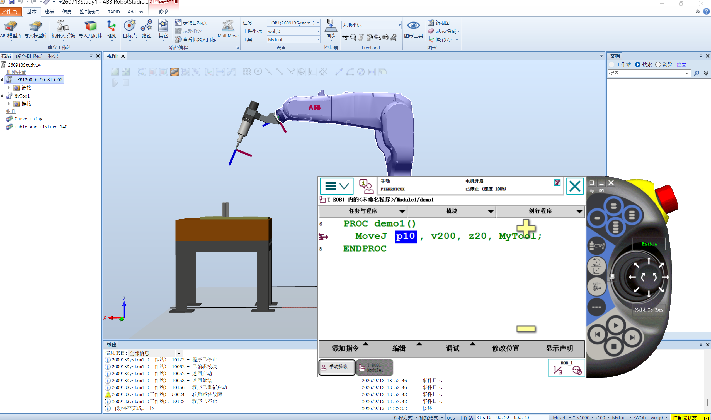

# 2026-09-13 · RAPID 第一个程序：Module1 / demo1 / MoveJ

> **来源**：实操（RobotStudio 6.08 虚拟控制器 `260913System1`，任务 `T_ROB1`）+ 官方帮助《RAPID 语言概览》《RAPID 指令、函数和数据类型》。
> **定位**：机器人实训**第一个 RAPID 程序**——用 `MoveJ` 让机器人运动到一个示教好的目标点。

## 一、程序原文（工作站导出的真实代码）

模块 `Module1`（`PROGMOD\Module1.mod`）：

```rapid
MODULE Module1
	CONST robtarget p10:=[[699.42,88.43,705.75],[0.190432,-0.061687,0.979687,0.0119907],[0,0,0,0],[9E+9,9E+9,9E+9,9E+9,9E+9,9E+9]];
	PROC demo1()
		MoveJ p10, v1000, z200, MyTool;
	ENDPROC
ENDMODULE
```

工具数据 `MyTool` 存在 `CalibData` 模块（`PROGMOD\CalibData.mod`）：

```rapid
MODULE CalibData
	PERS tooldata MyTool:=[TRUE,[[31.792631019,0,229.638935148],[0.945518576,0,0.325568154,0]],[1,[0,0,1],[1,0,0,0],0,0,0]];
ENDMODULE
```

## 二、逐行解读

### 1. `MODULE Module1 … ENDMODULE`
一个 RAPID **模块**，是程序/数据的容器。模块名 `Module1`，对应控制器里 `T_ROB1` 任务的程序模块。

### 2. `CONST robtarget p10:=[[…],[…],[…],[…]];`
**目标点**（机器人要去的"位置 + 姿态"），类型 `robtarget`，共四个方括号：

| 段 | 本例数值 | 含义 |
|----|---------|------|
| `[699.42, 88.43, 705.75]` | **trans**（平移） | TCP 在**当前工件坐标系**下的位置 X/Y/Z，单位 mm |
| `[0.190432, -0.061687, 0.979687, 0.0119907]` | **rot**（旋转） | 姿态**四元数** `q1 q2 q3 q4`（非欧拉角！） |
| `[0,0,0,0]` | **robconf**（轴配置） | 机器人 4 个臂/腕的**象限配置**（cf1/cf4/cf6/cfx） |
| `[9E+9, …×6]` | **extax**（外轴） | 外轴位置；`9E+9` 是**"未使用外轴"**的惯用占位值 |

> `CONST` 表示**常量**——示教完就不该被程序改动。示教出来的点一般用 `CONST robtarget`。

### 3. `PROC demo1() … ENDPROC`
**例行程序**（procedure），本例是空参数的子程序 `demo1`。

### 4. `MoveJ p10, v1000, z200, MyTool;`
**关节运动指令**，4 个参数：

| 参数 | 本例 | 含义 |
|------|------|------|
| `p10` | 目标点 | 运动终点 |
| `v1000` | 速度 | **1000 mm/s**（`v` 前缀 = TCP 线速度） |
| `z200` | 转弯区（zone） | 距目标 **200 mm** 内开始圆滑过渡，**不精确停** |
| `MyTool` | 工具 | 用哪个 `tooldata`（决定以 TCP 为准） |

> **`z` 与"精确停"**：`z200` 表示圆滑过渡；若要**精确到位**（必须停在该点）用 **`fine`**。
> 运行截图里参数是 **`v200, z20`**，是后续调慢、改小转弯区的版本（见"遇到的问题"）。

### 5. `MyTool` 工具数据详解（CalibData.mod）

```rapid
PERS tooldata MyTool:=
[ TRUE,                          ← robhold：TRUE=工具装在机器人上
  [[31.792631019, 0, 229.638935148],   ← tframe.trans：TCP 相对法兰的位置 (mm)，z 方向 229.6 mm
   [0.945518576, 0, 0.325568154, 0]],  ← tframe.rot：TCP 姿态四元数
  [1, [0,0,1], [1,0,0,0], 0, 0, 0]     ← tload：负载（质量 1 kg、重心、转动惯量）
];
```

> `PERS` 是**可持久化变量**——会保存在控制器里，重启不丢；工具/工件数据通常用 `PERS`。

## 三、运行结果

- 状态：虚拟示教器显示 `自动停止（速度 100%）`，`T_ROB1 内的<未命名程序>/Module1/demo1`。
- 事件日志：`10122 程序已停止`、`10062 已编辑模块`、`10052 返回启动`、`10053 返回就绪`、`10136 程序已重新启动`。
- **出现报警 `50024 转角路径故障`**（见下）。



## 四、遇到的问题

1. **`50024 转角路径故障`（Corner path failure）**
   — **含义（据官方手册）**：机器人正在执行转角（zone）运动时，**程序没有及时提供下一条运动指令**，系统被迫把编程的"飞越点"退化成"精确点"；事件日志随即报 50024，程序可能停止。
   — **相关线索**：`zone`（如 `z200`）越大、连续运动指令之间夹了逻辑指令、或 CPU 规划时间不足，都容易触发；手动**单条执行**（跑完一条指令就停）本身也是诱发情形之一。
   — **本案改动**：参数由 `v1000, z200` 改为 **`v200, z20`**（见截图）。**改后是否彻底不再报 50024，本次未单独验证**，只确认了截图中显示的参数版本。
   — **经验**：短距离/精细演示优先用 **`fine` 或小 `zone` + 低速度**；遇到该警告想先压下去，可用 `CornerPathWarning FALSE;`。

2. **"位置对了但姿态奇怪"**：`robtarget` 的 `rot` 是**四元数**，手工换算不直观；正确做法是**在 RobotStudio 里示教/定义目标点**（示教目标点 / 创建目标点），由软件生成数值，**不要手算**。

3. **程序跑不起来**：RAPID 必须**先"同步到工作站/RAPID"**（RAPID 选项卡），把模块从工作站同步到控制器，程序指针（PP）才能进 `demo1`。截图左侧 `*` 号表示有未保存修改。

4. **工具没生效**：`MoveJ` 第 4 参必须写 `MyTool`，且 `MyTool` 的 `tooldata` 要在模块里声明（本例在 `CalibData`），否则报未定义。

## 五、收获与心得

1. **RAPID 程序的最小骨架**：`MODULE` + 数据（`robtarget`/`tooldata`）+ `PROC` + 运动指令，就能让机器人动起来。

2. **`MoveJ` 四要素记住**：**去哪（目标点）、多快（v）、怎么过渡（z/fine）、用什么工具（tooldata）**。这是所有运动指令的通用骨架（`MoveL`/`MoveC` 同构）。

3. **四元数 ≠ 欧拉角**：`robtarget` 姿态是四元数，示教时由软件生成，理解"四个数表示一个 3D 旋转"即可。

4. **目标点/工具/工件是三大数据**：`robtarget`（点）、`tooldata`（工具 TCP）、`wobjdata`（工件坐标系，本例用 `wobj0` = 大地坐标）。三者共同决定"机器人把工具尖端送到哪里"。

5. **调试顺序**：**改代码 → 同步 → 选例行程序 → 手动/自动运行 → 看事件日志**，报警就是最好的老师。

## 六、下一步计划

1. 掌握 **`MoveL`（直线）/ `MoveC`（圆弧）/ `MoveAbsJ`（关节绝对）** 与 `MoveJ` 的区别与选用。
2. 弄清 **`v` 速度 `z/fine` 转弯区**对运动轨迹的影响（做对比实验）。
3. 学 **工件坐标 `wobjdata`** 的标定与使用（三点法/工件坐标向导）。
4. 把 `demo1` 扩成**多点多指令**的小程序（画一条路径），并与 `代码片段_CodeSnippets` 里的 `robtarget`/`tooldata`/模块头片段对照学习。

## 参考工具链接

- 官方手册：`02_RAPID指令函数数据类型`（`MoveJ`/`MoveL`/`robtarget`/`tooldata` 全参数）、`07_RAPID语言概览技术参考手册`、`06_RAPID语言内核技术参考手册`（语法/保留字）
- 代码片段：`代码片段_CodeSnippets`（`robtarget.snippet`、`tooldata.snippet`、`module header.snippet`）
- 文件模板：`RAPID文件模板_zh-CN`（`MainModule.mod`、`EmptyModule.mod`、`SystemModule.sys`）
- 配套记录（同日另一篇）：[2026-09-13_RobotStudio环境与建站.md](2026-09-13_RobotStudio环境与建站.md)
