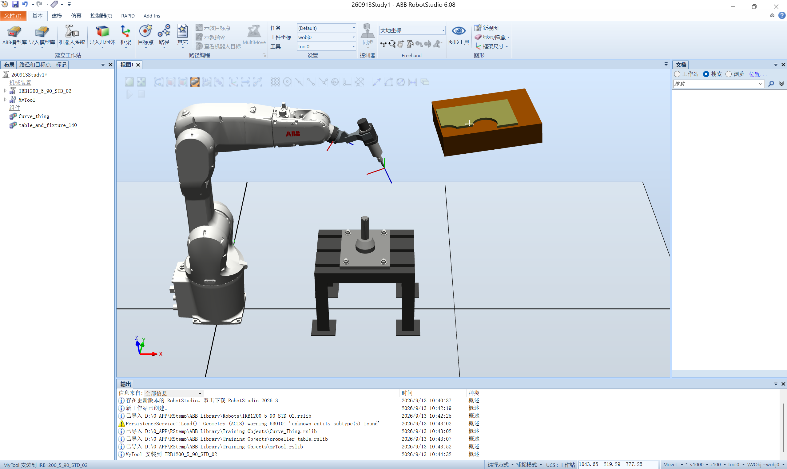

# 2026-09-13 · RobotStudio 环境认识与工作站搭建

> **来源**：实操（ABB RobotStudio 6.08，虚拟控制器）+ 官方帮助《RobotStudio 操作员手册》。
> **工作站**：`%USERPROFILE%\Documents\RobotStudio\Solutions\260913Study1`（虚拟控制器 `260913System1`，RobotWare 6.08.00.00）。
> **本日定位**：机器人实训**第一天**，把软件界面、建站流程、手动操纵"过了一遍"，并首次写出并运行 RAPID 程序。

## 一、软件与文档环境

| 项目 | 内容 |
|------|------|
| 软件 | ABB RobotStudio 6.08（本体 `<RobotStudio安装目录>`，安装包 `<RobotStudio安装包目录>`） |
| 官方手册 | 安装目录 `Help\zh-CN\` 下 9 本中文 CHM + `Help\en\` 12 本英文；已反编译成 HTML 整理进工作区（完整版资源目录 `帮助文档_中文` / `帮助文档_英文`） |
| 模型库 | `<RobotStudio安装目录>\ABB Library\`（Robots / Tools / Equipment / Positioners / Tracks / Training Objects 等） |
| 关键提示 | 启动时提示"存在更新版本 RobotStudio 2026.3"，本机仍用 **6.08**（教学版本），未升级 |

## 二、RobotStudio 界面分区（功能区）

按截图自上而下、从左到右认了一遍功能区（Ribbon）：

| 选项卡 | 主要功能组 | 用途 |
|--------|-----------|------|
| **文件** | 新建/打开/保存、共享、**Pack & Go / Unpack & Work** | 工作站整体打包迁移 |
| **基本** | 建立工作站（ABB 模型库、导入模型库、机器人系统、导入几何体、框架）、路径编程（目标点/路径/工具）、设置、Freehand、图形工具 | **建站主力选项卡** |
| **建模** | 组件组、Smart 组件、固体（布尔运算）、测量、创建机械装置/工具 | 自制几何体与机构 |
| **仿真** | 碰撞监控、仿真设定、事件管理器、工作站逻辑、I/O 仿真器、TCP 跟踪、计时器、信号分析器 | 逻辑仿真与信号调试 |
| **控制器** | 真实/虚拟控制器、系统生成器、安装管理器、配置编辑器、备份恢复、文件传送、虚拟示教器 | 控制器（系统）管理 |
| **RAPID** | 同步到工作站/RAPID、编辑 RAPID 代码、路径编辑器、测试与调试、程序指针、RAPID 监视 | **写程序与调试** |
| **Add-ins** | RobotApps、发行包、迁移备份 | 插件 |

> **记忆要点**：**基本**建站 → **建模**做件 → **控制器**配系统 → **RAPID**写程序 → **仿真**跑逻辑。右侧竖排是**布局浏览器**、**路径和目标点浏览器**、**控制器浏览器**、**文档浏览器**。

## 三、建站实操流程（本日完成）

### 1. 新建工作站
`文件 → 新建工作站` → 左侧**布局浏览器**出现空的"工作站"节点。输出窗口提示：`新工作站已创建`。

### 2. 导入模型（本次用到的四件套）

从**基本 → ABB 模型库**导入：

| 对象 | 库文件 | 类型 | 说明 |
|------|--------|------|------|
| 机器人 | `IRB1200_5_90_STD_02.rslib` | 机械装置 | **IRB 1200-5/0.9 Type B**，5 kg 负载 / 0.9 m 臂展 |
| 工具 | `myTool.rslib` | 工具 | 自定义工具（教学用），数据名 `MyTool` |
| 工件 | `Curve_Thing.rslib` | 几何体 | 待加工曲线零件 |
| 台面 | `propeller_table.rslib` | 几何体 | 台面/夹具组合（工作区显示为 `table_and_fixture_140`） |

> ⚠️ 导入 `Curve_Thing.rslib` 时输出窗口报**几何警告**：
> `PersistenceService : Load() : Geometry (ACIS) warning 63010: 'unknown entity subtype(s) found'`。
> 属于**旧版 ACIS 几何实体在新版本中的兼容性提示**，不影响使用（模型正常显示）。

### 3. 机器人系统（虚拟控制器）

在**基本 → 机器人系统 → 从布局创建系统**，生成虚拟控制器 `260913System1`：

- 产品：`RobotWare Base` + `Chinese` + `Drive System IRB 120/140/260/...` + `ADU-790A (X3/Y3/Z3)` + `Axis Calibration` + `IRB 1200-5/0.9 Type B`
- 任务：`T_ROB1`
- 系统文件：`SYS.cfg / PROC.cfg / MMC.cfg / EIO.cfg / SIO.cfg / MOC.cfg`

> 有虚拟控制器后，才能在**控制器选项卡**用虚拟示教器、跑 RAPID 程序、看事件日志。

### 4. 摆放与显示

- 机器人导入后默认落在原点 `(0,0,0)`，台面在机器人前方（见截图）。
- 用 **Freehand → 旋转/手动线性**调整视角；**图形工具 → 显示隐藏 / 框架尺寸**控制坐标系夹具的显示。

## 四、手动操纵（示教器）

在**控制器选项卡**打开**虚拟示教器（FlexPendant）**，或直接在图示右上角调出软示教器：

| 操作 | 含义 |
|------|------|
| **手动 / 自动**（手动状态） | 在**手动**模式下才能按使能键移动 |
| **使能键（Enable）** | 三档按键：轻按=电机上电，**重按/松手 = 急停**（安全设计） |
| 摇杆 | 控制机器人各轴 / TCP 移动方向 |
| **Hold To Run** | 按住才允许运动（配合使能键） |
| 模式 | `1..3` 档速度、增量 / 连续运动 |

状态栏显示：`电机开启` / `已停止（速度 100%）`，以及 **260913System1** 控制器名。

## 五、遇到的问题

1. **几何导入警告 63010**：`unknown entity subtype(s) found`。属 ACIS 版本兼容提示，模型可正常使用，**不影响后续操作**。

2. **`50024 转角路径故障`**：手动运行 `demo1` 时事件日志出现该报警（`2026/9/13 13:52:48`）。**机制、触发场景与对策见《[奇异点规避](2026-09-13_奇异点规避.md)》第四节**（要点：属**指令时序**问题，不是奇异点；手动单条执行、`zone` 偏大、指令间夹逻辑指令都可能触发；可用 `CornerPathWarning FALSE;` 抑制警告）。
   - **本案轨迹参数**：最初是 `MoveJ p10, v1000, z200`（与 13:41 保存的工作站、13:41:45 的模块备份一致），后来改为 **`v200, z20`**。
   - **待确认**：本次报警的确切诱因**没有逐项验证**，记录时只保留观察到的事实。

3. **首次按使能/摇杆不动**：手动模式未真正进入、或使能键按压档位不对；需**轻按使能 + 同时动摇杆**，且当前要选中正确的**机械单元（ROB_1）**。

> **补充（文档归档，不算"问题"）**：本机把安装目录里的官方手册与模型库**反编译/归档**到了工作区（`帮助文档_中文`、`帮助文档_英文`、`参考素材`，完整版才有），后续查手册直接看 HTML 即可，不必再开 CHM。

## 六、收获与心得

1. **建立"五区一流程"的整体认识**：功能区分工清楚，建站有固定顺序——**先建站 → 再导入模型 → 再创建系统 → 再摆位标定 → 最后写程序**。

2. **理解"虚拟控制器"的意义**：RobotStudio 不只是画图，它内置 **RobotWare 虚拟控制器**，能像真机一样装载 RAPID、跑程序、出报警，这让离线编程→真机部署成为可能。

3. **安全逻辑很关键**：示教器的**使能键三档**（轻按上电、重按/松手急停）与 **Hold To Run** 是"人机协作安全"的核心设计，理解了为什么手动模式下松手机器人会立刻停。

4. **工程文档要成体系**：ABB 官方手册（操作员手册 / RAPID 指令手册 / 系统参数手册）就是"字典"，安装目录里自带全套；已归档到工作区，随时可查。

## 七、下一步计划

1. **系统学 RAPID 编程**：掌握 `MoveJ/MoveL/MoveC/MoveAbsJ`、目标点四元数、`tooldata/wobjdata`。
2. **熟练手动操纵**：单轴 / 线性 / 重定向（对准）三种移动方式的区别。
3. **完成一个完整小任务**：工件坐标标定 → 示教目标点 → 生成路径 → 仿真运行。
4. **补全工作站**：把工作区里的教学模型（`myTool`、`Curve_Thing`、`propeller_table`）与程序整理归档。

## 参考工具链接

- 官方手册：`01_RobotStudio操作员手册`（用户界面、构建工作站、机器人编程、仿真程序、控制器、RAPID 选项卡）
- 手册速查索引：[README.md](../README.md)
- 教学模型：`教学模型_TrainingObjects`（`myTool.rslib`、`Curve_Thing.rslib`、`propeller.rslib`、`Table.sat` 等）
- 配套记录（同日另一篇）：[2026-09-13_RAPID首个程序MoveJ.md](2026-09-13_RAPID首个程序MoveJ.md)
