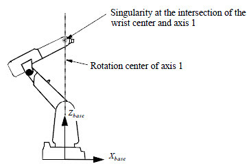
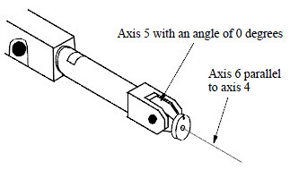
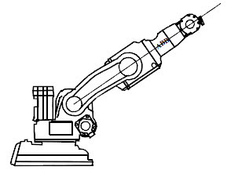

# 2026-09-13 · 如何避免奇异点报错（多用 MoveJ、适当偏移位置）

> **来源**：实操（RobotStudio 6.08，IRB 1200）体会 + 官方手册《RAPID 语言概览》"奇异点"一节、《RAPID 指令、函数和数据类型》`SingArea`。
> **一句话结论**：**能走关节运动（MoveJ）就别走直线（MoveL/MoveC）**；非要走直线时，**把位置/姿态从奇异点区域适当偏移开**。

## 一、什么是奇异点（先弄清"为什么报错"）

**奇异点**（也叫奇点）：机械臂空间里有少数位置，**确定工具位置和方位可以有无穷多种关节配置**。
正着算（关节角→工具位置）没问题，但**反着算（工具位置方位→关节角）时就会出问题**——这个位置就叫奇异点。

官方手册把 6 轴机器人的奇异点分**两类**：

| 类型 | 英文 | 出现条件 | 图示 |
|------|------|---------|------|
| **臂奇异点** | Arm singularity | **腕中心**（轴 4、5、6 的交点）正好**落在轴 1 的正上方** | 下图左 |
| **腕奇异点** | Wrist singularity | **轴 4 与轴 6 共线**（即**轴 5 角度 = 0°**） | 下图右 |

> **补充第三类**：**无平行杆的串行 6 轴机器人**（本机 IRB 1200 属此类）还多一种奇异点——
> **腕中心与轴 2、轴 3 的旋转中心在同一直线上**时出现。

## 二、为什么"直线运行"容易在奇异点报错

关键区别就在**插补方式**：

| 运动方式 | 指令 | 通过奇异点的情况 |
|---------|------|-----------------|
| **关节插补** | `MoveJ`（`MoveAbsJ`） | ✅ **不会有问题** |
| **直线 / 圆弧插补** | `MoveL` / `MoveC` | ❌ **无法通过**；接近时某些关节速率极大、扭矩不足 |

手册原文要点：

- **"在关节插补期间，机械臂通过奇异点时，不会出现问题。"**
- **"在线性插补期间，机器人无法通过奇异点。在奇异点附近移动可能会导致 TCP 速度降低，而关节动作较大。"**
- 接近奇异点时，轴必须沿"轴空间中的非直线路径"行进，非线性越严重，需要的扭矩越大；**扭矩超出电机能力时会自动降低所有轴速率**，严重时报错/停机。
- 手册直接给了建议：**"我们推荐改为在 z 轴附近进行关节插补（MoveJ）。"**

> 直观理解：走直线时，工具要对准一条笔直的轨迹，**手腕被迫做出很大的扭转**；到了奇异位置，这个扭转需要的关节速度/力矩超出电机能力 → 报警。
> 走 `MoveJ` 时，软件按**关节自己的最短路径**走，不需要硬凑直线，所以能平顺过去（代价是轨迹不是直线）。

## 三、★ 避免奇异点报错的办法

### 1. 多用 MoveJ，少用直线（MoveL / MoveC）—— 最直接
- **过路、抬刀、回原点、大跨度转移**：一律用 `MoveJ`。
- 只有在**真正需要笔直轨迹**（焊接、涂胶、切割、检测等工艺段）才用 `MoveL`。
- 今天的 `demo1` 用的就是 `MoveJ p10, v200, z20, MyTool;`，属于"点对点、不要求轨迹形状"的典型场景，天然避开这个坑。

### 2. 适当偏移位置 —— 让轨迹绕开奇异点区域
- **轨迹端点/示教点不要"正对"奇异点**（尤其别让**轴 5 停在 0°**、别让腕中心正对轴 1）。
- 手册原话：**"为避免重新配置，应利用导致必须重新配置的方位在奇异点另一侧设置第一个位置。"**
  → 意思是：与其让轨迹"擦着"奇异点过，不如**把点整体挪到另一侧**，一次跨过去，别在附近磨。
- **姿态（不是位置）也可以微调**：让工具方向和编程姿态**稍微差一点**，往往就能绕开腕奇异点。

### 3. 补充手段（了解，遇到再用）
| 手段 | 指令 | 作用 |
|------|------|------|
| 允许工具方位略偏 | `SingArea \Wrist;` | **轴 4、轴 6 平行（轴 5 = 0）**时，允许方位稍偏以避开腕奇异点；TCP 走正确路径，但工具方位略有偏差 |
| 锁定轴 4 | `SingArea \LockAxis4;` | 把轴 4 锁在 **0° 或 ±180°**，避免轴 5 接近 0 时的奇异问题 |
| 降低直线速率 | `v` 改小 / `VelSet` | 接近奇异点时关节速率会被顶到上限，**降速**可减少超限 |

## 四、易混淆：奇异点 ≠ "50024 转角路径故障"

今天事件日志里出现过 **`50024 转角路径故障`**，要跟"奇异点"区分开：

| | 奇异点报警 | `50024 转角路径故障` |
|---|---|---|
| **根因** | 工具位置/方位反算关节角不唯一（腕中心对轴1、轴5=0 等） | **程序没能及时给出下一条运动指令**，进入转角区时系统把"飞越点（zone）"退化成"精确点" |
| **触发场景** | 直线/圆弧插补**接近或通过**奇异点 | **程序没能及时给出下一条运动指令**：手动单条执行、两条指令间夹了逻辑指令（如 `WaitDI`）、`zone` 设得太大、或 CPU 规划时间不足 |
| **对策** | **多用 MoveJ、偏移位置**（本文） | 改小 zone / 改成 `fine`、检查指令间隔、必要时用 `CornerPathWarning FALSE;` 抑制警告 |

> 两者都在"直线 + 转角"场景下容易冒出来，所以现场容易混为一谈。记牢：**奇异点是"几何位置"问题，50024 是"指令时序"问题。**

## 五、要点串记

- **奇异点两类**：① **臂奇异点** = 腕中心在轴 1 正上方；② **腕奇异点** = 轴 4、轴 6 共线（轴 5 = 0°）。串行无平行杆机器人还有第三类（腕中心与轴 2、轴 3 旋转中心共线）。
- **根本原因**：这些位置上"工具位置姿态→关节角"的解不唯一（无穷多解）。
- **规避第一招**：**关节插补（MoveJ）不怕奇异点**，直线/圆弧插补（MoveL/MoveC）才会卡 → **非工艺段尽量用 MoveJ**。
- **规避第二招**：**适当偏移位置/姿态**，别让轨迹贴（或直穿）奇异点；要过就整体挪到另一侧一次跨过去。
- **进阶**：`SingArea \Wrist`（允许方位微偏）/ `SingArea \LockAxis4`（锁轴 4）/ 降低直线速度。
- **别记混**：`50024 转角路径故障`是**指令时序**问题（手动单条执行、zone 太大、指令间隔有逻辑指令），不是奇异点。

## 参考工具链接

- 官方手册：`07_RAPID语言概览技术参考手册`（**"奇异点"**一节：定义、臂/腕/第三类、通过奇异点的程序执行、通过奇异点手动控制）
- 官方手册：`02_RAPID指令函数数据类型`——`SingArea`（确定奇点周围的插补）、`MoveAbsJ`（"终点是一个奇点"是其使用场景之一）、`CornerPathWarning`（显示/隐藏圆角路径警告）、`motsetdata`（`sing.wrist` / `sing.lockaxis4`）
- 官方手册：`08_系统参数技术参考手册`——`Prefetch Time`、`Remove Corner Path Warning`、`Interpolations Buffer Startup Adjust`（均与 `50024` 相关）
- 同日记录：[2026-09-13_RobotStudio环境与建站.md](2026-09-13_RobotStudio环境与建站.md)、[2026-09-13_RAPID首个程序MoveJ.md](2026-09-13_RAPID首个程序MoveJ.md)
