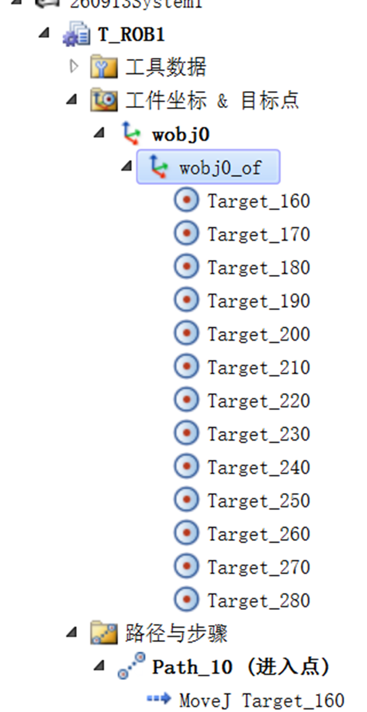

# 2026-09-13 · 轮廓巡点（工件轮廓初步遍历）与坐标系一致性

> **来源**：实操（RobotStudio 6.08，IRB 1200 + `MyTool`）工作站 `260913Study1`，路径 `Path_10（进入点）`。
> **本日成果**：完成了机器人对**工件轮廓的初步遍历巡点**——沿零件轮廓示教一圈目标点，用 `MoveJ` 进刀、`MoveL`/`MoveC` 沿轮廓连接，形成一条可执行的轮廓路径。
> **最大难点**：**各目标点在选中/创建时必须保证"坐标系相同"**；否则路径会报错，表现为**机器人实际无法到达的位置**。

## 一、什么叫"轮廓巡点"

就是让工具尖端（TCP）**沿着工件的外轮廓走一圈**，把轮廓上的关键位置逐个"点上"，再用运动指令把这些点连起来：

```
沿轮廓示教/创建一串目标点  →  用 MoveJ 从进入点接近  →  用 MoveL(直线段) / MoveC(圆弧段) 逐段连接  →  形成完整轮廓路径
```

本日的零件是 `Curve_thing`：轮廓上既有**直线边**，也有**两处圆弧（半圆）凸台**，所以路径里同时用到了 `MoveL` 和 `MoveC`。

## 二、工作站里的真实路径 `Path_10（进入点）`

从工作站导出的 RAPID（`Module1.mod`）：

```rapid
PROC Path_10()
    MoveJ Target_160, v50, z100, MyTool\WObj:=wobj0;   ! 进入点（进刀）
    MoveL Target_170, v50, z100, MyTool\WObj:=wobj0;   ! ┐ 直段
    MoveL Target_180, v50, z100, MyTool\WObj:=wobj0;   ! ┘
    MoveC Target_190, Target_200, v50, z100, MyTool\WObj:=wobj0;  ! 圆弧1（圆点190→终点200）
    MoveL Target_220, v50, z100, MyTool\WObj:=wobj0;
    MoveC Target_230, Target_240, v50, z100, MyTool\WObj:=wobj0;  ! 圆弧2（圆点230→终点240）
    MoveL Target_250, v50, z100, MyTool\WObj:=wobj0;
    MoveL Target_260, v50, z100, MyTool\WObj:=wobj0;
    MoveL Target_270, v50, z100, MyTool\WObj:=wobj0;
    MoveL Target_280, v50, z100, MyTool\WObj:=wobj0;   ! 收回，位置与进入点相同
ENDPROC
```

**读法**：
- **第 1 条用 `MoveJ`**：从当前位置快速、安全地"进刀"到轮廓第一个点 `Target_160`（关节运动，不要求轨迹形状）。
- **中间用 `MoveL`/`MoveC`**：贴着轮廓走直线段和圆弧段（这两条指令才要求"轨迹贴着轮廓"）。
- **`MoveC CirPoint, ToPoint`**：给**圆周点（中间点）+ 终点**两点，配合"上一句的终点"共三点定出一段圆弧。
- **速度统一 `v50`、转弯区 `z100`**：`z100` 表示经过中间点时**不精确停**、圆滑过渡（符合"巡点"而非"逐点停顿"）。


## 三、★ 难点：各点的"坐标系"必须一致

### 1. 现象
**各目标点在选中/创建时，必须保证它们属于同一个坐标系（同一个工作对象）**；
一旦不一致，路径就会**报错**——典型表现是**"机器人实际无法到达该位置"**（目标点显示为不可达）。

### 2. 为什么
- 手册（`01_RobotStudio操作员手册`·坐标系）明确：**"对机器人进行编程时，所有目标点（位置）都与工作对象的对象框架相关。如果未指定其它工作对象，目标点将与默认的 `wobj0` 关联，`wobj0` 始终与机器人的基座保持一致。"**
- 也就是说：**同一个坐标数值，挂在不同的工作对象下，代表的空间位置是完全不同的**。若一部分点挂在 A 坐标系、另一部分挂在 B 坐标系，程序按各自框架去解释，机器人就会走到"看起来对、实际到不了"的位置，从而报错。
- 手册（`01_RobotStudio操作员手册`·测试位置和动作）还指出：**"目标点的可达性同样取决于移动指令的工具和工作对象"**，可达状态分四档：**未知 / 可达 / 用其他配置可达（黄色）/ 不可达（红色）**。

### 3. 本项目是怎么处理一致的
- **所有目标点都建在同一个工作对象下**：浏览器树里 `工件坐标 & 目标点 → wobj0 → wobj0_of`，`Target_160 … Target_280` 全部挂在 `wobj0` 的对象框架（`wobj0_of`）下。
- **所有运动指令都引用同一个 `\WObj`**：`Path_10` 里 10 条指令**每条都写 `\WObj:=wobj0`**，没有一条漏写或写成别的坐标系。
- 两边一致（点挂在 `wobj0`、指令也指定 `wobj0`），路径才成立。



## 四、相关联的第二个"一致"：轴配置（robconf）

`robtarget` 的第 3 段是**轴配置**（`cf1..cfx`，即机器人各臂/腕的象限）。同一空间位置可以有**多种轴配置**，配置不同也直接影响"能否到达"。本路径里同一位置的两个点配置就不同：

| 目标点 | 位置 (X,Y,Z) | 轴配置 robconf |
|--------|-------------|----------------|
| `Target_160`（进入点） | (752.961, 0, 473) | `[0, -1, 0, 0]` |
| `Target_280`（收回点） | (752.961, 0, 473) | `[0, 0, 0, 0]` |

> 位置相同、**配置不同**——这正是"同一点可以有不同的机器人构型"。手册（`01_RobotStudio操作员手册`·测试位置和动作）给的改善可达性办法之一就是 **"将 ConfL/ConfJ 设为 Off，以便机器人可使用新配置达到目标"**，以及**改变目标方向、更改机器人或工件位置**。

## 五、运行结果与观察（如实记录）

- 程序在虚拟控制器 `260913System1` 上运行，事件日志显示：`程序指针已经复位 → 程序指针移至例行程序 → 返回启动 → 返回就绪 → 程序已启动`，随后出现 **`50024 转角路径故障`**，`程序已停止`。
- ⚠️ **该次日志时间戳为 `2026/9/14 10:43`**（工作站自动保存在 `2026/9/14 11:38`），而 `Path_10` 在 **`2026/9/13 16:15` 的工作站快照中已经存在**。即：**路径是 9/13 建好的，这次运行/报警发生在 9/14 上午**。—— 记录时按实际时间留存，便于日后对照。
- `50024` 属于**转角路径（指令时序）**类问题，与本文讲的"坐标系/配置不一致"是**两码事**（详见 `2026-09-13_奇异点规避.md` 第四节的对照表）。

## 六、要点串记

- **轮廓巡点 = 沿轮廓示教一串点 + `MoveJ` 进刀 + `MoveL`/`MoveC` 逐段连成路径**。
- **进刀用 `MoveJ`，贴轮廓用 `MoveL`/`MoveC`**：只有后者才要求"轨迹贴形状"。
- **`MoveC` 记法**：`MoveC 圆周点, 终点, …`，配合上一句终点共三点定圆弧。
- **★ 一致性是命门**：所有目标点要挂在**同一个工作对象**下，所有指令要写**同一个 `\WObj`**；否则位置被按不同坐标框架解读 → **报错 / 机器人无法到达**。
- **别忘轴配置**：`robtarget` 第 3 段 `robconf` 不同，可达性也不同（黄色"用其他配置可达"/红色"不可达"）。
- **`wobj0` 的含义**：默认工作对象，始终与机器人基座一致；不指定 `\WObj` 时目标点就与 `wobj0` 关联。

## 参考工具链接

- 官方手册：`01_RobotStudio操作员手册`——**坐标系**（工件坐标系 / 对象框架 / `wobj0`）、**测试位置和动作**（可达性四档、改善可达性）、**机器人编程**（目标点、路径）
- 官方手册：`02_RAPID指令函数数据类型`——`MoveC`（圆周运动，`CirPoint`/`ToPoint`/`\WObj`）、`MoveL`、`robtarget`（位置/姿态/轴配置/外轴四段）
- 官方手册：`06_RAPID语言内核技术参考手册`、`07_RAPID语言概览技术参考手册`
- 同日记录：[2026-09-13_RobotStudio环境与建站.md](2026-09-13_RobotStudio环境与建站.md)、[2026-09-13_RAPID首个程序MoveJ.md](2026-09-13_RAPID首个程序MoveJ.md)、[2026-09-13_奇异点规避.md](2026-09-13_奇异点规避.md)
