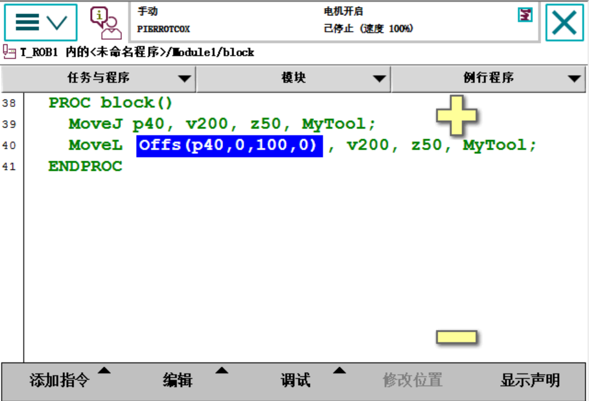

# 2026-09-14 · Offs() 偏移函数（基于参考点做 XYZ 偏移）

> **来源**：实操（示教器，程序 `Module1/block`）+ 官方手册《RAPID 指令、函数和数据类型》——**`Offs`（取代一个机械臂位置）**。
> **一句话**：`Offs(参考点, ΔX, ΔY, ΔZ)` 返回一个**从参考点偏移出来的新位置**（`robtarget`）；把它塞进 `MoveL`/`MoveJ`，就能只给一个基准点、批量生成"整排 / 整列 / 台阶"这类规则轨迹。

## 一、程序原文（示教器实拍）

```rapid
PROC block()
    MoveJ p40, v200, z50, MyTool;                    ! 38  先到基准点 p40
    MoveL Offs(p40, 0, 100, 0), v200, z50, MyTool;   ! 40  直线走到"p40 沿 Y 偏移 100 mm"的点
ENDPROC
```

截图里 `Offs(p40,0,100,0)` 处在高亮编辑态（光标选中），语句本身没问题。



## 二、★ 先厘清一个概念：`Offs` 是"函数"，不是"运动指令"

- **`Offs` 是函数（function）**，**返回值是 `robtarget`**（一个位置数据）——手册归类在"**位置函数**"里，定义为"**添加通过与对象的关系表现出的机械臂位置偏移量**"。
- 它**自己不产生运动**。真正让机器人动起来的是包着它的 **`MoveL` / `MoveJ`**。
- 所以准确说法是：**"`Offs` 算出一个偏移点，`MoveL` 把机器人开到那个点"**——"轨迹运动"是**运动指令**做的，`Offs` 负责**生成目标位置**。

> 换个角度看：`Offs(...)` 完全可以单独用，比如 `p1 := Offs(p1, 5, 10, 15);`（把 `p1` 就地改成偏移后的点），不一定非要配 Move。

## 三、参数与返回值（手册 `Offs` 页）

| 参数 | 数据类型 | 含义 |
|------|---------|------|
| **`Point`** | `robtarget` | **参考点**（"有待移动的位置数据"） |
| **`XOffset`** | `num` | **工件坐标系中 x 方向的位移** |
| **`YOffset`** | `num` | **工件坐标系中 y 方向的位移** |
| **`ZOffset`** | `num` | **工件坐标系中 z 方向的位移** |
| 返回值 | `robtarget` | 偏移后的位置 |

**本例解读**：`Offs(p40, 0, 100, 0)` = 以 `p40` 为参考点，**X 不动、Y 方向 +100 mm、Z 不动** → 得到 `p40` 正侧方 100 mm 的另一个点，再用 `MoveL` 直线走过去。

> ⚠️ **关键细节：偏移量是沿"工件坐标系"方向，不是大地坐标方向！** 手册原文反复强调 `XOffset/YOffset/ZOffset` 是"**工件坐标系中** x/y/z 方向的位移"。
> 因此 **`\WObj` 换一个，同样的 `0,100,0` 偏移方向就变了**。本例 `MoveL` 没写 `\WObj`，用的就是默认 **`wobj0`（与机器人基座一致）** → 即"沿机器人基座的 Y 方向偏 100 mm"。
> 如果换了自定义工件坐标（如**今天建的 `wobj1`**），**`Offs` 的偏移方向会跟着工件坐标系一起转**——工件斜着放，偏移也跟着斜，这一点非常好用（也容易踩坑）。

## 四、有什么用：更"特定"的规则轨迹

你总结的"**可以用来画更特定的轨迹**"很准。`Offs` 的价值在于**只示教一个基准点，其余点靠算**：

| 场景 | 写法示例 |
|------|---------|
| **偏移一个点** | `MoveL Offs(p40, 0, 100, 0), v200, z50, MyTool;` |
| **画矩形 / 台阶 / 往复** | 以基准点分别做 ±X、±Y 偏移，连成方形或"弓"字形 |
| **阵列 / 码垛（托盘取料）** | 手册经典例：`palletpos := Offs(palletpos,(row-1)*distance,(column-1)*distance,0);` 用**行列号 × 间距**算出每个零件位置 |
| **配合循环** | 在循环里改变偏移量，一次循环走一个位（`Offs` + 循环 = 自动生成整条轨迹） |

> 手册自带的"托盘拾料"例子最能说明它的定位：**把托盘定义成一个工件，用 `Offs` 按行列间距算出每个零件的拾取点**——不用逐个示教。

## 五、和前面笔记的呼应

- **坐标系一致（0913）**：`Offs` 的偏移方向取决于工件坐标系，**又一次说明"坐标系选对"是关键**——同一组 `(0,100,0)` 在不同坐标系下会走到完全不同的方向。
- **工件坐标系（0914）**：同日建 `wobj1`（斜面上的工件坐标系）时讲的"沿坐标系 Z 轴进退刀"，和这里 `Offs` "沿工件坐标系偏移"是**同一套逻辑**：**偏移/微动都跟着坐标系走**。斜面上用 `Offs` 沿 Z 偏移，就是**沿着斜面法线平移**。

## 六、要点串记

- **`Offs(Point, ΔX, ΔY, ΔZ)` 是函数**，返回 `robtarget`；**运动靠 `MoveL`/`MoveJ`**，别把它当运动指令。
- **四个参数**：参考点 + 三个方向偏移量。
- **★ 偏移沿"工件坐标系"方向**（不是大地坐标）；`\WObj` 一换，方向就变。
- **只改位置、不改姿态**：`Offs` 的参数里**只有三个位移量、没有任何姿态参数**，所以它只影响位置（`trans`），偏移后的点**姿态（`rot`）沿用参考点**。
- **典型价值**：**一个基准点 → 算出整排/整列/阵列/矩形轨迹**（配合循环或行列计算即可），是"少示教、多算"的关键工具。
- **易错**：偏移量写反方向、或忘了当前用哪个坐标系 → 机器人跑到意料之外的点（严重时撞件）。

## 参考工具链接

- 官方手册：`02_RAPID指令函数数据类型`——**`Offs`（取代一个机械臂位置）**（含"托盘拾料"示例）、`robtarget - 位置数据`、`MoveL` / `MoveJ`
- 官方手册：`07_RAPID语言概览技术参考手册`——**RAPID 概述·数学**（"位置函数"表：**"Offs 添加通过与对象的关系表现出的机械臂位置偏移量"**）
- 同日记录：[2026-09-14_工具与工件坐标系新建.md](2026-09-14_工具与工件坐标系新建.md)、[2026-09-14_斜向平面工件坐标系.md](2026-09-14_斜向平面工件坐标系.md)
- 前一日记录：[2026-09-13_轮廓巡点与坐标系一致.md](2026-09-13_轮廓巡点与坐标系一致.md)
