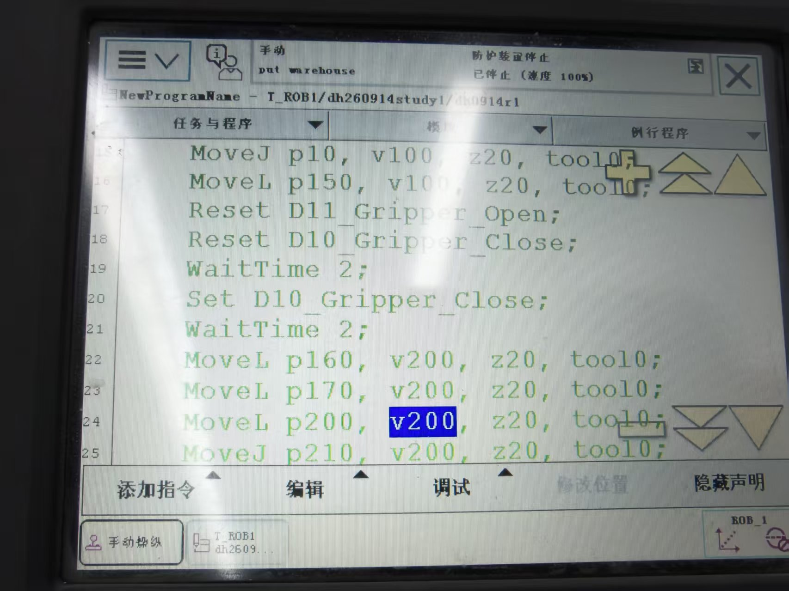
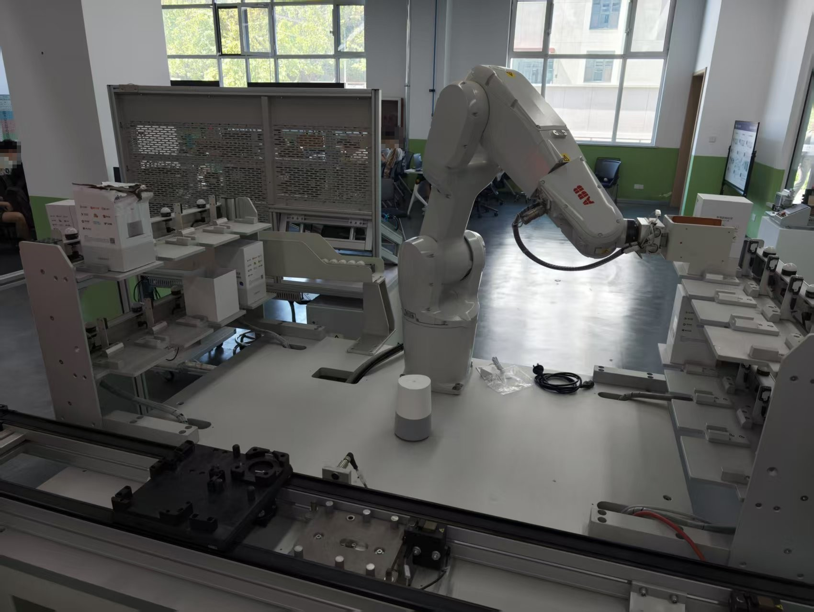

# 2026-09-14 · 机械臂的抓取与松开（夹爪 Set/Reset + WaitTime）

> **来源**：实操（**真机机械台**，示教器 FlexPendant，程序 `dh0914r1`）。
> **本日成果**：学会用 **`Set` / `Reset` 控制夹爪信号**完成"抓取 / 松开"，并理解了 **`Set` 前后要加 `WaitTime` 与 `Reset`** 的原因（给机械臂运动时间、释放信号状态）。
> **一句话结论**：**`Set`（置 1=夹紧）/ `Reset`（置 0=松开）只是"改信号"，信号真正生效有延迟；所以前后要用 `WaitTime` 等一等，并用 `Reset` 把状态先归零。**

## 一、程序原文（示教器实拍）

程序路径：`NewProgramName – T_ROB1/dh260914study1/dh0914r1`，状态栏：**手动**模式、**防护装置停止**、**已停止（速度 100%）**。

```rapid
MoveJ p10,  v100, z20, tool0;     ! 15  关节运动，接近抓取区
MoveL p150, v100, z20, tool0;     ! 16  直线移动到抓取位
Reset D11_Gripper_Open;           ! 17  松开信号 置0（先归零！）
Reset D10_Gripper_Close;          ! 18  夹紧信号 置0（先归零！）
WaitTime 2;                       ! 19  等 2 s —— 给机械臂/夹爪动作留时间
Set   D10_Gripper_Close;          ! 20  夹紧信号 置1 —— 抓取
WaitTime 2;                       ! 21  再等 2 s —— 等夹爪真正夹牢
MoveL p160, v200, z20, tool0;     ! 22  搬运（抬起/移出）
MoveL p170, v200, z20, tool0;     ! 23
MoveL p200, v200, z20, tool0;     ! 24
MoveJ p210, v200, z20, tool0;     ! 25
```

> 说明：截图中第 24 行的速度 `v200` 处于高亮编辑态，属正常光标选中，不影响语句本身。
> **信号名说明**：照片分辨率下第 2 个字符与字母 `I` 形近，按 `Set/Reset` 的用法判断应为**数字量输出**，记作 **`D10` / `D11`**（`Open`=松开、`Close`=夹紧）；准确名称以控制器 I/O 列表为准。





## 二、逐行解读

| 指令 | 作用 |
|------|------|
| `MoveJ p10, v100, z20, tool0;` | **关节运动**接近抓取区（快速、安全到位，不要求轨迹形状） |
| `MoveL p150, v100, z20, tool0;` | **直线运动**精确定位到抓取位（v100 慢速、稳妥） |
| `Reset D11_Gripper_Open;` | 把"松开"信号**置 0** |
| `Reset D10_Gripper_Close;` | 把"夹紧"信号**置 0**（两个信号都先归零） |
| `WaitTime 2;` | **等待 2 秒** |
| `Set D10_Gripper_Close;` | 把"夹紧"信号**置 1** → 夹爪抓取 |
| `WaitTime 2;` | **再等 2 秒** |
| `MoveL p160/p170/p200 …`、`MoveJ p210 …` | 抓稳后搬运（v200 提速） |

**要点**：本程序里动作与信号是"**先动到位、再动夹爪**"的顺序——即 **运动定位（Move）→ 释放/置位信号（Reset/Set）→ 等待（WaitTime）→ 再运动（Move）**。

## 三、★ 为什么 `Set` 前后要有 `WaitTime` 和 `Reset`

### 1. `Reset` 在 `Set` 之前 —— "状态释放"
- 先把 **两个信号都 `Reset`（置 0）**，让夹爪先回到**已知的、松开的状态**，再 `Set` 夹紧。
- 这样做**避免"上一个动作残留的状态"影响本次**——例如上一步留下的"松开"信号还亮着，直接 `Set` 夹紧就可能出现两个信号同时为 1、动作互相打架。
- 即**"状态释放"**：先把状态清干净，再置新状态。

### 2. `WaitTime` 在 `Set` 前后 —— "给动作留时间"
- **`Set` 之前**：给**机械臂定位到位 + 夹爪张开就位**留时间（夹爪要先能"夹住"这个零件）。
- **`Set` 之后**：给**夹爪真正夹紧**留时间；若立刻就走，夹爪可能还没夹牢 → **零件掉落 / 位置跑偏**。

### 3. 手册依据（关键）
`02_RAPID指令函数数据类型` 的 `Set` 页明确写道：
> **"在信号获得其新值之前，存在短暂延迟。如果你想要继续程序执行，直至信号已获得其新值，则可以使用指令 `SetDO` 以及可选参数 `\Sync`。"**

也就是说：**`Set` / `Reset` 执行完 ≠ 物理信号已经变了**，指令只是把值写下去，硬件生效还有个短暂延迟。**程序继续往下跑不会等它**——所以要用 `WaitTime` 来"等信号真正生效/机构真正动作"。这正是"`Set` 前后要加 `WaitTime`"的官方理由。

> 更"严谨"的替代写法：用 `SetDO 信号, \Sync;`（等信号真正到新值再继续），或用 `WaitDI 到位信号` 做成"握手"闭环。课堂先用 `WaitTime` 固定延时，简单可靠。

## 四、`Set` / `Reset` / `WaitTime` 官方定义（摘）

| 指令 | 手册定义 | 数据类型/参数 |
|------|---------|--------------|
| **`Set`** | 将数字信号**输出**信号的值**设置为一**（置 1） | `Signal`：`signaldo`（数字量**输出**） |
| **`Reset`** | 将数字信号**输出**信号的值**重置为零**（置 0） | `Signal`：`signaldo` |
| **`WaitTime`** | 等待给定的时间；**亦可用于等待机械臂和外轴静止** | `Time`：秒（分辨率 0.001 s，最长不限）；可选 `\InPos`＝先等机械臂静止再开始计时 |

> ⚠️ 两个易错点（手册原文）：
> 1. **`Set`/`Reset` 作用的是"输出"信号 `signaldo`**——若写成输入信号（`DI…`）会报错，这也是判断信号到底是 DO 还是 DI 的依据。
> 2. **`WaitTime \InPos` 之前若有 Move，该 Move 必须用停止点 `fine`（不能用 `z` 飞越点）**，否则电源故障后无法重启。本程序用的是 `z20`（飞越点）且未用 `\InPos`，所以没问题；但**若以后想改用 `\InPos`，要把前面的 `Move` 改成 `fine`**。

## 五、与 0913 的衔接

- 0913 用 `\WObj:=wobj0` 显式指定坐标系（轮廓巡点，强调**坐标系一致**）；本机程序用的是 **`tool0`**（默认工具）且**未写 `\WObj`** → 目标点自动关联默认 `wobj0`，这是允许的简写。
- 0913 只做"运动"（`MoveJ/MoveL/MoveC`）；今天**首次加入"动作/信号"类指令**（`Set`/`Reset`）和**逻辑时序控制**（`WaitTime`），从"能走轨迹"迈向"能完成工艺动作"。

## 六、要点串记

- **抓取 = `Set 夹紧信号`；松开 = `Reset 夹紧信号`**（或用 `Set 松开信号`）。
- **`Set` 前后要 `WaitTime`**：因为 **Set 写值到信号真正生效有延迟**，且要给机构动作留时间。
- **`Set` 之前要 `Reset`**：**先把状态归零（状态释放）**，避免旧状态残留导致动作冲突。
- **顺序套路**：`Move 到位 → Reset 归零 → WaitTime → Set 动作 → WaitTime → Move 离开`。
- **`Set`/`Reset` 只对数字量输出（`signaldo`）有效**。
- **想让程序"等信号真生效"**，可用 `SetDO 信号, \Sync;` 或 `WaitDI` 做握手——比固定 `WaitTime` 更稳。

## 参考工具链接

- 官方手册：`02_RAPID指令函数数据类型`——**`Set`（设置数字信号输出信号）**、**`Reset`（重置数字信号输出信号）**、**`WaitTime`（等待给定的时间）**、`SetDO`（`\Sync` 等信号真正生效）、`WaitDI`（等待输入信号）
- 官方手册：`08_系统参数技术参考手册`——I/O 信号配置（主题 I/O）
- 前一日记录：[2026-09-13_轮廓巡点与坐标系一致.md](2026-09-13_轮廓巡点与坐标系一致.md)、[2026-09-13_RAPID首个程序MoveJ.md](2026-09-13_RAPID首个程序MoveJ.md)
