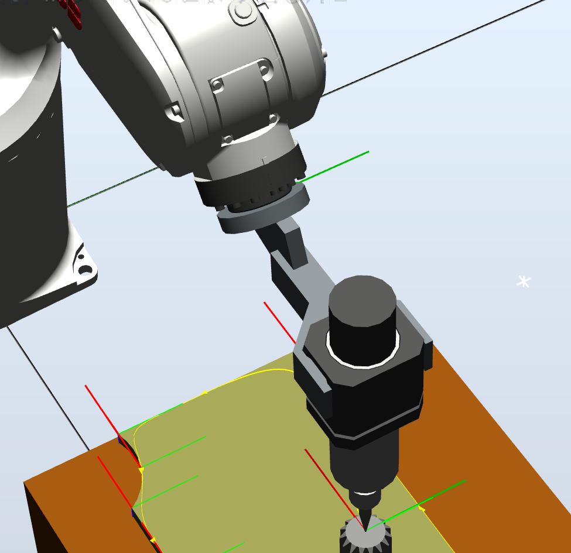
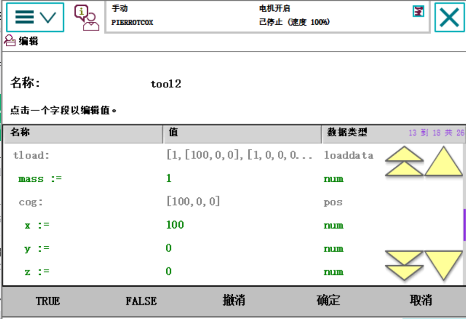
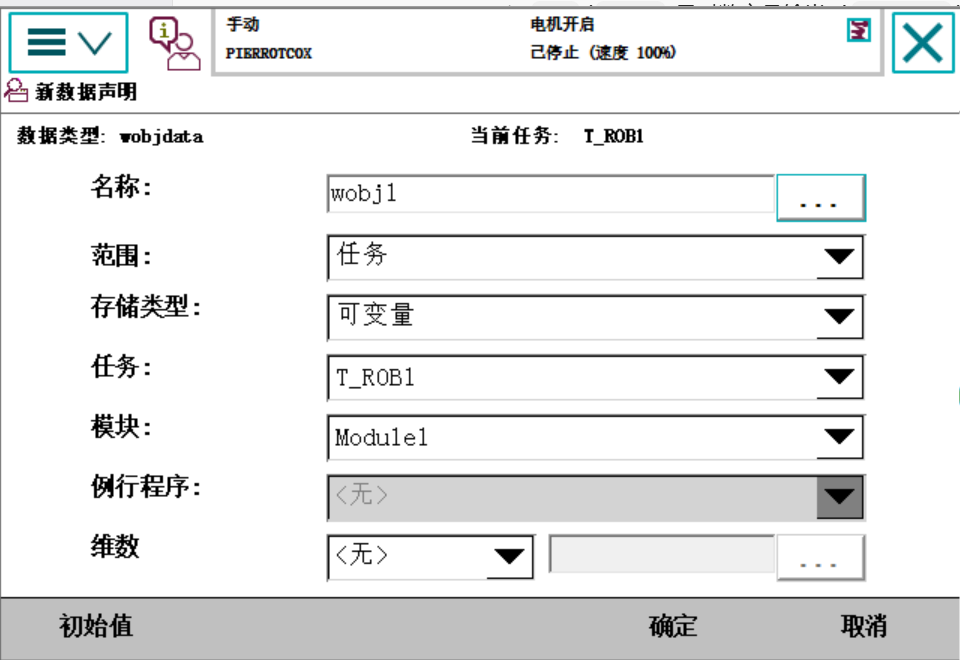
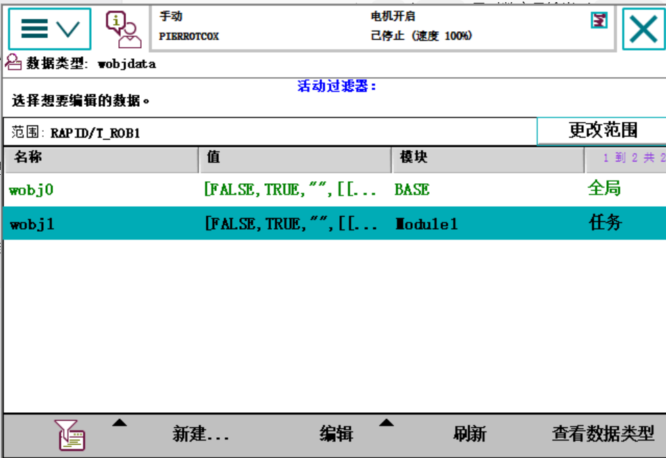

# 2026-09-14 · 工具坐标系与工件坐标系的新建

> **来源**：实操（示教器 FlexPendant）+ 官方手册《带 FlexPendant 的 IRC5 操作员手册》（编程和测试 - 工具 / 工件）、《RobotStudio 操作员手册》（基本选项卡 - 框架 / 工具数据 / 工件坐标）。
> **本日成果**：学会**新建两类坐标系**——**工具坐标系**（`tooldata`）与**工件坐标系**（`wobjdata`）。
> **两条要领**：
> ① **工具坐标系基于"机器人安装平台"**（安装法兰 / `tool0`），以它为零点量出工具 TCP；
> ② **工件坐标系建立基于"所需面上的两条相交垂线"**（X 轴两点 + Y 轴一点，交点即原点）。

## 一、两个坐标系各是什么、存在哪

| | 工具坐标系 | 工件坐标系 |
|---|---|---|
| RAPID 数据类型 | **`tooldata`**（如 `tool2`、`MyTool`） | **`wobjdata`**（如 `wobj1`） |
| 作用 | 告诉机器人"**工具尖端（TCP）在哪、朝向如何、多重**" | 告诉机器人"**工件在哪、朝向如何**" |
| 参照对象 | **机器人安装平台**（安装法兰 / `tool0`） | **大地基座 → 用户框架 → 工件框架** 两级 |
| 建立方法 | **4 点法**（TCP）+ 延伸器点定 Z / X 方向 | **3 点法**（X1、X2、Y1） |
| 手册依据 | `05_带FlexPendant…\doc100`（定义工具框）、`doc101`（编辑工具数据） | `05_…\doc107`（定义工件坐标系）、`01_RobotStudio…\doc113`（三点法创建框架） |

> **手册关键一句（印证"工具坐标系基于安装平台"）**：`doc104` 的"坐标系参考差异"表列出——**工具坐标系 · 通常参照 · 机器人安装平台**；`doc100` 也写"默认情况下，**工具坐标系与 `tool0` 的坐标系类似**"。



## 二、新建工具坐标系（工具框 / `tooldata`）

### 1. 原理：**基于安装平台量 TCP**
工具装在机器人**安装法兰（`tool0`）**上，所以工具坐标系就是**相对安装平台的一个偏移 + 一个旋转**：
- **位置**＝沿 `tool0` 的 X / Y / Z 轴，量出**"安装法兰 → 工具中心点（TCP）"**的三个距离；
- **方向**＝工具坐标系的 Z 轴、X 轴朝向。

### 2. 三种方法（区别只在"方向"怎么定）

| 如果要… | 选择 | 说明 |
|---------|------|------|
| 方向与**机器人安装平台**相同 | **`TCP`（默认方向）** | 只量位置，方向随安装平台 |
| 另设 **Z 轴**方向 | **`TCP&Z`** | 位置 + Z 轴延伸器点 |
| 另设 **X 轴和 Z 轴**方向 | **`TCP&Z, X`** | 位置 + Z、X 两个延伸器点 |

> **点数**：TCP 接近点**通常 4 点就够了**；若取更多点求更精确，则每一点都要同样小心。
> 本次实操选的正是 **`TCP 和 Z, X` + 点数 4**（对话框里点表共 6 项 = 4 个 TCP 点 + Z / X 两个方向点）。


### 3. 操作要点（手册 `doc100`）
1. **先在大地坐标系建立一个固定"参照点"**（作为量 TCP 的基准）；
2. 移动机器人，让**工具顶点尽量靠近参照点**，用**小幅增量**精细对齐 → `修改位置` 定义该点（点 A）；
3. 换个姿态重复得到 B、C、D（**要让机器人姿态变化大一些**，"仅修改工具方向不会获得良好效果"）；
4. 用 `TCP&Z,X` 时还要**再定义 Z、X 方向点**（延伸器点）；
5. 确定后看**计算结果**：**平均误差达到十分之几毫米**就算准确；偏差大可以 `位置 → 全部重置` 重来。

### 4. 工具数据都存了什么（`doc101`）

`tooldata = [robhold, tframe, tload]`：

| 字段 | 含义 | 单位 |
|------|------|------|
| `robhold` | 工具是否由机器人握持（固定工具填 `FALSE`） | — |
| `tframe.trans.x/y/z` | **TCP 相对安装平台 `tool0` 的位置**（沿 tool0 的 X/Y/Z 量） | mm |
| `tframe.rot.q1..q4` | 工具的框架定向（四元数） | — |
| `tload.mass` | 工具重量 | kg |
| `tload.cog.x/y/z` | 工具重心坐标 | mm |
| `tload.aom.q1..q4` | 力矩轴方向 | — |
| `tload.ix/iy/iz` | 转动惯量 | kg·m² |

**截图实证**——编辑工具 `tool2` 的数据（画面停在 `tload` 段）：`tload: [1, [100,0,0], [1,0,0,0…]]`，展开后 **`mass := 1`（kg）、`cog := [100,0,0]`（即 x=100, y=0, z=0）**。



> 重量和重心很重要：**载荷填错会让机械结构过载、路径精度下降**（手册 `doc111` 明确警告）。也可以用服务例行程序 **`LoadIdentify`** 自动测定。

## 三、新建工件坐标系（`wobjdata`）

### 1. 原理：**工件坐标系 = 两个框架**
手册 `doc105`：**"工件坐标系必须定义于两个框架：用户框架（与大地基座相关）和工件框架（与用户框架相关）"**，两者通常重合。

- **用户框架 `uframe`**：定位在**工作台 / 夹具**上；
- **工件框架 `oframe`**：定位在**工件**上（`uframe` 的子框架）。

### 2. ★ 建立方法：**所需面上的两条相交垂线**
手册 `doc107` 原话：**"共需定义三个位置，两个位于 x 轴上，一个位于 y 轴上"**，即 **"x 轴将通过点 X1-X2，y 轴通过 Y1"**：

```
在所需的工件面上取两条相交且互相垂直的线：
   X 轴 ← 由 X1、X2 两点确定
   Y 轴 ← 由 Y1 一点确定（Y 轴与 X 轴垂直）
   两条线的交点（原点）= 工件坐标系原点
```

> **X1 与 X2 的距离越大，定义就越精确**（`doc107` 原文）。这正是你记的"**基于所需面的两条相交垂线**"。

**截图实证**——定义 `wobj1`：**用户方法 = 3 点**，待定义点为 **用户点 X1、X2、Y1**（三行状态均为 `-`，即尚未取点）；**活动工具 = `MyTool`**。


### 3. 先"新建声明"，再"定义"

**① 新建数据声明**（`FlexPendant → 程序数据 → 新建`，数据类型 `wobjdata`）：



| 项 | 截图取值 | 手册建议（`doc106`） |
|---|---|---|
| 名称 | `wobj1`（自动命名为 `wobj`+序号） | 建议改成更明确的名称 |
| 范围 | **任务** | **全局**（"所有模块中，工件都应该是程序中的全局变量"） |
| 存储类型 | **可变量** | **持续变量**（"工件变量必须是持续变量"） |
| 任务 / 模块 | `T_ROB1` / `Module1` | 选声明该工件的模块 |

> ⚠️ **已核实（见同日《斜向平面工件坐标系》）**：手册建议工件用 **全局 + 持续变量（`PERS`）**；本次截图里建成了 **任务 + 可变量（`VAR`）**。
> **实操验证**：范围是"任务"时**切换工件坐标不生效**，**改成"全局"后才正常**；改的入口是 `编辑 → 更改声明`。**结论：范围应选「全局」**。
> 存储类型同理：**`VAR` 在"重置 RAPID / 程序指针回到 main"后会回到初始值**，标定值可能丢失；`PERS` 会保留 → 建议用持续变量。

**② 再看数据列表**：`wobj0` 在 `BASE`、范围**全局**（默认工件，**不可重新定义**——`doc107` 注明"此程序…对默认工件 `wobj0` 不适用"）；`wobj1` 在 `Module1`、范围**任务**，此时的 `wobj1` 值还是 `[FALSE,TRUE,"",[[…`，即**尚未标定**。



### 4. 定义时务必选对"活动工具"
`doc107` 的**小心提示**：**"在加载任何位置前，请确保在工件坐标定义对话框中激活了正确的工具和工件"**——截图里"活动工具 = `MyTool`"，说明此时是用 `MyTool` 的 TCP 去点在标定的。

> 保存定义点时，可以把这些点**存进一个程序模块**（`保存修改的点`），日后可**加载**复用；但保存的只是位置（`robtarget`），**修改它们时要注意当初用的是哪个工具**。

## 四、RobotStudio 里对应的入口（对照记）

| 操作 | RobotStudio 入口（`01_RobotStudio…`） |
|---|---|
| 新建工件坐标 | 基本 → 其他 → **创建工作对象**（`doc114`）；用户框架 / 工件框架各可用"**取点创建框架**" |
| 建框架（3 点） | 基本 → **三点法创建框架**（`doc113`）：X 轴第一点、X 轴第二点、Y 轴上的点 |
| 新建工具数据 | 基本 → 其他 → **工具数据**（`doc115`）：工具坐标框架（位置 x,y,z + 旋转 rx,ry,rz）+ 加载数据（重量/重心/惯性） |

> 两者都可选**存储类型 `PERS` 或 `TASK PERS`**；**要在 MultiMove 下使用就选 `TASK PERS`**（`doc114`/`doc115`）。

## 五、与 0913 的衔接

- 0913 的 `MyTool` 是**现成教学工具**（`CalibData.mod` 里 `PERS tooldata MyTool:=[[31.79,0,229.64],…]`）；**今天是自己"从零点量出来"新建坐标系**——从"用别人的工具"到"自己标定工具"。
- 0913 只会用默认的 `wobj0`；**今天新建了 `wobj1`**，开始把工件坐标独立出来——这正是"**换工件只改一个坐标系**"的基础。

## 六、要点串记

- **工具坐标系基于"机器人安装平台"**（安装法兰 / `tool0`）：位置＝沿 tool0 的 X/Y/Z 量到 TCP 的距离；方向靠 Z、X 延伸器点定。
- **工具定义三方法**：`TCP`（方向随安装平台）/ `TCP&Z` / `TCP&Z,X`；**TCP 点通常 4 点**够用。
- **工具数据三大块**：`robhold`（谁握）+ `tframe`（TCP 位置/方向）+ `tload`（重量/重心/惯量）；**载荷填错会过载、掉精度**。
- **工件坐标系基于"所需面两条相交垂线"**：X 轴由 **X1-X2** 定、Y 轴由 **Y1** 定，**交点即原点**；X1-X2 越远越准。
- **工件坐标系两级**：用户框架（←大地基座）+ 工件框架（←用户框架），通常重合。
- **`wobj0` 是默认工件、不可重新定义**；要新建别的工件用 `wobj + 序号`。
- **定义工件时必须选对"活动工具"**（截图是 `MyTool`）。
- **存储类型**：工件建议 **持续变量（`PERS`）**，避免 RAPID 复位后标定值丢失（截图当时是"可变量"，已核实应改为持续变量）。
- **范围（作用域）**：工件/工具应选 **全局**——否则**切换工件坐标不生效**（同日《斜向平面工件坐标系》已实操验证）。

## 参考工具链接

- 官方手册：`05_带FlexPendant的IRC5操作员手册`——**定义工具框**（`doc100`）、**编辑工具数据**（`doc101`）、**什么是工件**（`doc105`）、**创建工件**（`doc106`）、**定义工件坐标系**（`doc107`）、**编辑工件数据**（`doc108`）
- 官方手册：`01_RobotStudio操作员手册`——**三点法创建框架**（`doc113`）、**工件坐标**（`doc114`）、**工具数据**（`doc115`）、**示教目标点**（`doc116`）
- 官方手册：`02_RAPID指令函数数据类型`——`tooldata`、`wobjdata`（数据结构定义）
- 同日记录：[2026-09-14_夹爪抓取与松开.md](2026-09-14_夹爪抓取与松开.md)
- 前一日记录：[2026-09-13_轮廓巡点与坐标系一致.md](2026-09-13_轮廓巡点与坐标系一致.md)
