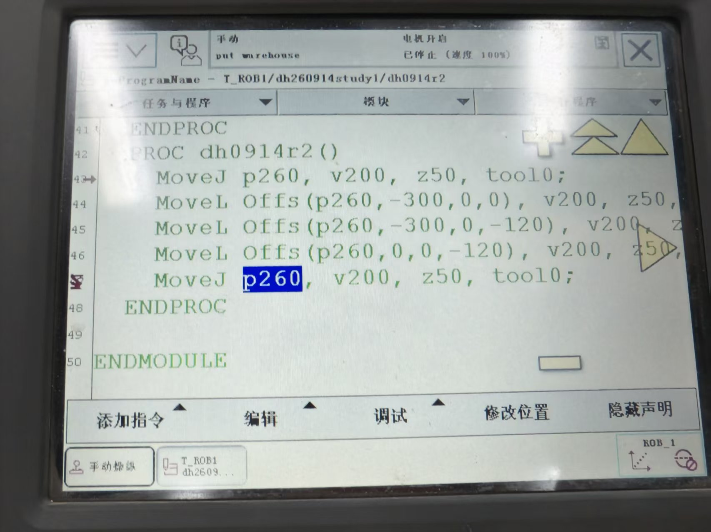
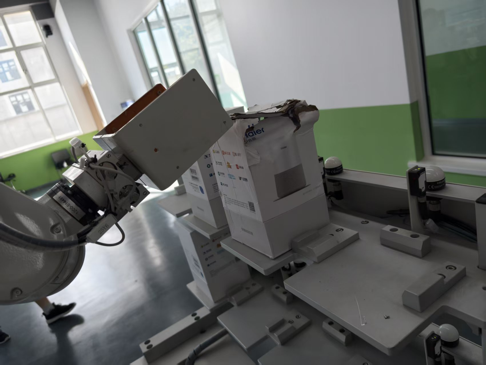

# 2026-09-14 · 真机 Offs 矩形轨迹（原"完成机器操作"）

> **来源**：实操（**真机机械台**，示教器，程序 `T_ROB1/dh260914study1/dh0914r2`）。
> **本日成果**：用 `Offs()` 从一个基准点算出**四个角点**，让机器人走出**闭合矩形轨迹**，在真机上**完成了机器操作**（至此 0914 的"抓取 → 建坐标系 → 偏移轨迹 → 实际作业"整条链路跑通）。
> **一句话**：**一个基准点 `p260` + 四个 `Offs` 偏移 = 一个矩形**——这正是 `Offs` "少示教、多算"的典型用法。

## 一、程序原文（示教器实拍）

程序：`ProgramName – T_ROB1/dh260914study1/dh0914r2`，状态：**手动**、`put warehouse`、**已停止（速度 100%）**。

```rapid
PROC dh0914r2()
    MoveJ p260, v200, z50, tool0;                      ! 43  关节运动 → 进到基准点 p260
    MoveL Offs(p260, -300, 0,   0), v200, z50, tool0;  ! 44  角2：X 偏 -300
    MoveL Offs(p260, -300, 0, -120), v200, z50, tool0; ! 45  角3：X 偏 -300、Z 偏 -120
    MoveL Offs(p260,    0, 0, -120), v200, z50, tool0; ! 46  角4：Z 偏 -120
    MoveJ p260, v200, z50, tool0;                      ! 47  关节运动 → 回到基准点 p260
ENDPROC
```



## 二、这条轨迹到底走的是什么形状

把四个角点都换算成"**相对基准点 `p260` 的偏移量**"，就很清楚了：

| 顺序 | 指令点 | 相对 `p260` 的偏移 (ΔX, ΔY, ΔZ) | 平面上的角 |
|------|--------|--------------------------------|-----------|
| ① 起点 | `p260` | (0, 0, 0) | 角 A |
| ② | `Offs(p260,-300,0,0)` | (−300, 0, 0) | 角 B |
| ③ | `Offs(p260,-300,0,-120)` | (−300, 0, −120) | 角 C |
| ④ | `Offs(p260,0,0,-120)` | (0, 0, −120) | 角 D |
| ⑤ 收尾 | `p260` | (0, 0, 0) | 回到角 A |

- **Y 方向始终为 0** → 四个点**全在同一平面**内，即工件坐标系的 **X–Z 平面**；
- **X 走 300 mm、Z 走 120 mm** → 一个 **300 × 120 的矩形**；
- 四个点**首尾相接回到原点** → **闭合**（走成一个"口"字），这正是可以**反复执行**的轨迹。

```
   X→            以 p260 为角 A（原点）
   ┌──────────────┐  角A (0,0) ──→ 角B (-300,0)
   │              │  │                │
   │  300 × 120   │  │                │
   │              │  角D (0,-120) ←── 角C (-300,-120)
   └──────────────┘
                   ↓ Z
```



## 三、几个值得记的点

| 观察 | 说明 |
|------|------|
| **首尾用 `MoveJ`，中间用 `MoveL`** | 与 0913 的轮廓巡点同一套路：**`MoveJ` 负责"进入/退出"**（不要求轨迹形状、快），**`MoveL` 负责"贴轨迹走"**（要直边） |
| **只示教 1 个点 `p260`** | 另外 3 个角点**全靠 `Offs` 算出来**——矩形不需要逐个示教，**改一个偏移量就换一种尺寸** |
| **`z50`（不是 `fine`）** | 四条边之间是 **`z50` 飞越点**，所以**四个角是"抹圆"过渡、不是尖角**（要走尖角得用 `fine`）。做**周边往复 / 环绕**动作时这种圆滑过渡是合理的 |
| **`Offs` 沿"工件坐标系"偏移** | 这里没写 `\WObj`，用的是默认 `wobj0`（与基座一致）；若换成自定义工件坐标，**矩形的朝向会跟着坐标系转**（如斜面上的工件，矩形就贴在斜面上） |
| **工具是 `tool0`** | 本条未用专门标定的工具；注意 `tool0` 的 TCP 在**安装法兰中心**，如果实际抓取用的是别的工具尖端，轨迹会有偏差（呼应 0914 工具坐标系新建那条） |

## 四、这条记录在 0914 里的位置

0914 一整天是一条**完整的作业链路**，本条是最后一环：

```
① 夹爪抓取与松开（Set/Reset/WaitTime）
        ↓  有了"动作能力"
② 工具坐标系 / 工件坐标系新建（含斜面、范围须全局、Z 轴方向）
        ↓  有了"在哪干活"的基准
③ Offs 偏移函数（一个参考点算偏移）
        ↓  有了"生成轨迹"的工具
④ 完成机器操作（本条：Offs 走闭合矩形，真机跑通）
```

## 五、要点串记

- **`Offs` 画矩形**：给**一个基准点 + 四个角点偏移**，就能走出**闭合矩形**（本例 300 × 120，位于 X–Z 平面）。
- **首尾 `MoveJ`、中间 `MoveL`**：进入/退出用关节运动，贴轨迹用直线运动。
- **只示教基准点**，其余靠算 —— 尺寸一改（改偏移量）就换一种矩形。
- **`z50` 会让角变圆**：要尖角用 `fine`；周边往复用圆滑过渡更合适。
- **偏移方向随坐标系**：`\WObj` 变了，矩形朝向跟着变（坐标系一致性的又一次体现）。

## 参考工具链接

- 官方手册：`02_RAPID指令函数数据类型`——**`Offs`（取代一个机械臂位置）**；`MoveL` / `MoveJ`；`robtarget - 位置数据`
- 官方手册：`07_RAPID语言概览技术参考手册`——RAPID 概述·数学（位置函数 `Offs`）
- 同日记录：[2026-09-14_Offs偏移函数.md](2026-09-14_Offs偏移函数.md)（函数机制与"托盘拾料"示例）、[2026-09-14_工具与工件坐标系新建.md](2026-09-14_工具与工件坐标系新建.md)、[2026-09-14_斜向平面工件坐标系.md](2026-09-14_斜向平面工件坐标系.md)、[2026-09-14_夹爪抓取与松开.md](2026-09-14_夹爪抓取与松开.md)
- 前一日记录：[2026-09-13_轮廓巡点与坐标系一致.md](2026-09-13_轮廓巡点与坐标系一致.md)
