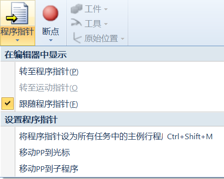

# 2026-09-15 · FOR 循环练习：打印 1~100 内能被 13 整除的整数

> **来源**：实操任务（程序 `Module1/div_by_13`）+ 官方手册《RAPID 指令、函数和数据类型》（`FOR` 页）、《RAPID 语言内核技术参考手册》（运算符表）。
> **练习要求**：使用 **FOR 循环**打印 1~100 之间所有**能被 13 整除**的整数。
> - 循环从 1 数到 100（边界含首尾）
> - 用 `i MOD 13 = 0` 判断能否整除
> - 用 `TPWrite` 逐个打印结果
> **本日成果**：第一次把 **FOR 循环 + 条件判断**组合使用，正式用上 **`MOD`（整数模运算）** 运算符，并学会了**不启动示教器、直接在 RAPID 编辑器里运行程序**（输出看"操作者窗口"）。

## 一、程序原文（控制器实际代码，`Module1/div_by_13`）

> 代码初版由 agent 生成（`RAPID代码\DivBy13_整除13_0915.mod`，输出 `"13x"`），后在 RAPID 编辑器里把输出文本改成了 `"13ok->"`，与控制器 14:48 备份一致。

```rapid
	PROC div_by_13()
		VAR num i;
		VAR num key;
		TPErase;
		FOR i FROM 1 TO 100 DO
			IF i MOD 13=0 THEN
				TPWrite "13ok->"\Num:=i;
			ENDIF
		ENDFOR
		TPReadFK key,"Done. Press OK to finish","","","","OK","";
	ENDPROC
```

## 二、运行验证（真实截图）

**操作者窗口**是 RAPID 程序文本输出（`TPWrite`）的显示位置，不用开示教器也能看到结果：


**不启动示教器运行程序的入口**：RAPID 标签页 → 程序指针 / 运行模式 / 启动（工具栏中段）：



**运行结果**：底部 `260913System1:操作者窗口` 输出 7 行，与预期完全一致：


```
T_ROB1 -> 13ok->13
T_ROB1 -> 13ok->26
T_ROB1 -> 13ok->39
T_ROB1 -> 13ok->52
T_ROB1 -> 13ok->65
T_ROB1 -> 13ok->78
T_ROB1 -> 13ok->91
```

## 三、★ 方法：不启动示教器运行程序（本日新技能）

**入口**：RAPID 编辑器工具栏 **「运行模式」→「程序」**，配合 **「程序指针」「启动」「停止」** 按钮；`TPWrite` 的输出显示在底部 **「操作者窗口」** 标签页。

**关键操作**（对照截图二"设置程序指针"菜单）：
- **将程序指针设为所有任务中的主例行程**（Ctrl+Shift+M）：把 PP 指到 `main`，从入口整程序运行；
- **移动 PP 到光标**：把 PP 直接移到当前编辑行（如 `div_by_13` 内部），只跑单个例行程序，适合调试单段逻辑；
- **转至程序指针（P）/ 转至运动指针（O）/ 跟随程序指针（F）**：编辑器视图跟着 PP 走，方便边运行边看代码走到哪；
- 然后点 **「启动」** 运行，**「停止」** 结束；如需单步看效果用 **「步入 / 跳出 / 跳过」**。

> 与"开示教器（FlexPendant）运行"相比，这条路径**省去虚拟示教器窗口**，人机交互指令（`TPReadNum`/`TPReadFK`）会以**弹出对话框**的形式出现，`TPWrite` 文本输出进"操作者窗口"——适合快速验证纯逻辑程序（如本练习没有运动指令，完全不用开示教器）。

## 四、★ 关键点 1：FOR 循环语法（手册核实）

**手册定义**（`02_RAPID指令函数数据类型` → FOR）：

> **"当一个或多个指令重复多次时，使用 FOR。"**

**语法**：

```
FOR <循环计数器> FROM <起始值> TO <结束值> [STEP <步进值>] DO
    <循环体语句>
ENDFOR
```

**执行机制**（手册"程序执行"节）：
1. 评估起始值、结束值、步进值表达式；
2. 计数器赋起始值；
3. **检查计数器是否在 [起始, 结束] 范围内**——超出则循环停止，直接执行 `ENDFOR` 之后的指令；
4. 执行循环体内指令；
5. 按步进值增量（或减量）；
6. 回到第 3 步继续。

**几个要点**：
- **计数器自动声明**：`i` 不用提前 `VAR`，系统自动创建（手册："自动声明该数据"）；
- **STEP 可省略**：默认 +1；起始值 > 结束值时自动变 -1（倒序）；
- **边界含首尾**：`FROM 1 TO 100` 会遍历 1、2、…、100 共 100 次；
- **计数器在循环内只读**：只能读取、不能赋值更新（手册："其仅可通过 FOR 循环中的指令来进行读取（未更新）"）；
- **小数不行**：起始/结束/步进不能用小数值（手册限制节）。

## 五、★ 关键点 2：MOD 整数模运算（手册核实）

**手册定义**（`06_RAPID语言内核技术参考手册` → 运算符）：

> **`MOD` 整数模运算；余数**：`num i MOD num i` → `num`（操作数必须表示整数值）

**运算符优先级**（手册"求值顺序"节）：`* / DIV MOD` 同级最高，先于 `+ -`。

所以 `i MOD 13 = 0` 的含义是：**i 除以 13 的余数为 0**，即 i 能被 13 整除。`=` 是关系运算符，优先级低于算术运算，因此先算 `i MOD 13` 再与 `0` 比较。

## 六、验证（结果复核）

| 项 | 值 |
|----|----|
| 1~100 内 13 的倍数 | 13, 26, 39, 52, 65, 78, 91 |
| 个数 | **7 个**（已用计算器复核 `Range[13,100,13]`） |

> 97 不是 13 的倍数（97 ÷ 13 = 7 余 6），所以到 91 就结束，与操作者窗口输出一致，程序正确。

## 七、要点串记

- **FOR 语法**：`FOR i FROM 起 TO 止 [STEP 步] DO ... ENDFOR`，边界含首尾，STEP 默认 ±1。
- **计数器自动声明、循环内只读**：无需 `VAR i`，但也不能在循环里改 `i`。
- **`MOD` 是整数取余运算符**：`i MOD 13 = 0` 即"能被 13 整除"，优先级与 `* / DIV` 同级。
- **FOR 适合"次数确定"**：重复次数已知用 FOR；次数不确定（条件成立就继续）用 WHILE（手册 FOR 页备注）。
- **TPWrite 输出数字**：`TPWrite "13ok->"\Num:=i;` 把数字附加到文本后显示。
- **不启动示教器也能跑**：RAPID 编辑器「运行模式 → 程序 → 启动」，`TPWrite` 输出看底部**操作者窗口**；`TPReadFK/TPReadNum` 会弹对话框。
- **字符串与注释全用英文**（RAPID 是 ISO 8859-1，汉字会变 `?`）；本程序已校验纯 ASCII。

## 参考工具链接

- 官方手册：`02_RAPID指令函数数据类型`——**`FOR`**（重复给定的次数）、`TPWrite`、`TPReadFK`
- 官方手册：`06_RAPID语言内核技术参考手册`——**运算符表（MOD 整数模运算、优先级）**、保留字
- 代码文件：`机器人实训\RAPID代码\DivBy13_整除13_0915.mod`
- 运行截图：`配图\Day4_images\image-0915_div13_*.png`（操作者窗口入口 / 程序指针菜单 / 运行输出）
- 同日记录：[2026-09-15_IF借阅费计算.md](2026-09-15_IF借阅费计算.md)、[2026-09-15_IF语句求最小值.md](2026-09-15_IF语句求最小值.md)、[2026-09-15_人机交互指令练习.md](2026-09-15_人机交互指令练习.md)、[2026-09-15_RAPID编程起步与同步机制.md](2026-09-15_RAPID编程起步与同步机制.md)
