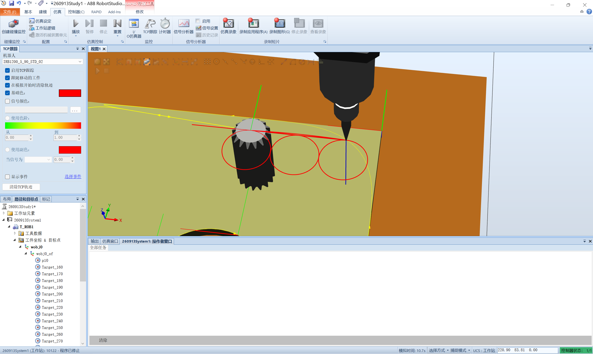

# 2026-09-15 · FOR 循环练习：画三个连续的圆（仿真 + TCP 跟踪）

> **来源**：实操（RobotStudio 6.08 虚拟控制器 `260913System1`，仿真运行）+ 官方手册《RAPID 语言内核技术参考手册》（**For 语句**）、《RobotStudio 操作员手册》（**TCP跟踪**、运动指令 / TrueMove）。
> **练习要求**：已知**圆半径 20 mm**，**圆心自己确定**，画**三个连续的圆**（起点用 `Target_160`，在 XY 平面内）。
> **本日成果**：先用 `MoveC` + `Offs` 写出 9 行版，再**改写成 FOR 循环（3 行指令）**；并用 **TCP 跟踪**把轨迹显示出来**验证成功**。
> **附加要求**：代码尽量不超过 10 行 → **FOR 版 3 行达标**。



## 一、最终程序（FOR 版，3 行指令）

```rapid
	PROC draw_circles()
		VAR num i;
		FOR i FROM 0 TO 2 DO
			MoveJ Offs(Target_160,i*40,0,0),v50,z0,MyTool\WObj:=wobj0;
			MoveC Offs(Target_160,i*40+20,-20,0),Offs(Target_160,i*40,-40,0),v50,z0,MyTool\WObj:=wobj0;
			MoveC Offs(Target_160,i*40-20,-20,0),Offs(Target_160,i*40,0,0),v50,z0,MyTool\WObj:=wobj0;
		ENDFOR
	ENDPROC
```

## 二、★ 一个完整圆 = 2 个 `MoveC`

**关键认识**：`MoveC` **一次只画一段弧**（≤180° 最稳妥），所以：

- **画一个完整的圆 → 2 个 `MoveC`**（分成左右两个半圆）；
- **三个圆 → 6 个 `MoveC`**。

`MoveC` 的写法是 **`MoveC 圆上的中间点, 终点`** —— 起点是**上一条指令的终点**，所以"**中间点 + 终点**"配上自动带过来的起点，三点定一段半圆。

| 段 | 中间点 | 终点 |
|----|--------|------|
| 圆的上半（顶→右→底） | `+20,-20`（右侧切点） | `0,-40`（底点） |
| 圆的下半（底→左→顶） | `-20,-20`（左侧切点） | `0,0`（回到顶点） |

## 三、几何布局（三个圆相切、横向排列）

以 `Target_160` 为**第 1 个圆的顶点**，半径 `r=20`：

```
        T160(0,0)      (40,0)      (80,0)      ← 各圆的顶点（起点）
          ●─────────────●─────────────●
         ╱                ╲              ╲      ← r=20
 (-20,-20)╲   (20,-20)   ╱  (60,-20)     ╲     ← 左右切点（即"圆心 ± 20"）
          ╲              ╱                 ╱
        (0,-40)       (40,-40)      (80,-40)   ← 各圆的底点
```

- **圆心**（相对 Target_160）：(0,−20)、(40,−20)、(80,−20)
- **圆心间距 = 40 = 2 × 半径** → 三个圆**恰好相切**（正是 PPT 提示图的样子）
- **Z 全程不变**（`Target_160` 的 z=473）→ 轨迹落在 **XY 平面**

## 四、★ FOR 循环让代码从 9 行变 3 行

| | `Offs` 逐点版 | **FOR 版** |
|---|---|---|
| 指令行数 | 9 行 | **3 行** |
| 圆的数量 | 写死 3 个 | 改 `TO` 的值即可（`0 TO 9` 就是 10 个圆） |
| 扩展 | 每加一圆复制 3 行 | **不用改** |

**优化的本质**：三个圆的关系是**纯平移**（每个整体右移 40 mm），正好是"**重复同一套动作**"——这是循环最典型的用武之地。

**做法**：把"写死的绝对坐标"换成"**用循环变量算出的偏移量**"——`i` 从 0 到 2，`i*40` 就是第 i 个圆心的 x 偏移，两条 `MoveC` 里的所有点都跟着 `i` 走。

## 五、★ FOR 语法与三个坑（手册确认）

**语法**（手册 For 语句）：
```
<for statement> ::= FOR <loop variable> FROM <expression> TO <expression>
                    [ STEP <expression> ] DO <statement list> ENDFOR
```

| 坑 | 手册原文 | 说明 |
|----|---------|------|
| **循环变量只读** | **"是只读的，即，无法被 for 循环的语句更新。"** | **不能在循环里改 `i`**（`i := i+1` 会报错），它的值由 FOR 机制自己维护 |
| **`FROM/TO/STEP` 只求值一次** | **"最初，from 表达式、to 表达式和 step 表达式将进行求值，将保持其值。它们只求值一次。"** | 循环次数**开局就定死**；循环体内改别的变量**不会**影响循环次数 |
| **`STEP` 是保留字** | 保留字表 | **不能拿 `STEP` 当变量名**（本程序用 `i`） |

> **补**：循环变量是 `num` 型，作用域**限于 `DO … ENDFOR` 之间**，且会**隐藏同名的外部对象**（手册原文）。

## 六、★★ 怎么把轨迹"看得见"：TCP 跟踪

### 1. 问题
`Offs()` 生成的**目标点在图形里不可见**（手册 `doc218`：**"指令中使用的目标在图形中不可见。但是，可以使用 RAPID 编辑器对指令编程或编辑，并可以使用虚拟控制器进行仿真。"**）——**仿真时机器人会在动，但不留痕**，所以"看不清"。

### 2. 解决：开通 TCP 跟踪
**仿真选项卡 → TCP跟踪**（手册原文）：

> **"启用TCP跟踪：选中此复选框可对选定机器人的 TCP 路径启动跟踪。"**

**操作步骤**：
1. **前提**（手册强调）：**"为使 TCP 跟踪正常进行，确保工作对象及本程序所用工具均同步至工作站。"**（本程序用 `MyTool` + `wobj0`）
2. 仿真选项卡 → TCP跟踪 → 勾选 **启用TCP跟踪**
3. 设 **主色**（本程序设了红色，轨迹看得清）
4. **用仿真选项卡的「播放」按钮跑程序**（不是 RAPID 编辑器里点运行）
5. 跑完 → TCP 走过的路径**留下彩色轨迹线** → 三个圆清晰可见 ✅

### 3. 结论
**TCP 跟踪记录的是"实际运动轨迹"，因此不受 `Offs` 限制** —— 这是"用 `Offs` 保持代码简洁"与"要看到轨迹"**两全其美**的办法。

### 4. 对比：如果想让 RS 直接画出路径对象
| 写法 | 代码量 | RS 里能看到路径线 |
|------|--------|------------------|
| **`Offs` + FOR**（本程序） | **3 行** | ❌ 点不可见，**需 TCP 跟踪看轨迹** |
| 真实示教点 + FOR | 需先建 9 个点 | ✅ 路径与目标点都显示 |

> 另有 **TrueMove 路径可视化**（手册 `doc124`）：可"精确看到机器人的编程路径，无论编程设定的速度如何"，**显示时把区域数据（zone）也考虑进去**；**关节移动会以虚线显示**（因为不精确走该路径）。

## 七、验证结果（对照练习要求）

| 要求 | 结果 |
|------|------|
| 半径 20 mm | ✅ 切点距顶点 `20,20` |
| **三个连续（相切）的圆** | ✅ 圆心间距 40 = 2r |
| 圆心自己确定 | ✅ 定为 (0,−20)/(40,−20)/(80,−20) |
| 起点 `Target_160` | ✅ 作为第 1 个圆的顶点 |
| XY 平面 | ✅ z 恒为 473 |
| **≤10 行** | ✅ **3 行指令** |

**TCP 跟踪截图**显示：**三个红色圆相互相切、横向排列**，与 PPT 提示图完全一致。

## 八、要点串记

- **一个完整圆 = 2 个 `MoveC`**（`MoveC 中间点, 终点`，起点是上一条的终点）。
- **`Offs` 擅长"重复阵列"**：所有点写成 `Offs(基准, Δx, Δy, 0)`，配合循环，**改数字就改布局**。
- **FOR 让"重复动作"从 N 行变 3 行**，且**圆心间距=2r 保证相切**。
- **FOR 三坑**：变量只读 / `FROM-TO-STEP` 只求值一次 / `STEP` 是保留字。
- **要看见轨迹 → 开 TCP 跟踪**（仿真选项卡），这绕过了"`Offs` 目标点不可见"的限制。
- **画圆用 `z0`**（近精确到位）；用大 `z`（如 `z100`）弧的接缝会被**抹圆**，圆就不圆了。

## 参考工具链接

- 官方手册：`06_RAPID语言内核技术参考手册`——**For 语句**（语法 / 只读变量 / 表达式只求值一次）、保留字
- 官方手册：`01_RobotStudio操作员手册`——**TCP跟踪**（`doc172`）、运动指令 / **TrueMove 路径**（`doc124`）、同步到工作站（`doc218`：`Offs` 指令目标不可见）
- 官方手册：`02_RAPID指令函数数据类型`——`MoveC`（圆周运动）、`Offs`（位置偏移函数）、`MoveJ`/`MoveL`
- 代码文件：`机器人实训\RAPID代码\DrawCirclesFor_画三个圆FOR版_0915.mod`（FOR 版）、`DrawCircles_画三个圆_0915.mod`（9 行展开版）
- 同日记录：[2026-09-15_IF借阅费计算.md](2026-09-15_IF借阅费计算.md)、[2026-09-15_IF时间段判断.md](2026-09-15_IF时间段判断.md)、[2026-09-15_IF语句求最小值.md](2026-09-15_IF语句求最小值.md)、[2026-09-15_人机交互指令练习.md](2026-09-15_人机交互指令练习.md)、[2026-09-15_RAPID编程起步与同步机制.md](2026-09-15_RAPID编程起步与同步机制.md)
- 前一日：[2026-09-14_软件轮廓遍历Offs.md](2026-09-14_软件轮廓遍历Offs.md)（`Offs` 基础用法）
