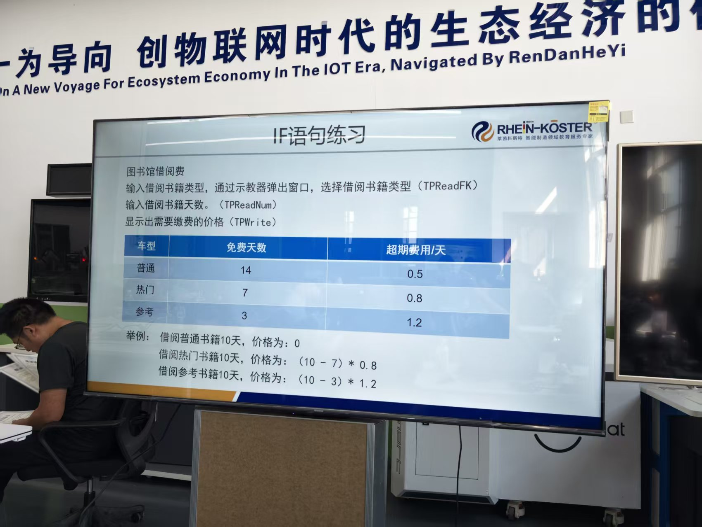

# 2026-09-15 · IF 语句练习：图书馆借阅费计算

> **来源**：实操（示教器 FlexPendant，程序 `Module1/library_fee`）+ 官方手册《RAPID 指令、函数和数据类型》（`TPReadFK` / `TPReadNum` / `TPWrite`）。
> **练习要求**：输入借阅书籍类型 → 输入借阅天数 → 显示需要缴费的价格。
> - 用 **`TPReadFK`** 弹出窗口**选择书籍类型**
> - 用 **`TPReadNum`** 输入借阅天数
> - 用 **`TPWrite`** 显示价格
> **本日成果**：完成一个"**选类型 → 选参数 → 算价格**"的完整三段式程序，并把 `TPReadFK` 的**返回值机制**真正用起来。



## 一、费率规则

| 类型 | 免费天数 | 超期费用/天 |
|------|---------|------------|
| **普通** Normal | 14 | 0.5 |
| **热门** Popular | 7 | 0.8 |
| **参考** Reference | 3 | 1.2 |

**题目给的例子**（借 10 天）：
- 普通：10 < 14 → 免费 → **0**
- 热门：(10−7)×0.8 = **2.4**
- 参考：(10−3)×1.2 = **8.4**

> PPT 表格里表头写的是"车型"，按上下文应为"**书型**"的笔误。

## 二、程序原文（示教器实际代码）

```rapid
	PROC library_fee()
		VAR num booktype;              ! 1=Normal  2=Popular  3=Reference
		VAR num days;
		VAR num freedays;              ! free days of the chosen type
		VAR num rate;                  ! fee per extra day
		VAR num price;
		VAR num key;
		TPErase;
		! --- Step 1: choose book type (keys 1..3 enabled) ---
		TPReadFK booktype,"Select book type","Normal","Popular","Reference","","";
		! --- Step 2: decide free days and rate by type ---
		IF booktype=1 THEN
			freedays:=14;
			rate:=0.5;
		ELSEIF booktype=2 THEN
			freedays:=7;
			rate:=0.8;
		ELSEIF booktype=3 THEN
			freedays:=3;
			rate:=1.2;
		ELSE
			freedays:=0;
			rate:=0;
		ENDIF
		! --- Step 3: input days ---
		TPReadNum days,"Days?";
		! --- Step 4: calculate the fee ---
		IF days>freedays THEN
			price:=(days-freedays)*rate;
		ELSE
			price:=0;                  ! within free days -> no fee
		ENDIF
		! --- Step 5: show the result ---
		TPWrite "Price:"\Num:=price;
		TPReadFK key,"Done. Press OK to finish","","","","OK","";
	ENDPROC
```

## 三、★ 关键点：`TPReadFK` 的返回值就是"第几个键"

**手册定义**（`TPReadFK` 页）：

> **"根据按下的键，返回数值 1..5 的变量。如果按下功能键 1，则返回 1，以此类推。"**

所以**三个书型分别放在第 1/2/3 个键位，返回值 `booktype` 直接当类型号用**：

```
TPReadFK booktype, "Select book type",  [键1]      [键2]       [键3]        [键4] [键5]
                                       "Normal"   "Popular"   "Reference"    ""    ""
→ 按 Normal 得 1 ； 按 Popular 得 2 ； 按 Reference 得 3
```

> 五键位参数的通用规则（5 个键位都要写、空位填 `""`、`TPFK1` 在最左、返回 1..5）见《[人机交互指令练习](2026-09-15_人机交互指令练习.md)》第四节。本题只需记住：**三个书型放在键 1–3，`booktype` 直接就是类型号**；程序会停住等按键，不按不往下走。

## 四、★ 设计思路：先"选参数"，再"算一次"

程序分成清晰的五步，其中最重要的设计是**把"判断类型"和"计算公式"分开**：

| 步骤 | 做什么 | 关键 |
|------|--------|------|
| Step 1 | `TPReadFK` 选类型 → `booktype` | 返回 1/2/3 |
| **Step 2** | IF 分支**只负责查出 `freedays` 和 `rate`** | ← 不在这里算钱 |
| Step 3 | `TPReadNum` 输入 `days` | — |
| **Step 4** | **统一算一次**：`price := (days - freedays) * rate` | ← 公式只有一份 |
| Step 5 | `TPWrite` 输出 | — |

**为什么这么写**：如果按"三种类型各写一遍计算"，会有**三份一模一样的公式**（只有数字不同），以后改公式要改三处、极易漏改。现在**公式只写一份**，`IF` 只负责"定参数"——**改费率只改数字，改公式只改一处**。

## 五、另一个要点：免费期内直接归零

```rapid
		IF days>freedays THEN
			price:=(days-freedays)*rate;
		ELSE
			price:=0;                  ! 免费期内
		ENDIF
```

**为什么需要 `ELSE` 兜底**：如果只写 `price := (days - freedays) * rate`，当 `days < freedays` 时 `(days - freedays)` 是**负数**，会算出**负价格**（等于倒找钱）。
加了 `IF days > freedays` 判断后，"普通书借 10 天"（10 < 14）走 `ELSE` → **输出 0**，与题目例子一致。

## 六、验证（对照题目例子）

| 类型 | 选择键 | 天数 | 计算 | 输出 |
|------|--------|------|------|------|
| 普通 Normal | 键1 → `booktype=1` | 10 | 10 < 14 → 0 | **0** |
| 热门 Popular | 键2 → `booktype=2` | 10 | (10−7)×0.8 | **2.4** |
| 参考 Reference | 键3 → `booktype=3` | 10 | (10−3)×1.2 | **8.4** |

> `TPWrite` 的 `\Num` 按**6 位有效位**转换（手册），`2.4` / `8.4` 会原样显示。

## 七、要点串记

- **`TPReadFK` 返回值 = 按下的第几个键**（1..5），可以直接当"选项编号"用。
- **`TPReadFK` 要连给 5 个键文本**，不用的填 `""`；`TPFK1` 是最左键。
- **"选参数"与"算结果"分开**：IF 只查出 `freedays`/`rate`，公式**只写一份** → 好维护。
- **免费期要用 `ELSE` 兜底归零**，否则 `(days-freedays)` 为负会算出负价格。
- **`TPReadNum` / `TPWrite`** 负责输入天数、输出价格，与 `TPReadFK` 配合构成完整人机交互。
- **字符串与注释全用英文**（RAPID 是 ISO 8859-1，汉字会变 `?`）。

## 参考工具链接

- 官方手册：`02_RAPID指令函数数据类型`——**`TPReadFK`**（读取功能键，返回 1..5）、`TPReadNum`、`TPWrite`、`TPErase`
- 官方手册：`06_RAPID语言内核技术参考手册`——IF 语句、保留字、字符集
- 代码文件：`机器人实训\RAPID代码\LibraryFee_借阅费_0915.mod`
- 同日记录：[2026-09-15_IF语句求最小值.md](2026-09-15_IF语句求最小值.md)、[2026-09-15_人机交互指令练习.md](2026-09-15_人机交互指令练习.md)、[2026-09-15_RAPID编程起步与同步机制.md](2026-09-15_RAPID编程起步与同步机制.md)
