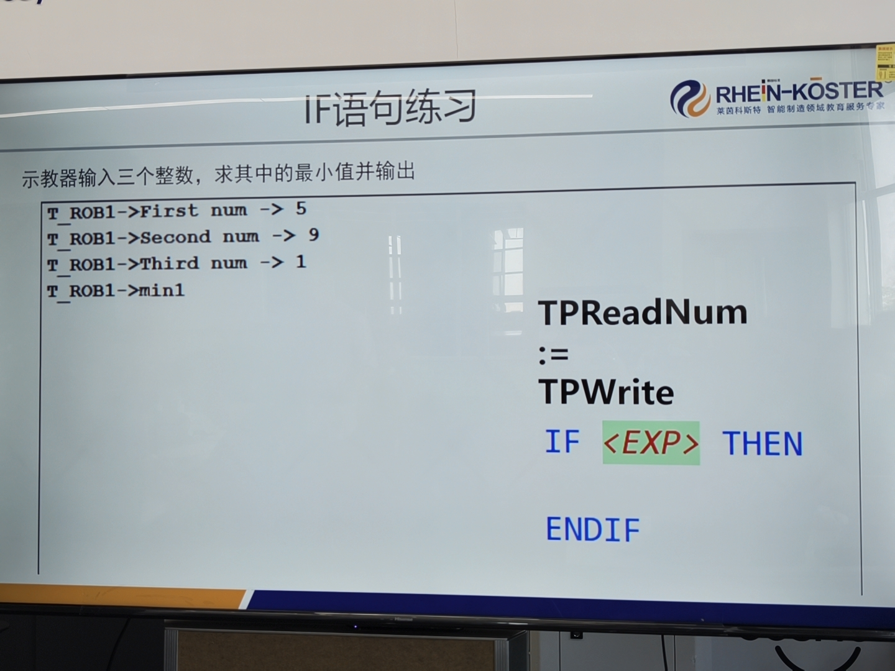

# 2026-09-15 · IF 语句练习：输入三个整数求最小值

> **来源**：实操（示教器 FlexPendant，程序 `Module1/min_of_three`）+ 官方手册《RAPID 语言内核技术参考手册》（**IF 语句**、**简洁 IF 语句**、**保留字**、RAPID 对象的存储分配）。
> **练习要求**：**示教器输入三个整数，求其中的最小值并输出**。
> **指令提示**：`TPReadNum`（读入）、`:=`（赋值）、`TPWrite`（写出）、`IF <EXP> THEN` / `ENDIF`（条件判断）。
> **本日成果**：用**擂台法 + 两条 IF** 求出最小值；并**亲手验证了"注释里也不能写中文"**（中文注释被替换成 `?`）。



## 一、程序（整理版：注释已改为英文）

> 控制器里保存的是同一段代码，但中文注释存入后已变成 `?`（见第四节）；下面按最终英文注释整理，逻辑未改。

```rapid
	PROC min_of_three()
		VAR num num1;
		VAR num num2;
		VAR num num3;
		VAR num min1;              ! holds the minimum
		VAR num key;
		TPErase;
		TPReadNum num1,"First num ->";
		TPReadNum num2,"Second num ->";
		TPReadNum num3,"Third num ->";
		min1:=num1;                ! (1) assume the first is smallest
		IF num2<min1 THEN
			min1:=num2;            ! (2) replace if smaller
		ENDIF
		IF num3<min1 THEN
			min1:=num3;            ! (3) replace if smaller
		ENDIF
		TPWrite "min"\Num:=min1;   ! output the minimum
		TPReadFK key,"Min found. Press OK to finish","","","","OK","";
	ENDPROC
```

## 二、★ 核心思路：擂台法（打擂）

求最值最常用的套路——**先立一个"擂主"，再让后面的数挨个来挑战**：

```
min1 := num1               ← num1 先当擂主（假设它最小）
IF num2 < min1 → 换擂台      ← num2 来挑战，更小就上位
IF num3 < min1 → 换擂台      ← num3 来挑战
最后 min1 即最小值
```

**为什么不用嵌套 IF？**

| 写法 | 三个数 | 扩展到 N 个数 |
|------|--------|---------------|
| **擂台法** | 2 条 IF | **加一行 IF**，逻辑不变 |
| 嵌套 IF 逐个枚举 | 六种排列组合都要写 | 组合爆炸，无法维护 |

**要点**：**N 个数比较，只需要 N−1 次两两比较**。这个思路以后求最大值、找最大值下标都一样用。

## 三、IF 语句语法（手册确认）

《RAPID 语言内核技术参考手册》→「语句 → **IF 语句**」：

```
<if statement> ::= IF <conditional expression> THEN <statement list>
                   { ELSEIF <conditional expression> THEN <statement list> }
                   [ ELSE <statement list> ]
                   ENDIF
```

**手册例句**：
```rapid
IF counter > 100 THEN counter := 100;
ELSEIF counter < 0 THEN counter := 0;
ELSE counter := counter + 1;
ENDIF
```

要点：
- **`THEN` 与 `ENDIF` 必须成对**；`ELSEIF` / `ELSE` 可选；
- 条件表达式**从上到下依次求值**，**第一个为真的分支执行**，之后跳出；全都不为真才走 `ELSE`；
- **`IF` / `THEN` / `ELSE` / `ELSEIF` / `ENDIF` 都是保留字**（手册"保留字"页），**不能用作变量名或程序名**。

> ⚠️ **易错点：还有"简洁 IF 语句"**（手册 `doc57`）——`IF 条件 单条语句;`，**没有 `THEN`、没有 `ENDIF`**，只跟一条语句。
> 例：`IF ERRNO = escape1 GOTO next;`
> 看到别人这么写**不是漏写**，是另一种合法形式；但**多条语句必须用 `THEN … ENDIF`**。

## 四、★★ 亲手验证：注释里也不能写中文

### 1. 现象
本日在代码里加了**中文注释**（想标"先假设第一个数最小"之类），存进控制器后**全变成问号**：

```rapid
		! ?????                      ← 原本是中文注释
		min1:=num1;
		! ? ?????????                 ← 同上
		IF num2<min1 THEN
			min1:=num2;
			! ? ?????????
		ENDIF
```

### 2. 结论：**不只字符串，注释也不行**
上一日（`2026-09-15_人机交互指令练习`）验证的是 **`TPWrite`/`TPReadNum` 的字符串不能写中文**；**本次把这条规律扩展到了注释**——

> **RAPID 字符集是 ISO 8859-1（Latin-1），凡是"写进程序文本的字符"——字符串、注释——都只能用该字符集内的字符，汉语汉字一律被替换成 `?`。**

旁证（手册《RAPID 对象的存储分配》页开篇）：

> **"电脑或控制器上存储的所有 RAPID 程序均为 ASCII 格式。"**

程序文件确实是纯 ASCII（本次用工具校验过），汉字无处安放。

### 3. 结论
**字符串、注释、标识符都不能写中文**；完整对照表见《[人机交互指令练习](2026-09-15_人机交互指令练习.md)》第五节，此处不再重复。

> **记牢**：RAPID 代码里凡给人看的文字（字符串、注释）都用英文；中文界面只能靠 ScreenMaker。

## 五、运行效果（对照练习要求）

按题目示例输入 5、9、1：

| 练习要求的输出 | 实际显示 | 说明 |
|---------------|---------|------|
| `T_ROB1->First num -> 5` | 同 | `T_ROB1->` 为示教器自动加的任务名前缀 |
| `T_ROB1->Second num -> 9` | 同 | 第二次输入 |
| `T_ROB1->Third num -> 1` | 同 | 第三次输入 |
| `T_ROB1->min1` | 同 | 最小值 1 输出 |

✅ **求最小值功能正确**：输入 5 / 9 / 1，输出最小值 1。

## 六、要点串记

- **求最小值用"擂台法"**：先立擂主，逐个挑战，**N 个数只需 N−1 次比较**。
- **IF 结构**：`IF 条件 THEN … ENDIF`；需要多分支时加 `ELSEIF` / `ELSE`。
- **注意别和"简洁 IF"搞混**：`IF 条件 单条语句;`（无 `THEN`、无 `ENDIF`）。
- **`IF/THEN/ELSE/ELSEIF/ENDIF` 是保留字**，不能当变量名。
- **★ 注释也不能写中文**（本次亲手验证）——RAPID 是 ISO 8859-1 / ASCII，**提示和注释全用英文**。
- **末尾用 `TPReadFK` 停住**，便于看清输出结果（沿用同日"人机交互指令练习"的做法）。

## 参考工具链接

- 官方手册：`06_RAPID语言内核技术参考手册`——**IF 语句**（语法）、**简洁 IF 语句**、**保留字**、**字符集**、RAPID 对象的存储分配（"均为 ASCII 格式"）
- 官方手册：`02_RAPID指令函数数据类型`——`TPReadNum`、`TPWrite`、`TPReadFK`、`TPErase`
- 代码文件：`机器人实训\RAPID代码\MinOfThree_求最小值_0915.mod`
- 同日记录：[2026-09-15_人机交互指令练习.md](2026-09-15_人机交互指令练习.md)（交换两数，首次发现字符串不能写中文）、[2026-09-15_RAPID编程起步与同步机制.md](2026-09-15_RAPID编程起步与同步机制.md)
