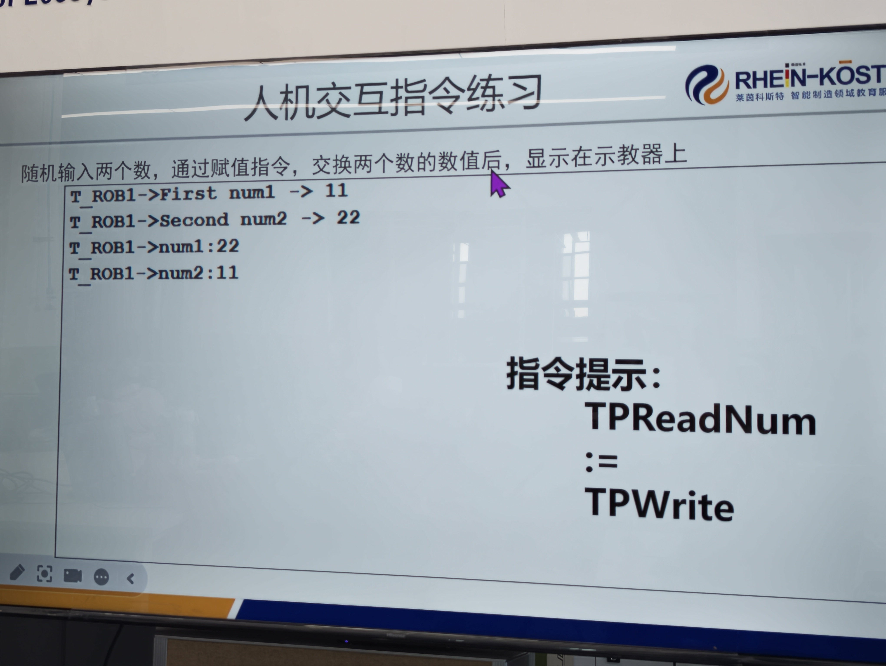

# 2026-09-15 · 人机交互指令练习：交换两个数（TPReadNum / := / TPWrite）

> **来源**：实操（示教器 FlexPendant，程序 `Module1/swap_num`）+ 官方手册《RAPID 指令、函数和数据类型》（`TPErase` / `TPReadNum` / `TPWrite` / `TPReadFK` / `WaitTime`）、《RAPID 语言内核技术参考手册》（**字符集**）。
> **练习要求**：**随机输入两个数 → 用赋值指令交换两个数的数值 → 显示在示教器上**。
> **指令提示**：`TPReadNum`（读入）、`:=`（赋值）、`TPWrite`（写出）。
> **本日成果**：完成交换程序，并解决了"显示完就没了"的停顿问题；同时**撞上 RAPID 不支持中文这条硬性限制**。



## 一、程序原文（示教器实际代码）

```rapid
	PROC swap_num()
		VAR num num1;
		VAR num num2;
		VAR num temp;
		VAR num key;
		TPErase;
		TPReadNum num1,"First num1 ->";
		TPReadNum num2,"Second num2 ->";
		temp:=num1;
		num1:=num2;
		num2:=temp;
		TPWrite "num1:"\Num:=num1;
		TPWrite "num2:"\Num:=num2;
		TPReadFK key,"Swap done. Press OK to finish","","","","OK","";
	ENDPROC
```

## 二、★ 核心：交换两个数为什么要"借第三个变量"

RAPID 的 `:=` 是**单值赋值**，**没有"一步交换"的写法**。如果直接写：

```rapid
num1 := num2;    ! ❌ 此时 num1 的原值已经丢了
num2 := num1;    ! 结果 num1 和 num2 都变成原 num2
```

**必须借一个临时变量 `temp`**：

```rapid
temp := num1;    ! ① 先把 num1 存起来（否则下一步就丢了）
num1 := num2;    ! ② num2 → num1
num2 := temp;    ! ③ 存起来的原值 → num2，交换完成
```

> 这和 C 语言里交换两个变量是**同一个道理**——三步走，中间必须有个中转。

## 三、各指令作用（含手册依据）

| 指令 | 类别 | 作用 | 语法要点 |
|------|------|------|---------|
| **`TPErase`** | 指令 | **清空示教器显示**，让后续文字从最上一行开始 | `TPErase;` 无参数 |
| **`TPReadNum`** | 指令 | 从示教器**数字键盘读入一个数**存进变量；程序**暂停等待输入** | `TPReadNum 变量, "提示文字";` |
| **`:=`** | 赋值操作符 | 把右边赋给左边（**不是函数**） | `num1 := num2;` |
| **`TPWrite`** | 指令 | 往示教器**写一行文字**，可同时带一个数值 | `TPWrite "文本" \Num := 变量;` |
| **`TPReadFK`** | 指令 | 显示文字 + **功能键**，**等你按键才继续** | 需连给 5 个功能键文本 |
| **`VAR num`** | 数据类型 | 声明**数值变量** | `VAR num num1;` |

**几个手册确认的细节**：
- **`TPReadNum` 是"指令"不是函数**——它不返回值，而是把输入塞进你给的变量。
- **`TPWrite` 的 `\Num` 会自动把数值接在文本后面**，不用手动转字符串；手册例：`TPWrite "No of produced parts="\Num:=reg1;` → 输出 `No of produced parts=5`。
- **数值是 6 位有效位**（手册原文），`1.141367` 会显示成 `1.14137`；整数不受影响。
- **`\Num` / `\Bool` / `\Pos` / `\Orient` / `\Dnum` 互斥**，一条指令只能用其中一个。

## 四、★ 停顿问题："显示完直接就没了"

### 1. 现象
`TPWrite` 写完两行结果，程序立刻结束，**来不及看清交换效果**。

### 2. 三个方案对比

| 方案 | 写法 | 效果 | 备注 |
|------|------|------|------|
| **`WaitTime`** | `WaitTime 5;` | 固定等 5 秒后继续 | ⚠️ **手动模式等待超 3 秒会弹"是否模拟"警告框**（手册明示） |
| **`TPReadFK`**（采用） | `TPReadFK key,"Swap done. Press OK to finish","","","","OK","";` | **停住等你按键** | ✅ 可控、不弹警告框 |
| `WaitDI` | `WaitDI di1, 1;` | 等外部输入信号 | 需要有外部按钮 |

**最终用 `TPReadFK`**——理由：① 按了才走，**看得够**；② 手动模式下**不触发模拟警告框**；③ 更贴合"人机交互"这个练习主题。

### 3. `TPReadFK` 参数怎么数（最容易错的地方）

`TPReadFK` 后面要**连给 5 个功能键文本**，对应示教器**最左到最右**的 5 个键：

```
TPReadFK key,"提示文字", [键1]  [键2]  [键3]  [键4]  [键5]
                        ""     ""     ""     "OK"   ""
```

- **不用的键填空字符串 `""`**（等价于预定义常量 `stEmpty`）；
- 手册例：`TPReadFK reg1, "More?", stEmpty, stEmpty, stEmpty, "Yes", "No";` → 显示 `More?`，把第 4、5 键设为 `Yes`/`No`，按下后 `reg1` 得到 4 或 5；
- **程序会一直停在这一行**，直到按下某个已启用的功能键。

## 五、★★ RAPID 不支持中文（字符集硬限制）

### 1. 现象
提示文字里写汉字，**存进去后全变成 `?`**：

```rapid
TPReadFK key, "????,???", "", "", "", "??", "";   ← 汉字被替换成问号
```

而**英文完好**（`"First num1 ->"`、`"num1:"`、`"num2:"` 都正常）。

### 2. 原因：手册明确规定
《RAPID 语言内核技术参考手册》→「词汇元素 → **字符集**」开篇第一句：

> **"RAPID 语言的语句采用标准 ISO 8859-1（Latin-1）字符集来构建。"**

ISO 8859-1 是**西欧字符集**——包含 `A-Z a-z 0-9` 及 `À Á Â … ß à á … ÿ` 等西欧重音字母，**一个汉字都没有**；超出范围的字符只能被替换。

### 3. 结论（可写能写对照）

| 能写 | 不能写 |
|------|--------|
| 英文字母、数字、标点 | **任何汉字**（变 `?`） |
| 西欧重音字母（ISO 8859-1 范围内，如 `é` `ü`） | 中文标点（`，` `。`） |

> **规律**：**凡 `TPWrite` / `TPReadNum` / `TPReadFK` 里的字符串，一律用英文。**
> 想在示教器上显示中文，得靠示教器界面定制（ScreenMaker），不是 RAPID 字符串能做到的。
> ——这也能解释为什么老师 PPT 上的输出全是英文（`First num1 -> 11`、`num1:22`）。

> **补充（同日后续验证）**：这条限制**不止字符串**——**注释里写中文也会变成 `?`**。详见 [2026-09-15_IF语句求最小值.md](2026-09-15_IF语句求最小值.md) 第四节。**结论：RAPID 代码里所有文字（字符串、注释）都用英文。**

### 4. 修正后的最终写法（全英文）

```rapid
	TPReadFK key,"Swap done. Press OK to finish","","","","OK","";
```

## 六、运行效果（对照练习要求）

| 练习要求的输出 | 实际显示 | 说明 |
|---------------|---------|------|
| `T_ROB1->First num1 -> 11` | 同 | `T_ROB1->` 是**示教器自动加的任务名前缀**，不是程序写的 |
| `T_ROB1->Second num2 -> 22` | 同 | 第二次读入 |
| `T_ROB1->num1:22` | 同 | **交换后** num1 变成原 num2 的值 |
| `T_ROB1->num2:11` | 同 | **交换后** num2 变成原 num1 的值 |

✅ **交换功能正确**：输入 11 / 22，输出 num1=22、num2=11。

## 七、要点串记

- **交换两数 = 三步赋值 + 一个临时变量**（RAPID 没有一步交换）。
- **`TPReadNum` 读入、`TPWrite` 输出、`:=` 赋值**：这就是练习给的三件套。
- **`TPWrite` 的 `\Num` 自动接数值**，数值 6 位有效位。
- **要"停住看清结果"→ 用 `TPReadFK`**（按了才走），比 `WaitTime` 好（不会弹手动模拟警告框）。
- **`TPReadFK` 要连给 5 个功能键文本**，不用的填空 `""`。
- **★ RAPID 字符集是 ISO 8859-1，不能写中文**——字符串一律用英文。
- **字符串、注释都能写英文**；但**标识符**（变量名/程序名）也只能用字母数字下划线。

## 参考工具链接

- 官方手册：`02_RAPID指令函数数据类型`——**`TPErase`**、**`TPReadNum`**、**`TPWrite`**、**`TPReadFK`**、`WaitTime`、`WaitDI`
- 官方手册：`06_RAPID语言内核技术参考手册`——**字符集**（ISO 8859-1 规定）、语法概述
- 代码文件：`机器人实训\RAPID代码\_历史版本\Module1_英文版含swap_0915.mod`（历史稿）、`SwapNum_交换两数_0915.mod`
- 同日记录：[2026-09-15_RAPID编程起步与同步机制.md](2026-09-15_RAPID编程起步与同步机制.md)
