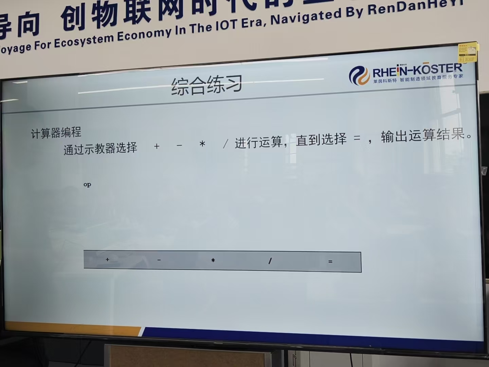

# 2026-09-16 · 综合练习：计算器编程（TEST 多分支）

> **来源**：实操（RobotStudio 6.08 虚拟控制器 `260913System1`，模块 `CalcEx`）+ 官方手册《RAPID 语言内核技术参考手册》（**Test 语句**、**While 语句**、保留字与预定义名限制）。
> **练习要求**：**通过示教器选择 `+` `-` `*` `/` 进行运算，直到选择 `=`，输出运算结果。**
> **本日成果**：这是本日的**综合练习**——把 0915 的人机交互指令、0916 的 WHILE 循环与**新学的 `TEST` 多分支**全部串起来；并**踩中并解决了"变量名 `num` 与预定义数据类型名冲突"**这个隐蔽的命名错误。



## 一、程序原文（控制器实际代码，模块 `CalcEx`）

```rapid
MODULE CalcEx
    PROC calc()
        VAR num result;
        VAR num operand;
        VAR num op;
        VAR num key;
        TPErase;
        TPReadNum result,"Num?";
        op:=0;
        WHILE op<>5 DO
            TPReadFK op,"Operator?","+","-","*","/","=";
            IF op<>5 THEN
                TPReadNum operand,"Num?";
                TEST op
                CASE 1:
                    result:=result+operand;
                CASE 2:
                    result:=result-operand;
                CASE 3:
                    result:=result*operand;
                CASE 4:
                    IF operand<>0 THEN
                        result:=result/operand;
                    ELSE
                        TPWrite "Div by zero";
                    ENDIF
                DEFAULT:
                    TPWrite "Illegal op";
                ENDTEST
            ENDIF
        ENDWHILE
        TPWrite "Result="\Num:=result;
    ENDPROC
ENDMODULE
```

> 说明：变量 `operand`（操作数）原写作 `num`，因**与预定义数据类型名冲突**而改名（详见第五节）。

## 二、★ 本日综合：这道题把所学全串起来了

| 用到的知识 | 来自哪天 |
|---|---|
| `TPReadNum`（输入数字）、`TPReadFK`（选运算符） | 0915 人机交互指令 |
| `WHILE` 循环（反复运算直到按 `=`） | **本日** WHILE 登录练习 |
| **`TEST…CASE`** 多分支（按运算符分流） | **本日新学** |
| 除零保护用 `IF` | 0915 IF 语句 |
| 数组、索引 | 本日数组练习（本题未用，但思路同源） |

**一句话**：**计算器 = 循环（反复输入）+ 多分支（按运算符分流）+ 人机交互（读入/输出）**。

## 三、★ 新知识点：`TEST` 语句（多分支）

**手册定义**（→ 语句 → **Test 语句**）：

```
<test statement> ::= TEST <expression>
                     { CASE <test value> { ',' <test value> } ':' <statement list> }
                     [ DEFAULT ':' <statement list> ]
                     ENDTEST
```

> **"test 语句将按表达式的值，对若干语句表中的一个语句表求值，或不对任何语句表求值。"**
> **"如果没有任何 case 子句与表达式吻合，那么将对可选默认子句求值。"**

**要点**：
| 特性 | 说明 |
|------|------|
| **测试值可以是多个** | `CASE 1, 2, 3:` —— 命中任一即执行 |
| **只执行第一个匹配的 CASE** | 手册："仅第一个测试值才会被识别" |
| **`DEFAULT` 可选** | 类似 `IF` 的 `ELSE`（兜底） |
| **以 `ENDTEST` 收尾** | 而 `IF` 是 `ENDIF` |
| 测试值类型必须与表达式类型一致 | 本题都是 `num` |

**`TEST` 与 `IF…ELSEIF` 的分工**：

| | `IF…ELSEIF…ELSE` | **`TEST…CASE…DEFAULT`** |
|---|---|---|
| 判断方式 | 每个分支写**条件表达式**（`x>5`、`a AND b`） | 拿一个**值**去和 `CASE` 常量**相等比较** |
| 适合 | **区间、复杂条件** | **按值分类**（编号 1/2/3/4） |
| 可读性 | 分支多时啰嗦 | **值分流更清晰** |

**本题为什么用 TEST**：`op` 是 1~5 的按键编号，属于"**按值分流**"。若用 IF 写，要写成：
```rapid
IF op=1 THEN ... ELSEIF op=2 THEN ... ELSEIF op=3 THEN ... ELSEIF op=4 THEN ... ELSE ... ENDIF
```
—— 远不如 `TEST op / CASE 1: / CASE 2: …` 清晰。

## 四、三个设计要点

### 1. 循环条件 `op<>5`，`=` 键当退出信号

```rapid
op:=0;                        ← ① 先给初值（VAR num 默认 0，显式写更清楚）
WHILE op<>5 DO                ← ② op 不是 5（没按 "="）就继续
    TPReadFK op,"Operator?","+","-","*","/","=";
    IF op<>5 THEN             ← ③ 按了 "=" 就跳过运算
        ...运算...
    ENDIF
ENDWHILE
```

**为什么要显式写 `op:=0`**：`VAR num` 的默认初值就是 0，不写也能跑；显式赋值是为了让"还没按键时先按 0 处理"的意图清楚。

**为什么 `IF op<>5` 不能省**：按了 `=` 之后，**不该再让你输数字、也不该再做运算**——所以运算部分要用 `IF` 包起来。**这是本题最容易漏的地方。**

### 2. 五个键位对应五种操作（`TPReadFK` 返回值 = 键号）

```rapid
TPReadFK op,"Operator?","+","-","*","/","=";
!                        键1 键2 键3 键4 键5
```
所以：**1=加、2=减、3=乘、4=除、5=等号** —— 直接拿 `op` 去 `CASE`。

### 3. 除法必须防"除以零"

```rapid
CASE 4:
    IF operand<>0 THEN
        result:=result/operand;
    ELSE
        TPWrite "Div by zero";
    ENDIF
```

**不加这层保护，除以 0 会直接报错停机。** 这是计算器程序的标准防护。

（`DEFAULT` 分支兜住 `op` 为其他值的意外情况。）

## 五、★★ 踩坑记录：变量名 `num` 与预定义数据类型名冲突

### 1. 现象
程序写入后报**语法/语义错误**，无法运行。出错的是这一行：

```rapid
VAR num num;        ← ❌ 用数据类型名 `num` 当变量名
```

### 2. 根因
`VAR num num;` 读作"**声明一个类型为 `num`、名字叫 `num` 的变量**"——**变量名和类型名撞了**。
（类比 C 语言里写 `int int;`，必然报错。）

**手册依据**（→ 词汇元素 → **保留字**，紧跟在保留字列表之后）：

> **"此外，还有许多预定义数据类型名称、系统数据、指令和有返回值程序也不能用作标识符。"**

而 `num` 正是 **RAPID 的预定义数据类型名**。

### 3. 解决
**改名成 `operand`（操作数）**，逻辑一律不动：

| 原写法 | 改后 |
|--------|------|
| `VAR num num;` | `VAR num operand;` |
| `TPReadNum num,"Num?";` | `TPReadNum operand,"Num?";` |
| `result:=result+num;` | `result:=result+operand;` |
| （其余减法/乘法/除法/除零判断同理，共 7 处） | |

> 实操时可用 RAPID 选项卡的**查找和替换**，把 `num` 整体替换成 `operand`，比逐行改快。

### 4. ★ RAPID 命名的"三大禁区"（重要规律）

| 禁区 | 例子 |
|------|------|
| **保留字** | `IF` `THEN` `WHILE` `FOR` `MOD` `DIV` `STEP` `AND` `OR` `NOT` `CASE` `TEST`… |
| **★ 预定义数据类型名** | **`num`** `bool` `string` `pos` `robtarget` `tooldata` `wobjdata` `speeddata` `zonedata`… |
| **预定义指令/函数名** | `MoveL` `TPWrite` `Offs` `Set` `Reset` `WaitTime`… |

**安全做法**：变量名**加前后缀**或用**更明确的词**，例如 `operand`、`numInput`、`val`、`myResult` —— 就不会撞。

> 这与 0915 那条"**`STEP` 是保留字不能当变量名**"是**同一类问题**，只是这次撞的是"**数据类型名**"而不是"关键字"。

## 六、两个小提醒

**① 提示文字全英文** —— `"Num?"`、`"Operator?"`、`"Result="`、`"Div by zero"`（RAPID 是 ISO 8859-1，汉字会变 `?`）。

**② 结尾建议加 `TPReadFK` 停住** —— 原程序最后只有 `TPWrite "Result="`，**结果显示后程序立即结束、看不清**（0915 遇到过的"显示完就没了"问题）。建议补一行：
```rapid
TPReadFK key,"Done. Press OK to finish","","","","OK","";
```

## 七、运行示例

```
Num?        → 10
Operator?   → +      (键1)     result = 10+5 = 15
Num?        → 5
Operator?   → *      (键3)     result = 15*2 = 30
Num?        → 2
Operator?   → =      (键5)     ← 退出循环
Result=30
```

## 八、要点串记

- **`TEST` 多分支**：`TEST 表达式 / CASE 值: / DEFAULT: / ENDTEST`，**适合按值分流**（区间用 `IF`）。
- **`CASE` 可写多个值**（`CASE 1,2,3:`），**只执行第一个匹配**，`DEFAULT` 可选。
- **循环 + 多分支 = 交互式计算器**：循环负责反复输入，`TEST` 负责按运算符分流。
- **循环退出用"条件变量"**（`op<>5`），不要用 `EXIT`（它会终止整个任务）。
- **★ 命名避开三大禁区**：保留字、**预定义数据类型名（`num` 等）**、预定义指令/函数名。
- **除法必须防零**，否则直接停机。
- **人机交互程序结尾加 `TPReadFK` 停住**，便于观察结果。

## 参考工具链接

- 官方手册：`06_RAPID语言内核技术参考手册`——**Test 语句**（语法与"只执行第一个匹配的 CASE"）、**While 语句**、**保留字**（含"预定义数据类型名称不能用做标识符"）、占位符
- 官方手册：`02_RAPID指令函数数据类型`——`TPReadNum`、`TPReadFK`、`TPWrite`、`TPErase`、`num` 数据类型
- 代码文件：`机器人实训\RAPID代码\CalcEx_计算器_0916.mod`
- 同日记录：[2026-09-16_WHILE用户登录.md](2026-09-16_WHILE用户登录.md)、[2026-09-16_数组练习最值差.md](2026-09-16_数组练习最值差.md)、[2026-09-16_嵌套循环六个圆.md](2026-09-16_嵌套循环六个圆.md)
- 前日记录：[2026-09-15_IF借阅费计算.md](2026-09-15_IF借阅费计算.md)（IF 多分支 + TPReadFK 返回值用法）
