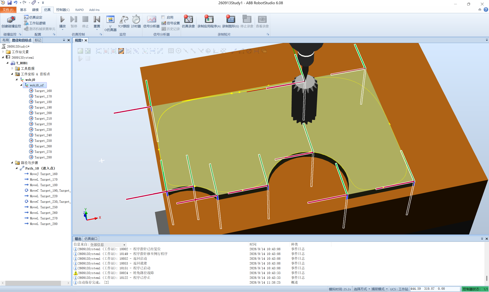

# 实习日记・Day 0913

> ⚠️ **免责声明**：本篇实习日志（及本仓库全部内容）为基于个人学习记录**由 AI 自主整合**的版本，**未经人工优化**，仅供学习内容参考；如照搬全抄造成课程成绩损失，概不负责。

> **实习时间**：2026 年 09 月 13 日（周日）
> **实习地点**：中德技师学院
> **实习方式**：机器人实训（ABB RobotStudio 6.08 · 虚拟控制器 `260913System1`）
> **实习主题**：**RobotStudio 入门与建站** → **RAPID 第一个程序** → **奇异点规避** → **工件轮廓初步遍历巡点（含坐标系一致性）**

---

## 一、实习内容

今天是**机器人实训的第一天**，从零起步，一路做到了"让机器人沿工件轮廓走一圈"。工作区见本仓库 `机器人实训\`，工作站 `%USERPROFILE%\Documents\RobotStudio\Solutions\260913Study1`（在工作区之外），虚拟控制器 `260913System1`（RobotWare 6.08.00.00），任务 `T_ROB1`。

### （一）RobotStudio 界面认识与工作站搭建

先熟悉功能区骨架（7 个选项卡）：**基本**（ABB 模型库、导入模型库、机器人系统、导入几何体、框架、目标点/路径）→ **建模**（Smart 组件、固体布尔运算、测量、创建机械装置/工具）→ **控制器**（系统生成器、配置编辑器、备份恢复、虚拟示教器）→ **RAPID**（同步、编辑代码、路径编辑器、测试与调试、程序指针）→ **仿真**（碰撞监控、事件管理器、I/O 仿真器、计时器、信号分析器）→ **Add-ins**。右侧竖排为**布局 / 路径和目标点 / 控制器 / 文档**四个浏览器。

**建站实操**——导入"四件套"模型并创建虚拟控制器：

| 对象 | 库文件 | 类型 |
|------|--------|------|
| 机器人 | `IRB1200_5_90_STD_02.rslib` | 机械装置（IRB 1200-5/0.9 Type B，5 kg / 0.9 m） |
| 工具 | `myTool.rslib` | 工具（数据名 `MyTool`） |
| 工件 | `Curve_Thing.rslib` | 几何体（待加工曲线零件） |
| 台面 | `propeller_table.rslib` | 几何体（显示为 `table_and_fixture_140`） |

再用 `基本 → 机器人系统 → 从布局创建系统` 生成虚拟控制器 `260913System1`（`RobotWare Base + Chinese + Drive System IRB 120/140/… + ADU-790A(X3/Y3/Z3) + Axis Calibration`）。


### （二）手动操纵（虚拟示教器）

在**控制器选项卡**调出虚拟示教器（FlexPendant），练习手动操纵：**手动/自动**切换、**使能键三档**（轻按上电、重按/松手急停）、**摇杆**控制各轴/TCP、**Hold To Run** 按住才允许运动。理解了"手动模式松手即停"这套安全设计。

### （三）RAPID 第一个程序：`Module1 / demo1 / MoveJ`

写出并运行了第一个 RAPID 程序：

```rapid
MODULE Module1
	CONST robtarget p10:=[[699.42,88.43,705.75],[0.190432,-0.061687,0.979687,0.0119907],[0,0,0,0],[9E+9,9E+9,9E+9,9E+9,9E+9,9E+9]];
	PROC demo1()
		MoveJ p10, v1000, z200, MyTool;
	ENDPROC
ENDMODULE
```

**解读**：`MoveJ` 的四个参数 = **去哪（`p10`）・多快（`v1000`=1000 mm/s）・怎么过渡（`z200`=200 mm 转弯区）・用什么工具（`MyTool`）**；`robtarget` 含**位置 trans / 姿态（四元数）rot / 轴配置 robconf / 外轴 extax** 四段（`9E+9` 表示不使用外轴）。工具数据 `MyTool` 在 `CalibData` 模块，TCP 相对法兰 z 向偏 229.6 mm。


### （四）★ 工件轮廓初步遍历巡点（本日重点成果）

**目标**：让工具尖端（TCP）**沿工件 `Curve_thing` 的轮廓走一圈**——把轮廓上的关键位置逐个示教成目标点，再用运动指令连成路径。轮廓上既有**直线边**，也有**两处圆弧（半圆）凸台**，所以路径里同时用到了 `MoveL` 和 `MoveC`。

**工作站里建成的路径 `Path_10（进入点）`**（导出的 RAPID）：

```rapid
PROC Path_10()
    MoveJ Target_160, v50, z100, MyTool\WObj:=wobj0;   ! 进入点（进刀）
    MoveL Target_170, v50, z100, MyTool\WObj:=wobj0;   ! ┐ 直段
    MoveL Target_180, v50, z100, MyTool\WObj:=wobj0;   ! ┘
    MoveC Target_190, Target_200, v50, z100, MyTool\WObj:=wobj0;  ! 圆弧1（圆点190→终点200）
    MoveL Target_220, v50, z100, MyTool\WObj:=wobj0;
    MoveC Target_230, Target_240, v50, z100, MyTool\WObj:=wobj0;  ! 圆弧2（圆点230→终点240）
    MoveL Target_250, v50, z100, MyTool\WObj:=wobj0;
    MoveL Target_260, v50, z100, MyTool\WObj:=wobj0;
    MoveL Target_270, v50, z100, MyTool\WObj:=wobj0;
    MoveL Target_280, v50, z100, MyTool\WObj:=wobj0;   ! 收回，位置与进入点相同
ENDPROC
```

**套路小结**：**第 1 条 `MoveJ` 进刀**（关节运动，快速安全到位，不要求轨迹形状）→ **中间 `MoveL`/`MoveC` 贴轮廓**（只有这两条要求"轨迹贴着轮廓"）→ **`MoveC CirPoint, ToPoint`** 由"上一句终点 + 圆周点 + 终点"三点定一段圆弧。



### （五）专题：如何避免奇异点报错

结合实操体会 + 官方手册《RAPID 语言概览》"奇异点"一节，总结了规避方法：

- **两类奇异点**：**臂奇异点** = 腕中心（轴 4/5/6 交点）落在轴 1 正上方；**腕奇异点** = 轴 4 与轴 6 共线（轴 5 = 0°）。串行无平行杆机器人（IRB 1200 属此类）还有第三类（腕中心与轴 2、轴 3 旋转中心共线）。
- **根本原因**：这些位置上"工具位置姿态 → 关节角"的解不唯一（无穷多解）。
- **规避第一招：多用 `MoveJ`（少用直线）**。手册原文：**"在关节插补期间，机械臂通过奇异点时，不会出现问题"**，而**"在线性插补期间，机器人无法通过奇异点"**；手册自己也建议"在 z 轴附近改为关节插补（MoveJ）"。`Path_10` 的**进刀段用 `MoveJ`** 正是这个道理。
- **规避第二招：适当偏移位置/姿态**。手册原话："为避免重新配置，应利用导致必须重新配置的方位**在奇异点另一侧设置第一个位置**"。
- **进阶**：`SingArea \Wrist`（允许工具方位微偏以避开腕奇异点）、`SingArea \LockAxis4`（锁轴 4）、接近时降低直线速度。

---

## 二、遇到的问题

1. **★ 各目标点选中/创建时必须"坐标系相同"**（本日最大难点）——否则**路径报错**，表现为**机器人实际无法到达的位置**。
   - **原因**：手册明确"所有目标点都与工作对象的对象框架相关；未指定其它工作对象时，目标点与默认的 `wobj0`（始终与机器人基座一致）关联"。**同一坐标数值挂在不同的工作对象下，代表的空间位置完全不同**，程序按各自框架解释就会走到"看似对、实际到不了"的位置。
   - **做法**：本项目所有目标点都建在**同一个工作对象 `wobj0`** 的对象框架（`wobj0_of`）下，且 `Path_10` 里 10 条指令**每条都写 `\WObj:=wobj0`**——两边一致，路径才成立。
   - **补充**：可达性还受**工具**和**轴配置（robconf）**影响（浏览器里分 未知/可达/用其他配置可达[黄]/不可达[红] 四档）。本项目 `Target_160` 与 `Target_280` 位置相同（752.961, 0, 473）但 `robconf` 不同（`[0,-1,0,0]` / `[0,0,0,0]`），就是"同一位置、不同构型"的实例。

2. **`50024 转角路径故障`**：运行路径时事件日志出现该报警（属**转角路径/指令时序**类，如程序未及时给出下一条运动指令、`zone` 偏大等；与"奇异点"是两码事）。另有 `63010` 几何导入警告（`Curve_Thing.rslib` 旧版 ACIS 兼容提示，不影响使用）。

3. **目标点姿态/配置不好手写**：`robtarget` 的 `rot` 是**四元数**、`robconf` 是象限配置，手算易错——正确做法是**在 RobotStudio 里示教/创建目标点、用"配置"对话框改配置**，由软件生成数值。

4. **奇点相关预留**：识别出"直线插补才会撞奇异点"，`MoveJ` 不受影响；后续做复杂轨迹时要提前判断。

---

## 三、收获与心得

1. **建立了 RobotStudio 的整体认识与建站流程**：**建站 → 导入模型 → 创建虚拟控制器 → 摆位示教 → 写程序 → 仿真/运行**。
2. **完成了从"单个点"到"一条轮廓路径"的跨越**：掌握 **`MoveJ` 进刀 + `MoveL`/`MoveC` 贴轮廓**的分工，以及 `MoveC` 的三点定圆弧写法（适用于直线边 + 圆弧凸台的零件轮廓）。
3. **抓住"两条一致性"这个命门**：
   - **坐标系一致**：目标点与运动指令必须引用**同一个工作对象**（`\WObj`），否则报错、目标点不可达；
   - **轴配置合理**：`robconf` 决定机器人用哪种构型到达，需要时可放开 `ConfL/ConfJ` 或改变目标方向来改善可达性。
4. **理解了奇异点为何与"直线"过不去**：直线插补要求 TCP 走笔直轨迹，手腕被迫大扭转，到奇异位置时关节点速/力矩超限 → 报错；**MoveJ 按关节最短路径走，天然避开**。
5. **学会用官方手册当"字典"**：安装目录自带 ABB 全套手册，已归档到工作区 ``、``，查指令/查参数直接看 HTML。

---

## 四、下一步计划

1. **把轮廓巡点做完整**：补全 `Target_210` 等遗漏点，让 `Path_10` 首尾闭合、真正把零件轮廓走满一圈。
2. **标定并使用工件坐标 `wobjdata`**：从"全用 `wobj0`"过渡到**自定义工件坐标**（三点法/工件坐标向导），理解它与 `wobj0` 的区别，为"换工件只改一个坐标系"打基础。
3. **消化 `MoveL/MoveC` 细节**：`v/z/fine` 对轨迹的影响、`MoveC` 圆弧点位置要求（宜放圆弧中间、误差最小）。
4. **系统排查可达性与报警**：用"测试可达性 / 执行移动指令 / 沿路径移动"逐段验证，减少 `50024` 这类运行期报警。
5. **整理归档**：把工作站与所用教学模型、路径代码一并归档进工作区。

---

## 附录：参考资料来源

* **官方手册**：`01_RobotStudio操作员手册`（坐标系、构建工作站、机器人编程、测试位置和动作、控制器、RAPID 选项卡）；`02_RAPID指令函数数据类型`（`MoveJ`/`MoveL`/`MoveC`/`SingArea`/`robtarget`/`tooldata`/`wobjdata`）；`07_RAPID语言概览技术参考手册`（**奇异点**一节）；`08_系统参数技术参考手册`（转角路径相关参数）。
* **随软件安装的素材**：`教学模型_TrainingObjects`（`myTool.rslib`、`Curve_Thing.rslib`、`propeller.rslib` 等）、`代码片段_CodeSnippets`、`RAPID文件模板_zh-CN`（均在 RobotStudio 安装目录下）。
* **本日学习记录（4 篇）**：`2026-09-13_RobotStudio环境与建站`、`2026-09-13_RAPID首个程序MoveJ`、`2026-09-13_奇异点规避`、`2026-09-13_轮廓巡点与坐标系一致`。
* **工作站文件**：`%USERPROFILE%\Documents\RobotStudio\Solutions\260913Study1`（`Stations\260913Study1.rsstn`、`Backups\260913System1_260913-161504`）；当日快照与 RAPID 源码归档在 `工作站归档\`。

> **时间备注**：轮廓巡点路径 `Path_10` 在 **09-13 16:15 的工作站快照中已经建成**；截图中显示的那次运行/`50024` 报警发生在 **09-14 10:43**（工作站自动保存 11:38）。即路径是 0913 建好的，报警发生在次日上午复跑时，记录时按实际时间留存以便日后对照。
