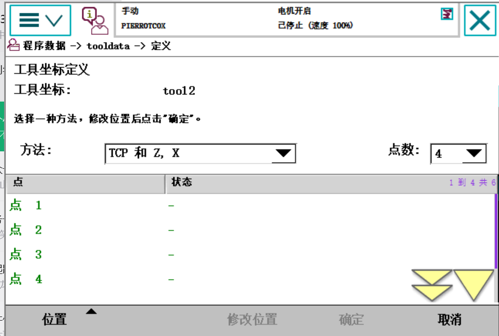
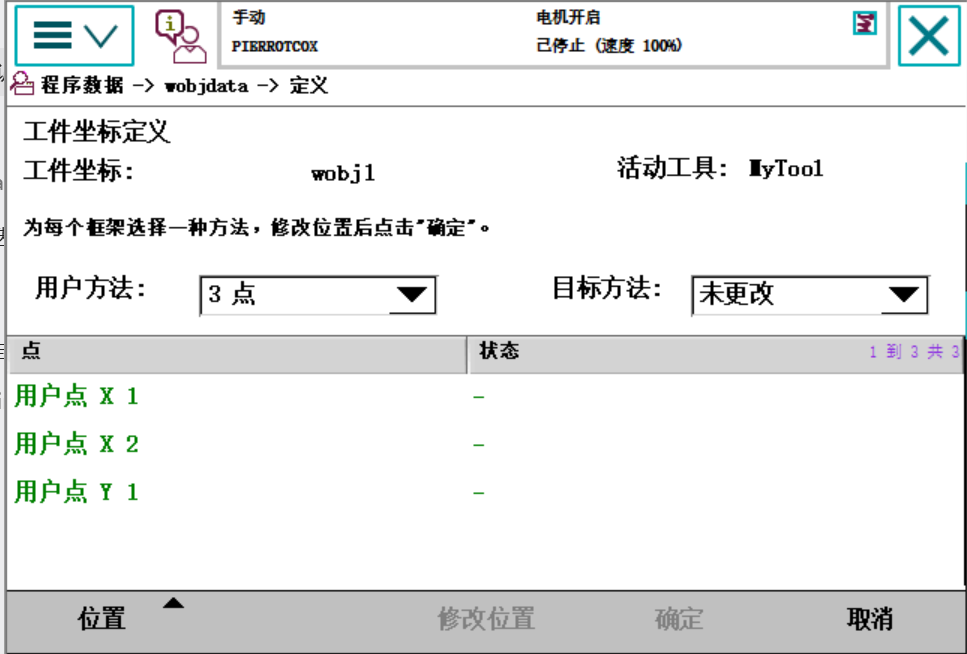
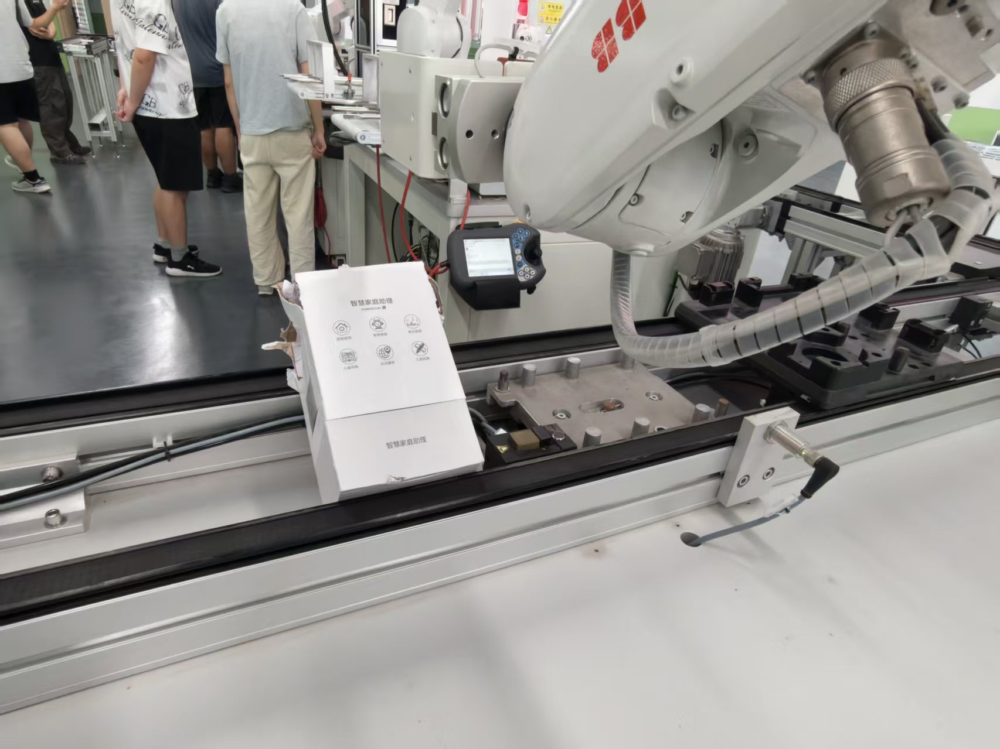
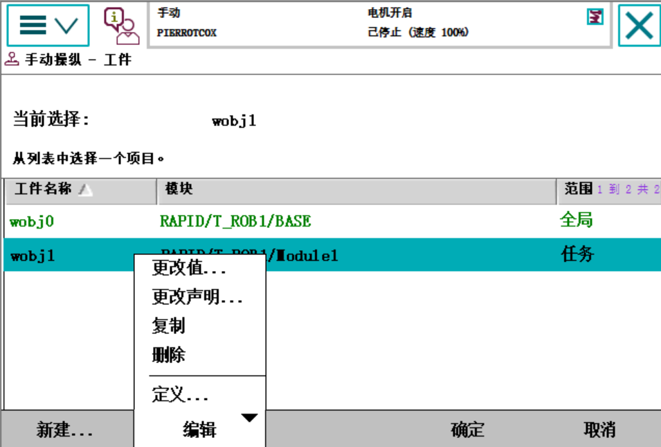
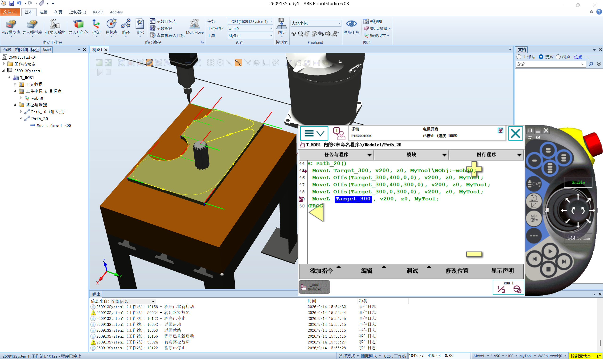

# 实习日记・Day 0914

> ⚠️ **免责声明**：本篇实习日志（及本仓库全部内容）为基于个人学习记录**由 AI 自主整合**的版本，**未经人工优化**，仅供学习内容参考；如照搬全抄造成课程成绩损失，概不负责。

> **实习时间**：2026 年 09 月 14 日（周一）
> **实习地点**：中德技师学院
> **实习方式**：机器人实训（**真机机械台** ABB + 示教器 FlexPendant；RobotStudio 6.08 离线工作站 `260913Study1` 复现）
> **实习主题**：**夹爪抓取与松开** → **工具坐标系 / 工件坐标系新建（含斜向平面）** → **`Offs` 偏移函数** → **真机完成机器操作** → **软件以 `Offs` 完成轮廓遍历**

---

## 一、实习内容

今天从"**让机器人动**"推进到"**让机器人干活**"：先学会控制夹爪完成**抓取/松开**，再学会**新建工具坐标系与工件坐标系**（把"在哪干活"标定出来），进而用 `Offs()` **生成轨迹**，最后**在真机上跑通作业**，并在**软件（离线编程）里以 `Offs` 为基础完成了轮廓遍历**。一整天是一条完整的作业链路。

### （一）夹爪抓取与松开（`Set` / `Reset` / `WaitTime`）

程序 `dh0914r1`（`T_ROB1/dh260914study1`）：

```rapid
MoveJ p10,  v100, z20, tool0;   ! 关节运动接近抓取区
MoveL p150, v100, z20, tool0;   ! 直线精确到抓取位
Reset D11_Gripper_Open;         ! 松开信号 置0
Reset D10_Gripper_Close;        ! 夹紧信号 置0
WaitTime 2;                     ! 等 2 s
Set   D10_Gripper_Close;        ! 夹紧信号 置1 → 抓取
WaitTime 2;                     ! 再等 2 s
MoveL p160, v200, z20, tool0;   ! 抓稳后搬运
MoveL p170, v200, z20, tool0;
MoveL p200, v200, z20, tool0;
MoveJ p210, v200, z20, tool0;
```

**两条要领**（老师强调、手册印证）：
1. **`Set` 之前要先 `Reset`（状态释放）**——先把两个信号都归零，让夹爪回到已知的松开态，避免上一步残留状态与本次冲突；
2. **`Set` 前后要有 `WaitTime`（给动作留时间）**——手册 `Set` 页原文：**"在信号获得其新值之前，存在短暂延迟"**，`Set`/`Reset` 执行完 ≠ 物理信号已变化，**程序不会等它**，所以要用 `WaitTime`。


### （二）工具坐标系与工件坐标系的新建

**① 工具坐标系**（`tooldata`，本次 `tool2`）——**基于"机器人安装平台"**（安装法兰 / `tool0`）：沿 `tool0` 的 X/Y/Z 量出"安装法兰 → TCP"的距离，方向靠延伸器点定。方法选 **`TCP 和 Z, X`**、点数 **4**。工具数据 `tload` 里 `mass=1 kg`、`cog=[100,0,0]`。



**② 工件坐标系**（`wobjdata`，本次 `wobj1`）——**基于"所需面的两条相交垂线"**：X 轴由 **X1–X2** 两点定、Y 轴由 **Y1** 一点定，**交点即原点**（手册："x 轴将通过点 X1-X2，y 轴通过 Y1"，且 X1-X2 越远越准）。定义时须**激活正确的工具**（本次"活动工具 = `MyTool`"）。



### （三）★ 斜向平面上的工件坐标系（两条要领）

工件是包装盒**倾斜的顶面**（不水平、不与轴对齐），只能**在斜面上取点**建立坐标系。



- **★ 要领一：范围必须选「全局」，切换才生效。** 手册把"范围"分三档——**全局（所有任务可用）/ 本地（仅模块内）/ 任务（仅任务内）**，且明确要求"工件都应该是程序中的全局变量"。本次 `wobj1` 建成时是"任务"，**切换不生效**，改成**「全局」**后正常（改的入口：选中 → `编辑 → 更改声明`）。
- **★ 要领二：Z 轴方向要朝外，避免卡机器。** 工件坐标系的 **Z 轴 = 表面法线**，而进/退刀多沿 Z 走；Z 朝里就会**顶进材料、撞夹具、卡机器**。



### （四）`Offs()` 偏移函数

`Offs(参考点, ΔX, ΔY, ΔZ)` 是**函数**（返回 `robtarget`），**本身不产生运动**；偏移量**沿工件坐标系方向**（手册原文），只改位置、不改姿态。先在小程序 `block` 里试用：

```rapid
PROC block()
    MoveJ p40, v200, z50, MyTool;                   ! 先到基准点 p40
    MoveL Offs(p40, 0, 100, 0), v200, z50, MyTool;  ! 走到"p40 沿 Y 偏 100 mm"的点
ENDPROC
```

### （五）完成机器操作：真机上走矩形轨迹

程序 `dh0914r2`（真机）——**一个基准点 + 四个 `Offs` = 闭合矩形**（300 × 120）：

```rapid
PROC dh0914r2()
    MoveJ p260, v200, z50, tool0;
    MoveL Offs(p260, -300, 0,   0), v200, z50, tool0;
    MoveL Offs(p260, -300, 0, -120), v200, z50, tool0;
    MoveL Offs(p260,    0, 0, -120), v200, z50, tool0;
    MoveJ p260, v200, z50, tool0;
ENDPROC
```


### （六）软件以 `Offs` 完成轮廓遍历

回到离线工作站 `260913Study1`，用同样思路**只示教一个点** `Target_300`，靠 `Offs` 走出 **400 × 300 的闭合矩形轮廓** `Path_20`：

```rapid
PROC Path_20()
    MoveL Target_300,                  v200, z0, MyTool\WObj:=wobj0;
    MoveL Offs(Target_300, 400,   0, 0), v200, z0, MyTool;
    MoveL Offs(Target_300, 400, 300, 0), v200, z0, MyTool;
    MoveL Offs(Target_300,   0, 300, 0), v200, z0, MyTool;
    MoveL Target_300,                  v200, z0, MyTool;
ENDPROC
```



> **与 0913 的 `Path_10` 对比**：`Path_10` 是**沿轮廓逐个示教**（`Target_160…280`）、用 `z100` 圆滑过渡；`Path_20` 是**只示教 1 个点、其余靠 `Offs` 算**，且用 **`z0`（0.3 mm，近乎精确停）** 所以**角是尖的**——**规则形状靠算、任意轮廓靠示教**。

---

## 二、遇到的问题

1. **★ 工件坐标系"范围"选错导致切换不生效**：`wobj1` 建成了**"任务"**，切换（激活）时不生效；改成**「全局」**后才正常。手册要求工件/工具应为全局。→ 入口：`编辑 → 更改声明`。
2. **★ Z 轴方向不当有卡机器风险**：工件坐标系 Z 轴即表面法线，若朝工件内部，进/退刀会顶进材料、撞夹具 → 取点后必须**检查 Z 轴朝外**。
3. **`Set`/`Reset` 后信号未立即生效**：`Set` 执行完不等于硬件已动作（手册明说"存在短暂延迟"），因此**必须用 `WaitTime` 等**；更严谨可用 `SetDO 信号,\Sync` 等信号真正到值。
4. **信号名辨识**：示教器照片分辨率有限，信号名（`D10/D11` 或 `DI0/DI1`）不能完全确认，记录时已标注待核。
5. **`50024 转角路径故障`仍出现**（软件运行 `Path_20`，`2026/9/14 15:55:27`）：属**转角路径/指令时序**类问题（`z0` 近乎精确停 + 连续短段指令易触发），与"奇异点"是两码事。
6. **`Offs` 的方向容易搞混**：偏移量**沿工件坐标系**而非大地坐标，`\WObj` 一换方向就变。

---

## 三、收获与心得

1. **完成了"从会动到会干活"的跨越**：今天的链路是 **动作能力（夹爪 `Set`/`Reset`）→ 定位基准（工具/工件坐标系）→ 轨迹生成（`Offs`）→ 真机作业（矩形轨迹）→ 离线轮廓遍历**，环环相扣。
2. **掌握了夹爪时序的规范写法**：**`Move 到位 → Reset 归零 → WaitTime → Set 动作 → WaitTime → Move 离开`**；理解了"**信号生效有延迟**"这个根本原因。
3. **学会两类坐标系的新建方法**：工具坐标系**基于机器人安装平台**量 TCP（`TCP&Z,X` + 4 点）；工件坐标系**基于所需面两条相交垂线**（X1–X2 定 X 轴、Y1 定 Y 轴，交点即原点）。斜面作业必须先建工件坐标系，后续**沿 Z 轴进退刀就等价于"垂直于工件表面"**。
4. **理解了"范围/作用域"的工程意义**：**工件/工具应为全局**，否则切换不生效、程序跨模块用不了。
5. **掌握了 `Offs` 这个"生成轨迹"的利器**：**一个基准点 + 若干偏移量**就能得到规则轮廓/阵列（免逐个示教）；并搞清了**小 `z`（`z0`=0.3 mm）走尖角、大 `z` 走圆滑**。
6. **体会到离线编程的价值**：先在**软件**里把轨迹调好（`Path_20`），再上**真机**跑（`dh0914r2`）——同一条思路在两处落地。
7. **延续了"坐标系一致性"这条主线**：从 0913 的"目标点必须同坐标系"，到今天的"工件坐标系切换要生效""`Offs` 沿工件坐标系偏移"，**坐标系始终是机器人编程的命门**。

---

## 四、下一步计划

1. **把工件坐标系真正用起来**：在斜向工件坐标系下编程 + `Offs` 做**沿法线的阵列/多行轨迹**（验证"坐标系一致"与"Z 轴朝外"两条要领）。
2. **攻克 `50024`**：分析"精确停 + 连续短段"为何触发，尝试 `fine`/调整 `zone`/`Prefetch Time` 等手段减少运行期报警。
3. **闭环一个完整任务**：**抓取 → 标定工件坐标 → `Offs` 生成轨迹 → 松手放置**（把今天分散的环节串成一条自动流程）。
4. **核对信号与范围**：确认夹爪信号的确切命名（`D10/D11` vs `DI0/DI1`）与工件/工具的**存储类型（持续变量）**设置。
5. **整理归档**：把工作站 `Path_20`、真机程序 `dh0914r1/r2` 与所用模型一并归档（已存工作站快照）。

---

## 附录：参考资料来源

* **官方手册**：`05_带FlexPendant的IRC5操作员手册`（定义工具框、编辑工具数据、创建/定义工件坐标系、新建数据实例与范围/存储类型）；`01_RobotStudio操作员手册`（工具数据、工件坐标、三点法创建框架、方向）；`02_RAPID指令函数数据类型`（**`Set` / `Reset` / `WaitTime` / `Offs` / `zonedata`** / `MoveL`/`MoveJ`/`MoveC` / `robtarget`/`tooldata`/`wobjdata`）；`07_RAPID语言概览技术参考手册`（RAPID 概述·数学：位置函数 `Offs`）。
* **工作站与源码**：`%USERPROFILE%\Documents\RobotStudio\Solutions\260913Study1`（`Stations\260913Study1.rsstn`；`Backups\260913System1_260914-155743\...\Module1.mod`）；当日快照与源码归档在 `工作站归档\`（`Module1_0914含Path_20.mod`）。
* **本日学习记录（6 篇）**：`2026-09-14_夹爪抓取与松开`、`2026-09-14_工具与工件坐标系新建`、`2026-09-14_斜向平面工件坐标系`、`2026-09-14_Offs偏移函数`、`2026-09-14_真机Offs矩形轨迹`（原名"完成机器操作"）、`2026-09-14_软件轮廓遍历Offs`。
* **前一日**：`Day_0913_RobotStudio入门到轮廓巡点`（`Path_10` 逐个示教的轮廓巡点）。
* **真机程序**：`T_ROB1/dh260914study1` 下的 `dh0914r1`（夹爪）、`dh0914r2`（矩形轨迹）。

> **备注**：0914 的实训在**真机机械台**上进行（示教器 `dh260914study1`），本地工作站目录中无该真机工程，相关证据为**示教器与现场截图**；软件部分（`Path_20`）取自离线工作站 `260913Study1` 的实际源码。
