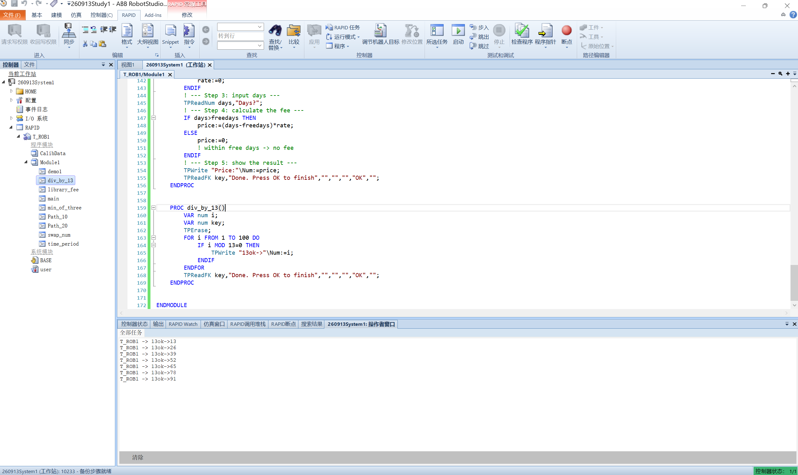

# 实习日记・Day 0915

> ⚠️ **免责声明**：本篇实习日志（及本仓库全部内容）为基于个人学习记录**由 AI 自主整合**的版本，**未经人工优化**，仅供学习内容参考；如照搬全抄造成课程成绩损失，概不负责。

> **实习时间**：2026 年 09 月 15 日（周二）
> **实习地点**：中德技师学院
> **实习方式**：机器人实训（ABB RobotStudio 6.08 · 虚拟控制器 `260913System1`）
> **实习主题**：**RAPID 编程入门** —— 程序结构与会话机制 → 人机交互指令 → **IF 分支** → **FOR 循环** → 循环画圆（仿真验证）

---

## 一、实习内容

今天开始学 **RAPID 编程**，是机器人实训从"操作"转向"编程"的转折点。全天完成 **1 个环境机制专题 + 6 个编程练习**（3 道 IF、2 道 FOR、1 道人机交互），并在**仿真中用 TCP 跟踪验证了轨迹**。原定下午的**实机三盒搬运**因**机器故障顺延到 0916**。

### （一）RAPID 编程起步：程序入口与"两层存储 + 同步"机制

严格说这块不算"编程"而是"环境"，但它先把两个大坑摊开了：

**1. 程序入口 `main`**
报错 `'T_ROB1'中的RAPID符号'main'未找到` —— RAPID 规定**每个任务有且仅有一个 `main`**，程序从它开始。当时模块里只有 `demo1`/`Path_10`/`Path_20`，**全任务都没有 `main`**，所以无法启动。

**2. 模块结构铁律**
一次把 `PROC main()` **粘到了 `MODULE` 前面**（模块外），连报三条语法错：
```
语法错误(135): 预期值 'module'
语法错误(137): 预期值为 'trap' ，但找到的是 'module'
语法错误(135): 预期值 'endtrap'
```
解析器读到模块外的 `PROC`，以为要写 `TRAP` 陷阱程序，往下找 `ENDTRAP` 就撞见 `MODULE`——**三条报错是同一处错误的连锁误判**。**正确结构：`MODULE` 开头、`ENDMODULE` 收尾，所有 `PROC`/数据夹在中间。**

**3. ★ 两层存储 + 两个同步方向**

RAPID 程序**同时存在两个地方，各存各的**：

| | 软件侧（站点） | 示教器侧（控制器） |
|---|---|---|
| 存哪 | `Stations\260913Study1.rsstn`（结构化对象图） | `Systems\...\INTERNAL\RAPID\PRG1\`（纯文本 RAPID） |
| 面向 | 离线编程（路径/目标点） | 真机/仿真运行 |

靠**手动同步**对齐，**方向反了就是旧版覆盖新版**：

| 按钮 | 方向 | 谁覆盖谁 | 何时用 |
|------|------|---------|--------|
| **同步到 RAPID** | 工作站 → 控制器 | **软件赢** | 在软件里改了图形对象后 |
| **同步到工作站** | 控制器 → 工作站 | **控制器赢** | **在示教器/RAPID 编辑器里敲了代码后** |

> 今天**实际踩了这个坑**：在示教器写完代码却点了「同步到 RAPID」，**软件里的旧版把控制器的新版顶掉了**。
> **教训：改代码 → 同步到工作站；改图形 → 同步到 RAPID。**


### （二）人机交互指令练习：交换两个数

**要求**：随机输入两个数 → 用赋值指令交换 → 显示在示教器上。指令提示 `TPReadNum` / `:=` / `TPWrite`。

**核心是"交换"**：RAPID 的 `:=` 是**单值赋值**，直接 `num1:=num2; num2:=num1;` 会让两者都变成原 `num2`。**必须借第三个临时变量**：

```rapid
	PROC swap_num()
		VAR num num1;
		VAR num num2;
		VAR num temp;
		VAR num key;
		TPErase;
		TPReadNum num1,"First num1 ->";
		TPReadNum num2,"Second num2 ->";
		temp:=num1;
		num1:=num2;
		num2:=temp;
		TPWrite "num1:"\Num:=num1;
		TPWrite "num2:"\Num:=num2;
		TPReadFK key,"Swap done. Press OK to finish","","","","OK","";
	ENDPROC
```

**验证**：输入 11 / 22 → 输出 `num1:22`、`num2:11` ✅

**★ 本日第一个重要发现：RAPID 不能写中文**
提示文字里写汉字，存进控制器后**全变成 `?`**：
```rapid
TPReadFK key, "????,???", "", "", "", "??", "";   ← 汉字被吞
```
**手册依据**（《RAPID 语言内核技术参考手册》→ 字符集）：
> **"RAPID 语言的语句采用标准 ISO 8859-1（Latin-1）字符集来构建。"**

ISO 8859-1 是**西欧字符集**，**一个汉字都没有**。→ **代码里的文字一律用英文。**

### （三）IF 语句练习（三道）

#### 1. 求三个数的最小值 —— 擂台法

```rapid
		min1:=num1;                    ! 先假设第一个最小（立擂主）
		IF num2<min1 THEN
			min1:=num2;                ! 更小就换
		ENDIF
		IF num3<min1 THEN
			min1:=num3;
		ENDIF
```

**为什么不用嵌套 IF**：三个数有 6 种排列组合，穷举很冗长。**擂台法只需 N−1 次比较**，扩展到 10 个数只是多加几行 IF，逻辑完全不变。

#### 2. 判断时间段 —— `ELSEIF` 多分支

**要求**：输入整数，0–5 凌晨 / 6–11 上午 / 12–17 下午 / 18–23 晚上 / 其他 NG。

```rapid
		IF timeval>=0 AND timeval<=5 THEN
			TPWrite "dawn";
		ELSEIF timeval>=6 AND timeval<=11 THEN
			TPWrite "morning";
		ELSEIF timeval>=12 AND timeval<=17 THEN
			TPWrite "afternoon";
		ELSEIF timeval>=18 AND timeval<=23 THEN
			TPWrite "evening";
		ELSE
			TPWrite "NG";
		ENDIF
```

**两个要点**：
- **区间必须两侧限** —— 用 `timeval >= 0 AND timeval <= 5`，**RAPID 不支持 `0 <= x <= 5` 的连写**（不是 Python）；
- **`ELSE` 兜底非法值** —— 输入 −5 或 100 时落到 `NG`，避免程序毫无反应。

> 手册对求值顺序的说明：**"条件表达式将连续进行求值，直至其中一个求值为真"**——即**第一个为真的分支执行完就跳出**，区间重叠时靠前的会"截胡"。

#### 3. 图书馆借阅费 —— `TPReadFK` + 参数与公式分离

**要求**：选书籍类型（`TPReadFK`）→ 输入天数（`TPReadNum`）→ 显示价格（`TPWrite`）。

| 类型 | 免费天数 | 超期费用/天 |
|------|---------|------------|
| 普通 | 14 | 0.5 |
| 热门 | 7 | 0.8 |
| 参考 | 3 | 1.2 |

**★ 关键：`TPReadFK` 的返回值就是"第几个键"**
手册原文：**"根据按下的键，返回数值 1..5 的变量。如果按下功能键 1，则返回 1，以此类推。"**
所以把三个书型放在第 1/2/3 个键位，返回值直接当类型号用：
```rapid
TPReadFK booktype,"Select book type","Normal","Popular","Reference","","";
!                           键1        键2        键3       键4 键5
```
（**5 个键位必须都写**，不用的填 `""`。）

**设计要点——"选参数"与"算结果"分离**：前面的 IF **只负责查出 `freedays` 和 `rate`**，最后**统一算一次** `price := (days-freedays)*rate`。这样**公式只有一份**，改费率只改数字。

**验证**：普通 10 天 → 10<14 → `0`；热门 10 天 → (10−7)×0.8 = `2.4`；参考 10 天 → (10−3)×1.2 = `8.4` ✅ 与题目例子一致。

### （四）FOR 循环练习（两道）

#### 1. 打印 1~100 内能被 13 整除的整数

```rapid
	PROC div_by_13()
		VAR num i;
		VAR num key;
		TPErase;
		FOR i FROM 1 TO 100 DO
			IF i MOD 13=0 THEN
				TPWrite "13ok->"\Num:=i;
			ENDIF
		ENDFOR
		TPReadFK key,"Done. Press OK to finish","","","","OK","";
	ENDPROC
```

**新学到 `MOD`（整数模运算）**——`i MOD 13 = 0` 即"能被 13 整除"。这也是**第一次把 FOR 循环 + IF 判断组合使用**。

**运行结果**（操作者窗口）：`13 / 26 / 39 / 52 / 65 / 78 / 91` 共 **7 个**，与预期一致 ✅

**★ 本日第二个新技能：不启动示教器直接运行程序**
打开**操作者窗口**（底部标签）即可看到 `TPWrite` 的文本输出，不用开虚拟示教器——提高调试效率。



#### 2. 画三个连续的圆（本日核心任务）

**要求**：半径 20 mm，圆心自定，画**三个连续的圆**（起点用 `Target_160`，XY 平面内），代码尽量 ≤10 行。

**先写出 9 行的展开版，再优化成 FOR 版（3 行）**：

```rapid
	PROC draw_circles()
		VAR num i;
		FOR i FROM 0 TO 2 DO
			MoveJ Offs(Target_160,i*40,0,0),v50,z0,MyTool\WObj:=wobj0;
			MoveC Offs(Target_160,i*40+20,-20,0),Offs(Target_160,i*40,-40,0),v50,z0,MyTool\WObj:=wobj0;
			MoveC Offs(Target_160,i*40-20,-20,0),Offs(Target_160,i*40,0,0),v50,z0,MyTool\WObj:=wobj0;
		ENDFOR
	ENDPROC
```

**两个关键认识**：
- **一个完整圆 = 2 个 `MoveC`**（`MoveC 圆上中间点, 终点`，起点是上一条指令的终点）→ 三个圆 = 6 段弧；
- **三个圆是纯平移关系**（每个右移 40mm = 2r，恰好相切）→ **正是循环的用武之地**，改 `TO` 的值就能改圆的数量。


**验证结果**：**TCP 跟踪截图显示三个红色圆相互相切、横向排列**，与题目提示图完全一致 ✅

---

## 二、遇到的问题

### 1. ★ 程序入口缺失（`main` 未找到）
全任务没有 `main` → 无法启动。**每个任务必须有且仅有一个 `main`**。

### 2. ★ 结构错误：`PROC` 写在 `MODULE` 外面
连报 3 条语法错（`预期值 module` / `预期值 trap` / `预期值 endtrap`）——**同一处错误的连锁误判**。正确结构：`MODULE`…`ENDMODULE` 夹住所有内容。

### 3. ★★ 同步方向反了 → 旧版覆盖新版
在示教器写完代码却点了「同步到 RAPID」→ **软件旧版把控制器新版顶掉**。
**规律：改代码 → 同步到工作站；改图形 → 同步到 RAPID。**

### 4. ★★ RAPID 不能写中文（字符串**和注释**都不行）
- 字符串里的汉字 → 变 `?`（人机交互练习时发现）
- **注释里的汉字 → 也变 `?`**（求最小值练习时发现，如 `! ?????`）
- 手册：**"RAPID 语言的语句采用标准 ISO 8859-1（Latin-1）字符集来构建"**，旁证：**"所有 RAPID 程序均为 ASCII 格式"**
- **结论：代码里的提示和注释一律用英文。**

### 5. ★ 带参数的例程不能作为程序入口（PP）
把 PP 设到 `PROC draw_circles(robtarget base)` 报错：
```
C004900F : Given routine is not a legal entry point.
Possible reasons are: routine is a function, or routine has parameters.
```
**规则：PP 只能指向无参数的过程**；带参数的例程/函数**只能被调用**。
（本次最后改用**两份无参例程**的方案，简单直接、可任意设 PP。）

### 6. 复制代码时漏声明 / 混用基准点
- 复制 FOR 版的循环体时**漏了 `VAR num i;` 和 `FOR...ENDFOR`** → "未声明的标识符"；
- 程序里 `MoveJ` 用 `Target_260`、`MoveC` 终点却用 `Target_160` → **画出来不是圆**（两点相距 105/63/65mm）。
- **`VAR` 声明与 `FOR…ENDFOR` 是一体的**；**一个程序里基准点必须统一**。

### 7. 改了"签名"却没改"函数体" → 静默错误
把 `PROC draw_circles()` 改成 `(robtarget base)` 后，**函数体里三行仍是 `Target_160`** → **不报错，但调用 `draw_circles(Target_260)` 仍画在 160 的位置**。**改参数要"签名 + 函数体"同步改。**

### 8. 视图面板被关掉
左侧"布局 / 路径和目标点"浏览器消失，界面只剩 3D 视图。
**恢复**：标题栏左侧**自定义快速访问 ⯆ → 窗口布局 → 默认布局**（手册《窗口布局》）。**面板只是被隐藏，数据不丢。**

### 9. 同名模块并存
`PRG1` 目录里出现**两个都叫 `MODULE Module1`** 的文件（新旧各一），是隐患——**同名模块并存会撞名**。

### 10. 实机任务因机器故障顺延
原定下午的**实机三盒搬运**（FOR 循环抓放）**因机器故障未能实操**，代码框架已备好，**顺延到 0916**（详见 `README.md` 第十节待办）。

---

## 三、收获与心得

1. **完成了从"操作"到"编程"的跨越**：0913–0914 是建站、手动操纵、示教轨迹；**今天开始真正写程序**——掌握了 `main` 入口、模块结构、变量声明、分支、循环。

2. **打通了"两层存储 + 双向同步"这个最反直觉的机制**：明白了**站点与控制器各存一份**、**不点同步就不会一致**、**方向反了就是旧版覆盖新版**。这条以后天天要用。

3. **掌握了 RAPID 的字符集硬限制**：**字符串和注释都不能写中文**（ISO 8859-1 / ASCII）——这是写代码的"底线规则"，两处踩坑才记牢。

4. **练熟了 IF 的两种用法**：
   - **独立 `IF`（擂台法）** —— 判断后**继续**，适合求最值、累积判断；
   - **`IF…ELSEIF…ELSE`** —— 判断后**分路**，适合按区间/类别分流。
   - 要点：**区间两侧限（用 `AND`）**、**`ELSE` 必须兜底**。

5. **掌握了 FOR 循环与其三个约束**（手册确认）：
   - **循环变量只读**（不能在循环内改）；
   - **`FROM/TO/STEP` 只求值一次**（循环次数开局定死）；
   - **`STEP` 是保留字**（不能当变量名）。
   - 价值：**把"重复动作"从 N 行压成 3 行**，且**改一个数字就能改规模**。

6. **学会了用 `Offs` 做"阵列式"轨迹**：一个基准点 + 循环变量算偏移 → 三个圆/多个盒子**不用逐个示教**。

7. **学会了用 TCP 跟踪让轨迹"显形"**：`Offs` 的目标点在图形里不可见，但**开通 TCP 跟踪后，TCP 实际走过的路径会留下彩色轨迹线**——这是"代码简洁"与"看得见结果"两全的办法。
   （前提：手册强调**"确保工作对象及程序所用工具均同步至工作站"**。）

8. **练出了排错的方法论**：
   - **看报错原文**（`C004900F` 直接说明了原因）；
   - **区分"语法错"与"静默错"**——后者（改了签名没改函数体）最难查；
   - **别靠"复制粘贴 + 局部修改"**，结构变了就整段替换；
   - **先跑通单个、再套循环**（调试顺序）。

---

## 四、下一步计划

1. **★ 完成 0916 实机三盒搬运**（本日顺延）：示教 `pPick`/`pPlace` → 单盒验证 → 套 FOR 循环。
   上机前必读结论见 `README.md` 第十节（含 `PERS` 与 `VAR` 的示教差异）。
2. **整理模块**：清理并存的旧 `Module1` 文件，避免同名冲突。
3. **继续 RAPID 进阶**：
   - 更多循环场景（While / 数组配合循环）；
   - **函数（`FUNC`）** 与带参数例程的用法（注意：**不能设 PP**）；
   - 错误处理（`ERROR` 处理程序）。
4. **把仿真与实机闭环**：先在软件验证轨迹，再上真机运行（离线编程的标准流程）。
5. **理顺同步习惯**：改代码后立即「同步到工作站」，改图形后立即「同步到 RAPID」，避免两边不一致。

---

## 附录：参考资料来源

* **官方手册**：`06_RAPID语言内核技术参考手册`（**字符集** ISO 8859-1、**语法概述**、模块/过程声明、**IF 语句**、**For 语句**、常量/变量/永久声明、初始化表）；`02_RAPID指令函数数据类型`（**`TPReadNum`**、**`TPWrite`**、**`TPReadFK`**、`TPErase`、**`Offs`**、**`zonedata`**、`MoveC`、`robtarget`）；`01_RobotStudio操作员手册`（**同步**、同步到工作站/RAPID、**TCP跟踪**、窗口布局、TrueMove 路径）。
* **代码文件**：`机器人实训\RAPID代码\`——`SwapNum_交换两数_0915.mod`、`MinOfThree_求最小值_0915.mod`、`TimePeriod_时间段判断_0915.mod`、`LibraryFee_借阅费_0915.mod`、`DivBy13_整除13_0915.mod`、`DrawCircles_画三个圆_0915.mod`、`DrawCirclesFor_画三个圆FOR版_0915.mod`、`DrawCircles260_基于Target260画圆_0915.mod`、`PickPlace_取放框架_0915.mod`（0916 待办）。
* **工作站归档**：`工作站归档\`——`Module1_0915含四个练习.mod`、`Module1_0915含swap与min.mod`、`Module1_0915含画圆FOR.mod`、`Module1_0915含两组画圆.mod` 等。
* **本日学习记录（8 篇）**：`2026-09-15_RAPID编程起步与同步机制`、`2026-09-15_人机交互指令练习`、`2026-09-15_IF语句求最小值`、`2026-09-15_IF时间段判断`、`2026-09-15_IF借阅费计算`、`2026-09-15_FOR循环整除13`、`2026-09-15_FOR循环画三个圆`、`2026-09-15_画圆拓展与编程易错点`。
* **前一日**：`Day_0914_抓取到Offs轮廓遍历`（夹爪抓取 → 坐标系 → `Offs` → 真机作业）。

> **备注**：本日全部练习均在**虚拟控制器**（RobotStudio 6.08）上完成，验证方式为**仿真 + TCP 跟踪 + 操作者窗口输出**。原定的实机操作因设备故障顺延。
