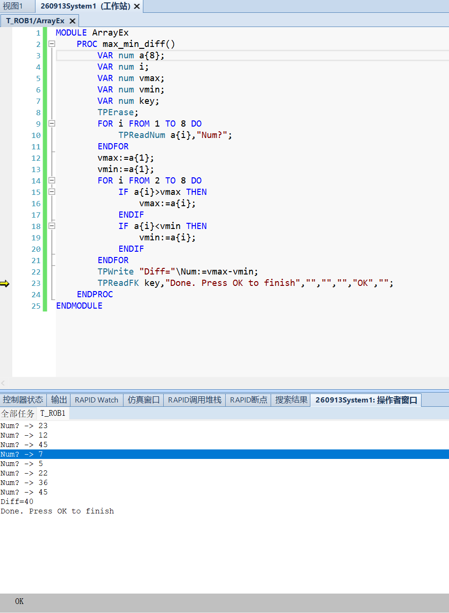
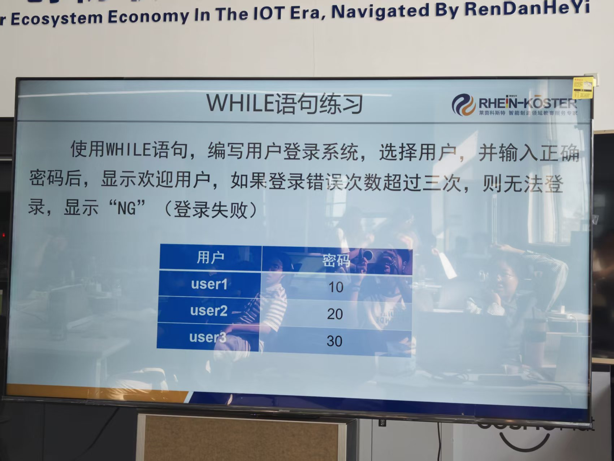

# 实习日记・Day 0916

> ⚠️ **免责声明**：本篇实习日志（及本仓库全部内容）为基于个人学习记录**由 AI 自主整合**的版本，**未经人工优化**，仅供学习内容参考；如照搬全抄造成课程成绩损失，概不负责。

> **实习时间**：2026 年 09 月 16 日（周三）
> **实习地点**：中德技师学院
> **实习方式**：机器人实训（ABB RobotStudio 6.08 · 虚拟控制器 `260913System1`）
> **实习主题**：**RAPID 编程进阶** —— 数组 → 嵌套循环 → WHILE 循环 → 综合练习（计算器）・**工程排错实战**

---

## 一、实习内容

今天在 0915 的基础上把 RAPID 编程推进了一大步：**数据结构从"单个变量"升到"数组"、循环从"单层"升到"嵌套"、语句从"FOR 定次"扩展到"WHILE 不定次"，最后用一个计算器把所学全部串起来**。全天完成 **4 个编程练习**，并处理了 **3 个工程层面的问题**（其中 `<SMT>` 占位符问题排查了较长时间）。

### （一）★ 工程排错：`<SMT>` 占位符导致的"找不到的错误"

**现象**：整个任务报 `40160 - RAPID 程序中存在错误`，并且**不能把程序指针移到任何例行程序**（"移动PP到光标: 由于语法错误所请求的操作被禁止"）。

**排查过程**：错误提示**只说"程序中存在错误"，不说在哪个模块**，所以先按"逐个模块结构配平"的方法逐个核对，最后定位到 `Test1` 模块：

```rapid
MODULE Test1
	PROC test0916()
		<SMT>          ← ❌ 就是这行
	ENDPROC
ENDMODULE
```

**根因**：`<SMT>` 是 **PPT / 手册里的"占位符"，不是真实代码**。

手册对占位符的定义（《RAPID 语言内核技术参考手册》→ 词汇元素 → **占位符**）：

> **"离线编程工具和在线编程工具可利用占位符来临时表示 RAPID 程序的'未定义'部分……RAPID 语言将识别下列占位符：**`<SMT>` **语句**、`<EXP>` **表达式**、`<ID>` **标识符**、`<DDN>` **数据声明**……"

而 0915 那道 IF 题的 PPT 骨架正是这样的：

```
IF <EXP> THEN
    <SMT>          ← 意思是"这里该填一条语句"
ELSEIF <EXP> THEN
    <SMT>
ELSE
    <SMT>
ENDIF
```

**`<SMT>` = `<simple statement>`（一条待填的简单语句）**，是**给你看的模板骨架**。而 RAPID 里 `<` `>` 是**比较运算符**，所以 `<SMT>` 会被解析成"小于 SMT 大于"——**语法错误**。

**解决**：删掉 `Test1` 模块（它只是个空壳）。

> **★ 教训**：**PPT / 手册里 `<XXX>` 尖括号的内容都是占位符，要替换成真实代码，不能照抄。**
> **★ 教训**：**报错是全任务级的** —— 任何一个模块里有一处语法错，**整个任务**都起不来。所以定位错误时**不能只看当前打开的那个模块**，要逐个核对。

**副产品**：排查过程中还澄清了两件事——① `CalibData` 的"文件名变了"（`000CF3EB` → `00112511`）是模块**删除后重建**导致的**内部 ID 变更**，内容一模一样，属正常现象；② 清理了又出现的**同名 `Module1`** 并存隐患。

### （二）数组练习：输入 8 个数求最大值与最小值的差

**要求**：通过示教器依次输入 8 个整数，输出最大值与最小值的差。

```rapid
MODULE ArrayEx
    PROC max_min_diff()
        VAR num a{8};
        VAR num i;
        VAR num vmax;
        VAR num vmin;
        VAR num key;
        TPErase;
        FOR i FROM 1 TO 8 DO
            TPReadNum a{i},"Num";
        ENDFOR
        vmax:=a{1};
        vmin:=a{1};
        FOR i FROM 2 TO 8 DO
            IF a{i}>vmax THEN
                vmax:=a{i};
            ENDIF
            IF a{i}<vmin THEN
                vmin:=a{i};
            ENDIF
        ENDFOR
        TPWrite "Diff="\Num:=vmax-vmin;
        TPReadFK key,"Done. Press OK to finish","","","","OK","";
    ENDPROC
ENDMODULE
```

**★ 关键点：RAPID 数组从索引 1 开始**（不是 0）。手册原文（《RAPID 语言内核技术参考手册》→ 表达式 → 变量）：

> **"索引表达式必须表示为一个大于0的整数值……索引值 1 是指选择数组的第一个元素。"**

所以 `VAR num a{8};` 的合法索引是 **`a{1}` ~ `a{8}`**，**没有 `a{0}`**；循环必须写 `FOR i FROM 1 TO 8`。
（**对习惯 C / Python 0 起索引的人，这是必须改掉的思维定式。**）

**算法：两趟循环 + 擂台法**
- 第一趟：读入 8 个数存进数组；
- 第二趟：**擂主取 `a{1}`、从 `a{2}` 开始挑战**，两个 `IF` **同时维护最大和最小**（比"跑两趟分别求最大/最小"省一半循环）。

**运行验证**（操作者窗口）：
```
Num? -> 23 / 12 / 45 / 7 / 5 / 22 / 36 / 45
Diff=40
```
最大 45、最小 5 → 45−5 = **40** ✅




### （三）嵌套循环：画六个圆（两排 × 每排三个）

**要求**：把 0915 的"三个连续的圆"扩充为**六个圆，分两排、每排三个**。

```rapid
    PROC draw_circles()
        VAR num i;
        VAR num j;
        FOR j FROM 0 TO 1 DO
            FOR i FROM 0 TO 2 DO
                MoveJ Offs(Target_160,i*40,j*40,0),v50,z0,MyTool\WObj:=wobj0;
                MoveC Offs(Target_160,i*40+20,j*40-20,0),Offs(Target_160,i*40,j*40-40,0),v50,z0,MyTool\WObj:=wobj0;
                MoveC Offs(Target_160,i*40-20,j*40-20,0),Offs(Target_160,i*40,j*40,0),v50,z0,MyTool\WObj:=wobj0;
            ENDFOR
        ENDFOR
    ENDPROC
```

**★ 核心：嵌套循环 = 二维阵列**

| | 0915（3 个圆） | **0916（6 个圆）** |
|---|---|---|
| 循环 | 一层 `FOR i` | **两层：`FOR j`（排）× `FOR i`（列）** |
| 位置 | `i*40` 只动 X | **X 用 `i*40`、Y 用 `j*40`** |
| 指令行数 | 3 行 | **仍是 3 行**（只多 2 行循环头尾） |

**六个圆没有复制代码** —— 只把每个点的 Y 坐标从常量 `0` 换成 `j*40`。

**几何自检**：横向圆心距 = 纵向圆心距 = **40 = 2r** → 六个圆**横纵都相切**。

**嵌套新增的两条注意**（0915 的三条 FOR 约束同样适用）：
- **两个循环变量必须不同名**（`i` 和 `j`）—— 否则内层会**同名隐藏**外层变量，逻辑就乱；
- **内外层变量都要声明**（漏一个就报"未声明的标识符"，0915 踩过）。

> ⚠️ **本项尚未获得运行后的轨迹确认**：代码已录入控制器，建议用 **TCP 跟踪**跑一次确认六个圆位置正确。
> 另注意 **第二排方向的符号**：本程序放在第一排的 `+Y` 侧（`j*40`）；若现场空间在 `−Y` 侧，需把 3 处 `j*40` 改成 `-j*40`。

### （四）WHILE 循环练习：用户登录系统

**要求**：选择用户并输入正确密码后显示欢迎信息；**错误次数超过三次则无法登录，显示 "NG"**。

| 用户 | 密码 |
|------|------|
| user1 | 10 |
| user2 | 20 |
| user3 | 30 |

```rapid
MODULE LoginEx
    PROC login()
        VAR num pwd{3};
        VAR num usr;
        VAR num input;
        VAR num tries;
        VAR bool ok;
        VAR num key;
        pwd{1}:=10;
        pwd{2}:=20;
        pwd{3}:=30;
        TPErase;
        TPReadFK usr,"Select user","user1","user2","user3","","";
        ok:=FALSE;
        tries:=0;
        WHILE ok=FALSE AND tries<3 DO
            TPReadNum input,"Password?";
            IF input=pwd{usr} THEN
                ok:=TRUE;
            ELSE
                tries:=tries+1;
            ENDIF
        ENDWHILE
        IF ok THEN
            TPWrite "Welcome user";
        ELSE
            TPWrite "NG";
        ENDIF
        TPReadFK key,"Done. Press OK to finish","","","","OK","";
    ENDPROC
ENDMODULE
```

**★ WHILE 语法**（手册《RAPID 语言内核技术参考手册》→ 语句 → **While 语句**）：

```
<while statement> ::= WHILE <conditional expression> DO <statement list> ENDWHILE
```

> **"只要指定的条件表达式求值为真，那么，while 语句将重复对语句表进行求值。"**
> **"将在每一新循环前，对条件表达式进行求值和核实。"**

**WHILE 与 FOR 的关键区别**：

| | FOR | **WHILE** |
|---|---|---|
| 循环次数 | 开局定死（`FROM/TO/STEP` 只求值一次） | **每轮重新判断**（可中途改变） |
| 适用 | 次数**已知** | 次数**不确定**（如"输入正确密码为止"） |

**★ 陷阱：不要用 `EXIT` 跳出循环！**

手册（语句 → **Exit 语句**）原文：

> **"exit 语句用于立即终止任务的执行。"**
> **"不像从任务的入口程序返回，利用 exit 语句进行任务终止，还将禁止系统自动重启任务的尝试。"**

**`EXIT` 会终止整个任务，不是"跳出循环"**——用它的话，程序直接结束，后面的 `TPWrite "NG"` 根本执行不到，甚至以后都不能自动重启任务。

**正确做法：用条件变量控制循环**（本程序的做法）：
```rapid
ok:=FALSE;                      ← 先假设没登录成功
WHILE ok=FALSE AND tries<3 DO   ← 两个条件都不满足才退出
    ...
    IF 密码正确 THEN ok:=TRUE;   ← 改条件变量 → 下一轮判断时自然退出
```

**三个设计要点**：
1. **循环条件用两个条件的 `AND`**（`ok=FALSE AND tries<3`）—— 任一不满足就退出，正好覆盖"成功"和"试错超限"两种结局。特意写成 `ok=FALSE` 而非 `NOT ok`，**避免 `NOT` 与 `AND` 的优先级歧义**。
2. **用数组存密码**（`pwd{3}`）—— 配合 `TPReadFK` 返回值（1/2/3），**`pwd{usr}` 一次取到对应密码**，不用写三段 IF。
3. **结局统一判断** —— 循环外一次 `IF` 看 `ok`，分别输出 `Welcome user` / `NG`；循环只负责"改状态"。



### （五）综合练习：计算器编程

**要求**：通过示教器选择 `+` `-` `*` `/` 进行运算，**直到选择 `=`，输出运算结果**。

```rapid
MODULE CalcEx
    PROC calc()
        VAR num result;
        VAR num operand;
        VAR num op;
        VAR num key;
        TPErase;
        TPReadNum result,"Num?";
        op:=0;
        WHILE op<>5 DO
            TPReadFK op,"Operator?","+","-","*","/","=";
            IF op<>5 THEN
                TPReadNum operand,"Num?";
                TEST op
                CASE 1:
                    result:=result+operand;
                CASE 2:
                    result:=result-operand;
                CASE 3:
                    result:=result*operand;
                CASE 4:
                    IF operand<>0 THEN
                        result:=result/operand;
                    ELSE
                        TPWrite "Div by zero";
                    ENDIF
                DEFAULT:
                    TPWrite "Illegal op";
                ENDTEST
            ENDIF
        ENDWHILE
        TPWrite "Result="\Num:=result;
    ENDPROC
ENDMODULE
```

**这道题把所学全部串起来了**：

| 用到 | 来自 |
|---|---|
| `TPReadNum`（输数字）、`TPReadFK`（选运算符） | 0915 人机交互 |
| `WHILE` 循环（反复运算直到 `=`） | 本日登录练习 |
| **`TEST...CASE`** 多分支（按运算符分流） | **本日新学** |
| 除零保护用 `IF` | 0915 IF |

**★ 新知识点：`TEST` 语句**（手册 → 语句 → **Test 语句**）：

```
<test statement> ::= TEST <expression>
                     { CASE <test value> { ',' <test value> } ':' <statement list> }
                     [ DEFAULT ':' <statement list> ]
                     ENDTEST
```

**`TEST` 与 `IF…ELSEIF` 的区别**：

| | `IF…ELSEIF…ELSE` | **`TEST…CASE…DEFAULT`** |
|---|---|---|
| 判断方式 | 每个分支写**条件表达式**（`x>5`） | 拿一个**值**去和 `CASE` 常量**比较** |
| 适合 | 区间、复杂条件 | **按值分类**（运算符编号 1/2/3/4） |
| 可读性 | 分支多时啰嗦 | **值分流更清晰** |

**要点**：`CASE` 可写多个值（`CASE 1, 2, 3:`）；**只执行第一个匹配的 CASE**；`DEFAULT` 可选（类似 `ELSE`）；以 `ENDTEST` 收尾。

**三个设计要点**：
1. **循环条件 `op<>5`，`=` 键（第 5 键）当退出信号**；`op:=0` 是**先给初值**（否则第一轮判断时 `op` 未定义）。
2. **按了 `=` 就不该再输数字/运算** —— 所以运算部分用 `IF op<>5` 包起来。**这是本题最容易漏的地方。**
3. **除法必须防"除以零"** —— 不加这层保护，除以 0 会直接报错停机。


---

## 二、遇到的问题

### 1. ★★ `<SMT>` 占位符被当成真实代码（本日最大排查项）
`Test1` 模块里写了 `<SMT>` → 整个任务报 `40160`、**无法移动程序指针**。
**根因**：`<SMT>` 是 PPT / 手册里的**占位符**（表示"待填一条语句"），不是可执行的代码。
**教训**：**PPT/手册里 `<XXX>` 尖括号内容都是占位符，要替换成真实代码**；且**报错是全任务级的**，定位时不能只看当前打开的模块。

### 2. ★★ 变量名 `num` 与预定义数据类型名冲突
计算器程序里写了 `VAR num num;` —— **用数据类型名 `num` 当变量名**，报错。
手册（保留字页）明确：

> **"还有许多预定义数据类型名称、系统数据、指令和有返回值程序也不能用作标识符。"**

`VAR num num;` 读作"声明一个类型为 `num`、名叫 `num` 的变量"——**名字和类型名撞了**（类比 C 语言的 `int int;`）。
**解决**：改名成 `operand`（操作数），改动 7 处。

### 3. 计算器结尾的"停住等按键"被删掉了
`CalcEx` 最后一行的 `TPReadFK key,...` 被删除，导致**结果显示后程序立即结束、看不清结果** —— 正是 0915 遇到过的"显示完就没了"问题。
**建议**：把结尾补回，便于观察 `Result=`。

### 4. `CalibData` 的"文件名变了"（虚惊一场）
`PRG1` 目录里 `CalibData` 的文件名从 `000CF3EB` 变成 `00112511`，像是"多了个文件"。
**真相**：模块**删除后重建**会给它分配**新的内部 ID**（文件名），**内容完全相同**（逐字节比对确认）。**正常现象，不用处理。**

### 5. 同名 `Module1` 又出现并存
`PRG1` 目录里出现两个都声明 `MODULE Module1` 的文件，是隐患。**已清理，现只剩一个。**

### 6. 六圆程序尚未做轨迹验证
代码已录入控制器，但**未用 TCP 跟踪确认**六个圆的位置与相切关系。

---

## 三、收获与心得

1. **掌握了 RAPID 数组**（本日新知识）：
   - **索引从 1 开始**（`a{1}`~`a{8}`），**没有 `a{0}`**；
   - 声明看维度（`VAR num a{8};`），**索引可以是变量**（`a{i}`），所以循环能统一处理数据；
   - **擂台法 + 循环 = 求任意多个数的最值**，这是从"写死几个变量"到"处理一批数据"的关键一步。

2. **掌握了嵌套循环**：
   - **外层管"排"、内层管"列"**，位置写成 `(i*dx, j*dy)`，就能实现**二维阵列**；
   - **六个圆仍是 3 行指令** —— 重复的结构用循环表达，而不是复制代码；
   - 嵌套要注意：**两循环变量不能同名**、**都要声明**。

3. **掌握了 WHILE 循环及其适用场景**：
   - 与 FOR 的分工：**次数已知用 FOR，次数未知用 WHILE**；
   - **每轮重新判断条件**，因此可以用条件变量**中途控制退出**。

4. **踩到并记住了 `EXIT` 的陷阱**：**`EXIT` 是"立即终止整个任务"，不是"跳出循环"** —— 想跳出循环要用**条件变量**。

5. **学会了 `TEST` 多分支语句**：
   - 语法 `TEST 表达式 / CASE 值: / DEFAULT: / ENDTEST`；
   - 适合**按值分流**（比多层 `IF…ELSEIF` 更清晰）；
   - 与 `IF` 的分工：**区间/复杂条件用 IF，值分类用 TEST**。

6. **理清了 RAPID 命名的"三大禁区"**：
   | 禁区 | 例子 |
   |---|---|
   | **保留字** | `IF` `THEN` `WHILE` `FOR` `MOD` `STEP` `AND` `OR` `NOT` |
   | **预定义数据类型名** | **`num`** `bool` `string` `pos` `robtarget` `tooldata` `wobjdata`… |
   | **预定义指令/函数名** | `MoveL` `TPWrite` `Offs` `Set` `Reset`… |
   → **安全做法：变量名加前后缀或用更明确的词**（如 `operand`、`numInput`、`val`）。

7. **学会了区分"占位符"和"真实代码"**：PPT / 手册的语法骨架里 `<SMT>`、`<EXP>`、`<ID>` 等**都是占位符**，要替换成真实内容才能运行。

8. **练出了"全任务级"排错的方法**：
   - **报错是整个任务的**，不看当前模块 → 要**逐个模块核对**；
   - **结构配平检查**（MODULE/PROC/IF/FOR/WHILE 是否成对）是快速定位手段；
   - **看手册的报错描述**往往直接给出原因（如 `40160` 的描述就说了"用程序编辑器中的'检查'程序检查 RAPID 错误"）。

---

## 四、下一步计划

1. **★ 补做 0916 实机"三盒搬运"**（0915 因机器故障顺延，本日仍未实操）：
   示教 `pPick`/`pPlace` → 单盒验证 → 套 FOR 循环。
   上机前必读结论见 `README.md` 第十节（`PERS` 与 `VAR` 的示教差异、无参例程可直接设 PP）。
2. **验证六圆轨迹**：用 TCP 跟踪确认六个圆的相切关系与位置。
3. **补全计算器**：把结尾的 `TPReadFK` 加回，便于观察结果。
4. **继续 RAPID 进阶**：
   - **函数（`FUNC`）** 与带参数例程（注意：**不能设 PP**）；
   - **错误处理**（`ERROR` 处理程序、`RAISE`/`RETRY`）；
   - `TEST` 与 `IF` 的更多组合场景。
5. **整理代码资产**：`RAPID代码\` 目录已有多个练习文件，可归类整理。
6. **理顺同步习惯**：改代码后立即「同步到工作站」，改图形后立即「同步到 RAPID」。

---

## 附录：参考资料来源

* **官方手册**：`06_RAPID语言内核技术参考手册`——**占位符**（`<SMT>`/`<EXP>` 定义）、**While 语句**、**Test 语句**、**Exit 语句**、**保留字**（含"预定义数据类型名称不能用做标识符"）、表达式·变量（数组索引从 1 起）、For 语句
* **官方手册**：`02_RAPID指令函数数据类型`——`TPReadNum`、`TPWrite`、`TPReadFK`、`TPErase`、`Offs`、`MoveC`、`num` 数据类型
* **代码文件**：`机器人实训\RAPID代码\`——`ArrayEx_数组最值差_0916.mod`、`DrawCircles6_六个圆两排_0916.mod`、`LoginEx_用户登录_0916.mod`、`CalcEx_计算器_0916.mod`
* **工作站归档**：`工作站归档\`——`ArrayEx_0916.mod`、`LoginEx_0916.mod`、`CalcEx_0916.mod`、`Module1_0916终版含六圆.mod`
* **本日学习记录**：`2026-09-16_数组练习最值差`、`2026-09-16_嵌套循环六个圆`
* **前一日**：`Day_0915_RAPID编程入门到循环画圆`（编程起步 → IF → FOR → 画圆）

> **备注**：本日全部练习均在**虚拟控制器**（RobotStudio 6.08）上完成，验证方式为**仿真 + 操作者窗口输出**。原定 0915 的实机操作因设备故障仍顺延。
