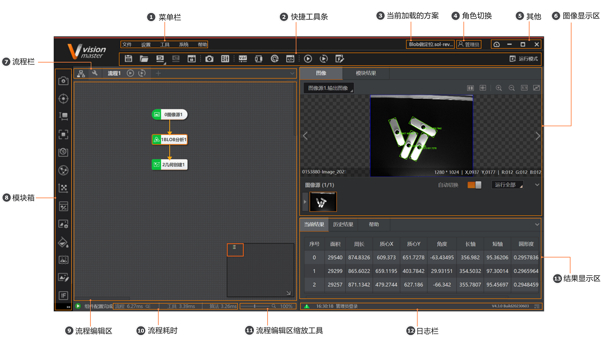
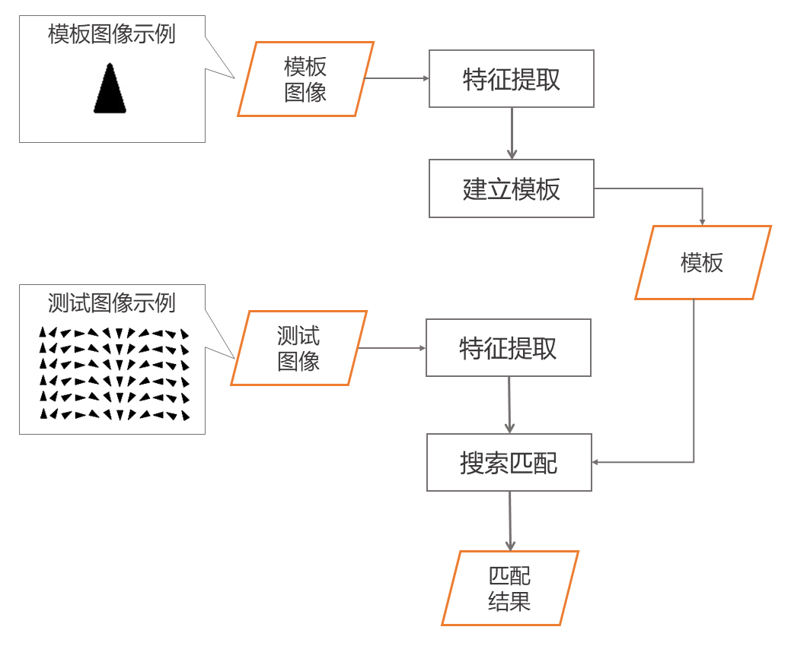
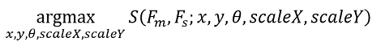

# VisionMaster 新手实操指南（带图蒸馏版）

> **文档来源**：从 VisionMaster 4.3.0 本地帮助系统 `Applications\Help\CH\`（257 个主题）蒸馏提炼。
> **面向对象**：零基础 -> 掌握"拍照-找物-检测"最基本流程。
> **配图**：图片用相对路径引用（`../../../配图/知识库配图/`），随本仓库整体拷贝，换机器也不会裂图。
> **配套课程**：配合 ZCode 实时讲解与答疑使用。
> 版本：V4.3.0（界面截图左下角 `V4.3.0 Build 20240901`）
>
> **编号说明**：本篇用"第 0~5 章"自成体系，对应知识库主线：**本篇 = 主线第 1 章（入门）**；本篇"第 2 章 让软件认出相机"对应主线第 2 章《采集》。阅读时不要把两套编号混用。

---

## 第 0 章 先看：VisionMaster 主界面长什么样

打开软件后（启动引导界面选任意方案类型，如"通用方案"），进入的就是这个主界面。**看懂这张图，你就知道东西都在哪。**



主界面共 **13 个区域**（对应图上 ①~⑬），对新手最重要的是这 4 个：

| 编号 | 区域 | 干什么 | 新手怎么用 |
|------|------|--------|-----------|
| ⑧ | **模块箱** | 存放所有能拖的"积木"（算子）：采集、定位、测量、识别、标定、缺陷检测、图像处理、逻辑工具、通信…… | **你所有能拖的算子都在这里**，要什么从这找 |
| ⑨ | **流程编辑区** | 把模块箱里的积木拖进来、排列、连线的地方 | 搭流程的操作台 |
| ⑥ | **图像显示区** | 流程跑完后，显示每一步处理后的图像和结果 | 看图像变化的地方 |
| ⑬ | **结果显示区** | 显示流程运行结果 + 历史结果 + 选中模块的说明 | 看数值结果（如"面积 29540"）的地方 |

> 图右下角显示了一个正在跑的流程：`图像源1 → BLOB分析1 → 几何创建1`，它就是"采集→分析→创建"的雏形，跟你以后搭的流程很像。

---

## 第 1 章 流程的起点：图像源（采图）

**任何流程的第一块积木永远是"采集"。** 对应模块箱里的 **`图像源`**（也常叫采集模块）。它的作用只有一个：**把图像"端"进流程里**。

### 1.1 图像源有 3 种图片来源

| 图像源选项 | 说明 | 何时用 |
|-----------|------|--------|
| **本地图像** | 从硬盘加载图片 | 调试阶段没相机，或测试算法时最常用 |
| **相机** | 从已配置的工业相机实时取图 | 真正上产线时 |
| **SDK** | 通过二次开发的 SDK 获取图像 | 你写代码集成时 |

### 1.2 关键参数（本地图像 / 相机模式下都要懂）

- **像素格式**：Mono8（灰度，常用值 `17301505`）或 RGB24（彩色，常用值 `35127316`）。
- **取图间隔**：连续加载两张图片的间隔时间。
- **显示图像名称**：开启后在图像显示区左下角显示图名。
- **图像缓存**：内存里最多缓存几张图。

> ✅ **给新手的建议**：还没接相机时，把"图像源"设为 **本地图像**，先拿一张测试图把流程跑通；等会连相机了再切到"相机"。

---

## 第 2 章 让软件认出相机的 3 步（关联相机）

如果你用的是工业相机（VisionMaster 用 MVS 采图，MVS 就是配套的海康相机 SDK），必须先把相机"关联"到图像源模块。**就这 3 步：**


1. **① 打开全局相机**：点快捷工具条的相机图标，进入"相机管理"。
2. **② 添加相机**：在"相机管理"窗口点 **+** 号，会列出线上所有相机，选中你的相机，点"确定"。（图中添加后变成"全局相机1"）
3. **③ 打开模块关联相机**：回到"0 图像源"模块的"基本参数"，把 **图像源** 下拉设为 **相机**，**关联相机** 选 **全局相机1**。

> 说明：连接相机前，官方建议**先用相机配套客户端（MVS 客户端）调试好图像**，确保曝光、清晰度达标，再进 VisionMaster，可少走很多弯路。

---

## 第 3 章 核心算子：模板匹配（找到"东西在哪"）

这是你上次玻璃板案例里最重要的算子。它的作用一句话：**给一张标准样图，让电脑在画面里找出和它一样的东西，并告诉你在哪、是什么角度。**

### 3.1 算法原理（一张图看懂）



流程拆解（两边是示例，中间是算法步骤）：

- **左边-模板图像**（如一个三角形）：先对它做"特征提取"，把显著的轮廓特征记下来，**建立成模板**。
- **左边-测试图像**（很多三角形）：也要"特征提取"。
- **搜索匹配**：把"模板"拿到"测试图像"里去扫描比对，找到最像的位置，输出**匹配结果**。

> 白话理解：好比记住了一个好朋友的长相（模板），然后在人群（测试图）里一眼认出他并指出他在哪（匹配结果）。

### 3.2 相似度得分怎么算（为什么有的像、有的不像）

算法里有个"相似度得分"（0~1），**越接近 1 越像**。它靠一组参数描述模板怎么变：

- `x`、`y`：模板在图上平移的位置
- `θ`：旋转角度
- `scaleX`、`scaleY`：伸缩（放大/缩小）

算法把模板经过**缩放、旋转、平移**后，看有多少特征点能在目标图上找到对应点。**找到的越多，得分越高。**

> 示例（下图是得分对比，理解即可）：模板的所有特征点全对上了 → 得分 1；只有约 70% 对上 → 得分 0.71。



### 3.3 内部是怎么加速找的（图像金字塔）

为了不傻乎乎地逐像素扫，算法用了**图像金字塔**——先在小图（顶层）粗找，锁定候选目标，再逐层放大精确定位。就像先扫一眼全球场找到大致方向的"人"，再走近看清是谁。（配图示意 R、P 字母搜索过程）

> 涉及的两个参数：**速度尺度**（顶层金字塔大小，调搜索速度）、**特征尺度**。新手先不用深究，能理解"先粗后精"即可。

### 3.4 模板匹配的四个子模块（选哪个？）

模板匹配不是单一算子，它包含了 4 个细分模块：

| 模块 | 定位特征 | 适合场景 |
|------|---------|---------|
| **快速匹配** | 边缘轮廓点 | 追求速度、特征明显的场景 |
| **高精度匹配** | 边缘轮廓点 | 精度要求高的场景（速度稍慢） |
| **轮廓匹配** | 边缘轮廓点 | 轮廓特征突出的场景 |
| **灰度匹配** | 灰度值 | 依赖亮度/纹理特征、非轮廓的场景 |

> 新手建议：先用**高精度匹配**或**快速匹配**把流程跑通，理解"模板－搜索－得分"这套逻辑，再按需换。

---

## 第 4 章 只检查该查的地方：绘制 ROI 区域

**这是新人最容易忽略、却最关键的一步。** 找到目标后，**不能整张图都拿去检测**，否则玻璃边缘、台面反光都会被误判成"划痕"。正确做法是**只框出该检查的那块区域**，这个区域叫 ROI（Region of Interest，感兴趣区域）。

- 工具：模块箱里的 **`绘制ROI区域`** 算子（或在图像显示区直接用鼠标圈）。
- 操作：在图像上**拖出一个矩形/圆/多边形**，圈住真正要检测的部位。
- 原理：后续所有检测（缺陷、测量等）都**只在 ROI 内进行**，区间外彻底忽略。

> ✅ 记住这个经验：**ROI 划得准不准，直接决定误判率。** 这是老师傅和新手的最大区别之一。

---

## 第 5 章 总结：一套完整的"玻璃划痕检测"流程

把上面几章串起来，就是你在上一个案例里琢磨的那条流程的**正确完整版**：

```
图像源(采集)  →  模板匹配(找到玻璃+定位)  →  绘制ROI(框出检测区)  →  缺陷检测(找划痕)  →  输出结果(有/无)
```

对应到界面操作就是：从**模块箱**依次拖这几个模块到**流程编辑区**，从上到下连成一排（上一个的输出连到下一个的输入），点击运行，在**图像显示区**看中间结果、在**结果显示区**看最终判定。

> **要点提醒**：如果只需要判断"有没有划痕"，**不需要标定**；只有当你要报"划痕长 x 毫米"这种真实尺寸时，才在流程外额外加"标定"作为前置准备。

---

## 附：本指南用到的核心页面（本地帮助索引）

以下页面都在 `<VisionMaster安装目录>\Applications\Help\CH\`，需要细看可双击打开对应 HTML：

| 章节 | 主题 | 源文件 |
|------|------|--------|
| 主界面 | 主界面 | `GUID-C4084526-...html` |
| 图像源 | 图像源 | `GUID-8D7949F0-...html` |
| 采集 | 采集 | `GUID-1A1DCFC0-...html` |
| 模板匹配 | 模板匹配 | `GUID-3EEB6D91-...html` |
| ROI | 绘制ROI区域 | `GUID-CDA33397-...html` |

> 完整帮助总入口：`Help\CH\index.html`（268 页 + 完整手册 `pdf.pdf` + 英文 CHM `Help\EN\HikRobotVMHelp.chm`）。

---

## 学习路线建议（配合课程）

1. **先会看图**：能指着主界面说出"模块箱/流程编辑区/图像显示区/结果区"。
2. **跑通最小流程**：图像源(本地图) → 模板匹配 → 输出，先看到"找到了"。
3. **加入 ROI**：学会只框检测区，减少误判。
4. **换真实相机**：按"关联相机3步"接真相机。
5. **处理具体问题**（按需）：测量、缺陷检测、标定、深度学习等，逐个算子展开。
