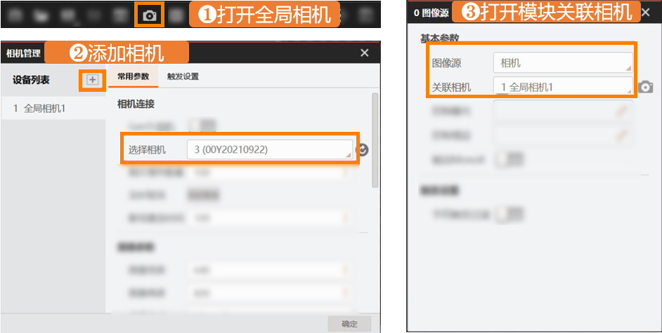

# 第2章 采集：怎么把图像弄进来

> **来源**：VisionMaster 4.3.0 帮助系统蒸馏（主题：采集、图像源、多图采集、输出图像、缓存图像）。
> **本章定位**：**任何视觉方案的起点。** 没有图像，后面所有算子都是空转。
> **一句话原则**：**流程的第一块积木永远是"采集"。**

---

## 2.0 速查表（操作者先看这）

| 模块 | 一句话用途 | 何时用 |
|------|-----------|--------|
| **图像源** | 提供图像来源（本地图/相机/SDK） | 几乎每个流程的第一个模块 |
| **多图采集** | 一次采多张（3~8张） | 多视角、多光源下采图 |
| **输出图像** | 把图像保存/输出记录 | 需要留档、存图 |
| **缓存图像** | 缓存最近 N 张图 | 前后帧需要对比/拼接 |
| **光源** | 控制外接光源开关/亮度 | 需要打光时 |

> 关联相机的 3 步操作在 §2.3，这是新手最容易卡住的点。

---

## 2.1 图像源模块（核心）

**作用**：给流程提供第一张图像，可选三种来源。它的大部分参数是在"选哪个来源"后才出现的。

### 三种图片来源

| 图像源选项 | 说明 | 调试期推荐 |
|-----------|------|-----------|
| **本地图像** | 从硬盘加载图片 | ✅ 没相机时最常用 |
| **相机** | 从已配置的工业相机实时取图 | 上产线时 |
| **SDK** | 通过二次开发 SDK 获取图像 | 写代码集成时 |

### 关键参数（每种来源都涉及）

- **像素格式**：Mono8（灰度，枚举值 `17301505`）或 RGB24（彩色，枚举值 `35127316`）。
- **取图间隔**：（本地图时）相邻两张图加载间隔。
- **显示图像名称**：开启后在图像显示区左下角显示图名。
- **SN初始值**：运行时首张图的帧号，之后每次 +1。
- **图像缓存**：内存最多缓存几张图。
- **拼接使能**：把上一张图和本次图在 Y 方向拼起来（用于大幅面拼接），需设"起始高度/拼接高度"。

### 高级参数（理解即可，先不用管）

- **触发清空 + 触发变量**：当某全局变量非 0 时清空上一张缓存（配合外部信号）。
- **自动切换 / 最后一张停止**：本地图连续运行时，自动切下一张、跑完最后一张自动停。
- **字符触发过滤**：通过外部通信传字符来决定本模块是否运行。

### 模块结果（下游算子能读到的数据）

| 输出 | 类型 | 含义 |
|------|------|------|
| 图像数据 | image | 当前图像本身 |
| 图像宽度/高度 | int | 图像尺寸 |
| 图像像素格式 | int | Mono8=17301505，RGB24=35127316 |
| 当前图像路径/名称 | string | 图像来源 |
| 帧号 | int | 相机采的第几张 |
| 丢帧数/丢包数 | int | 采图质量指标（掉帧/丢包）|
| 相机获取失败次数 | int | 连接失败计数 |
| SN码 | int | 运行时帧号 |

> **新手提醒**：丢帧数/丢包数不为 0 说明采图有问题（常见是网线/带宽/相机参数），先解决它再谈后续算法。

---

## 2.2 多图采集模块

**作用**：一次流程执行，采集 3~8 张不同角度的图像，供后续多视角处理（如多光源、多工位）。

- 每张图有独立的输出：`输出图像0` ~ `输出图像7` 的图像数据/宽度/高度/格式。
- 还能输出每张图拍摄时**光源的水平分布角 / 垂直照射角**（配合光源模块）。

---

## 2.3 关联相机（新手必看，3 步）

要用**相机**作为图像源，先得让 VisionMaster 认出相机。就 3 步：



1. **① 打开全局相机**：点快捷工具条的相机图标，进"相机管理"。
2. **② 添加相机**：在"相机管理"窗口点 **+**，列出线上所有相机，选中你的相机并确定（图中变成"全局相机1"）。
3. **③ 打开模块关联相机**：回到"0 图像源"模块的"基本参数"，把**图像源**下拉设为**相机**，**关联相机**选**全局相机1**。

> ⚠️ **强烈建议**：连接相机前，先用相机配套客户端（MVS 客户端）调试好图像（曝光、清晰度、像素格式），达标后再进 VisionMaster。能少走一半弯路。

---

## 2.4 输出图像 / 缓存图像模块

### 输出图像
- **作用**：把处理后的图像保存到本地或输出记录，留档用。
- **关键输出**：模块状态（0=NG红/1=OK绿）、本地原图保存路径、渲染图保存路径、输出图像数据（二进制）。

### 缓存图像
- **作用**：缓存最近 N 张图（0~14 张），供需要"看前后帧"的场景（如比对、拼接）。
- **关键输出**：`输出图像0~14` 的图像数据/宽度/高度/格式。

---

## 2.5 典型流程示例（采集 + 关联相机）

```
[图像源]  --图像-->  [下一模块（如模板匹配/圆查找）]
   ↑
 设置为"相机"，关联"全局相机1"
```

- **调试期**：图像源选"本地图像"→ 选一张测试图 → 跑通后续算法。
- **上产线**：图像源选"相机" → 关联相机 → 实时采图。

---

## 2.6 动手任务（学习者）

1. 新建一个"通用方案"，拖入一个 **图像源** 模块。
2. 在"图像源"里选 **本地图像**，加载一张图片，点运行，在图像显示区看到它。
3. （有条件）按 §2.3 的三步连接一台真实相机，切到"相机"模式。
4. 运行后查看"模块结果"里的宽度/高度/像素格式，确认采集正常。

> 完成以上 4 步，你就掌握了采集 = 方案能"看到"图像了。这是迈向视觉检测的第一步。
