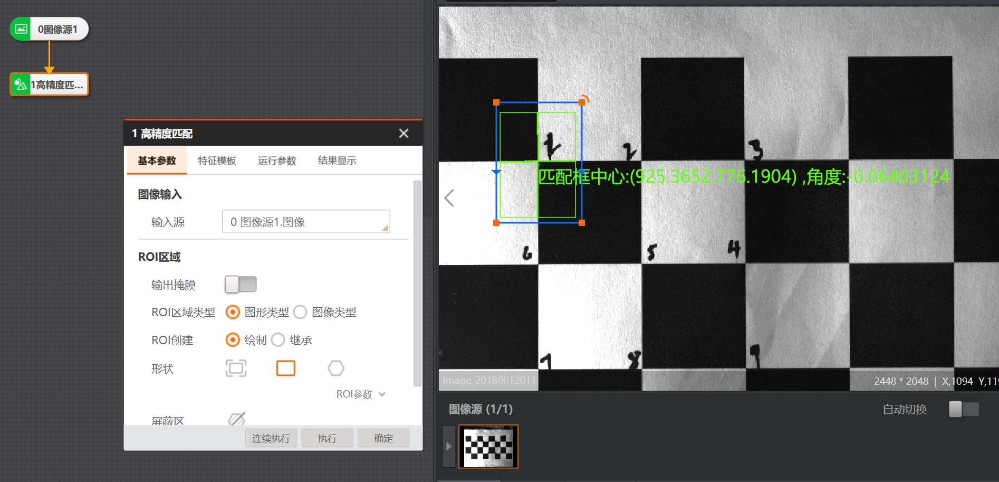

# 2026-09-07 · 高精度匹配确定模板后，九点逐个标定

> **来源**：上课/实操口述 + 实操截图（`图像源1 + 高精度匹配1`）。关联《第3章_定位查找.md》高精度匹配、模板匹配；《第6章_标定.md》N点标定。

## 前置背景

在黑白格子纸（单格 30mm×30mm，参见上一条笔记）上做 **N 点标定**。为了获得"像素坐标 ↔ 物理坐标"的 N 组对应点，需要**先用高精度匹配锁定一个模板，再逐个点重复匹配，逐点记录 XY**。下图是"高精度匹配"这一步确定模板的界面。

## 操作流程：如何在高精度匹配里确定模板后做九个点逐个标定

### 第一步：搭好图像源 + 高精度匹配
- 流程：`0 图像源1 → 1 高精度匹配1`。
- 图像源里加载黑白格子纸图（图源示图中可见 1~9 编号的黑白格）。

### 第二步：在高精度匹配里确定模板
在「基本参数」页签设置：
1. **图像输入**：输入源选 `0 图像源1.图像`。
2. **ROI区域**：
   - **ROI区域类型**：选**图形类型**。
   - **ROI创建**：选**绘制**。
   - **形状**：选**矩形**（图上蓝色/绿色框）。
   - 在画面上**框住一个格子交界处的角点**（如框住标号"1"与"6"之间的交界），这个框就是模板的**搜索/匹配区域**。
3. **输出掩膜 / 屏蔽区**：按需留空（输出掩膜常见用途是排除干扰区域）。

> 匹配结果会直接显示在画面里，如下方绿色文字：**匹配框中心(925.3652, 778.1904)，角度: 0.06403124**，以及画面中央的绿色模板框（轮廓描边、角点标记）。

### 第三步：九点逐个标定的关键
1. **模板只定一个特征**：用高精度匹配把"格子交界角点"这一特征锁成模板（选中的是交界点，而不是整格或格心）。
2. **对选中的每个点做高精度匹配**：让匹配工具去识别画面里 1~9 这 9 个格子交界点。
3. **每成功选中一个点，就记录一次该点的 X/Y 像素坐标**——这是 N 点标定的"像素坐标"侧数据。
4. 与机械手移动到的**已知物理坐标**（30mm 格距折算）配对，软件据此建立「像素坐标 ↔ 物理坐标」转换。

## 要点串记（为什么这么做）

- **选交界角点**：黑白交界处边缘梯度最清晰，匹配定位最稳；整格或格心易受光照/模糊干扰。
- **用高精度匹配而非快速匹配**：标定误差会被后续所有测量放大，必须用精度优先的高精度匹配逐个锁点（快速匹配=速度优先，特征清晰）。
- **逐点记录 XY**：N 点标定本质是采集 N 组「像素坐标↔物理坐标」对应点；点越多、分布越开，拟合出的**像素精度（mm/pixel）**越准。
- **标定误差**：允许 **0.1~0.5**，>0.5 要重新标定（检查格子纸放平、光照均匀、特征点提取全）。

## 附 · N点标定"点集对"文件（txt）6列含义

> 文件示例：`课程案例/视觉上课资源/02-工业视觉PCB板质量检测项目/无线充电N点标定点.txt`（老师课堂补充讲解）。

以第一行 `1  925.611  757.208  130.17  86.8  0.000` 为例：

| 列 | 数值 | 含义 |
|----|------|------|
| 第1列 | `1` | **点序号**（1~9，九点标定） |
| 第2列 | `925.611` | **图像坐标 X**（像素）——相机测得的特征点像素坐标 |
| 第3列 | `757.208` | **图像坐标 Y**（像素） |
| 第4列 | `130.17` | **物理坐标 X**（mm）——机械手/运动机构实际到达的物理位置 |
| 第5列 | `86.8` | **物理坐标 Y**（mm） |
| 第6列 | `0.000` | **物理角度**——9 点**纯平移**标定无旋转，故为 0 |

**要点**：**第2、3列（图像坐标X/Y）与第4、5列（物理坐标X/Y）一一配对**，构成一个「像素↔物理」点对——一张图测到一个像素点，就对应机械手实际到达的物理点，这正是 N 点标定建立「像素坐标↔物理坐标」转换的两组数据（公式 `Pw = H·Pi`，Pi、Pw 均为2维坐标点）。**第6列（物理角度）是附加的旋转信息**，9点纯平移标定恒为0，不参与坐标配对。

### 物理点从哪来？（官方帮助文档说明）
N 点标定的物理点来源有两种：
1. **模块自动生成**（推荐）：用「物理坐标系参数」——基准点X/Y、偏移量X/Y（如 30mm 格距）、X/Y优先方向、相对/绝对坐标，让软件**按网格自动算出**物理坐标。此时界面不显示、你也不需要手填物理点，只需记录图像点。
2. **接收通信数据 / 手动导入**：通过接收数据+协议解析，或直接导入该 txt（点集对文件）。

> **为什么操作时"只看到前两列"**：多半是用了"自动生成物理点"模式，物理坐标由软件算、被隐藏了，所以你只看到并手动记录了图像像素坐标。

### 需要改吗？
- **只做图像侧练习、无真实机械手**：物理点交给「物理坐标系参数」自动生成即可，具体数值不用手改。
- **配合真实机械手标定**：第4、5列（物理坐标X/Y）必须与机械手实际到达位置一致；物理角度在 9 点平移标定恒为 0。这里是能否换算准确像素精度的关键，改错则标定结果错误。

### 补充：N≥4 与 9点/12点
- N 点标定需 **N≥4**；常见**9点标定**（机械手共轴、9次平移）与**12点标定**（不共轴，9次平移+3次旋转）。

## 参考工具链接

- `VisionMaster知识库/第3章_定位查找.md`：高精度匹配 / 快速匹配 / 模板匹配输出（匹配框中心、角度、分数）、位置修正。
- `VisionMaster知识库/第6章_标定.md`：N点标定、像素精度、标定误差阈值。
- `VisionMaster知识库/第14章_官方例程解读.md`：static 静态标定 / dynamic 动态标定（N图像标定）流程示例。
- 官方帮助主题：`N点标定`（图像/物理点来源、点集对导入导出、9点/12点）。
