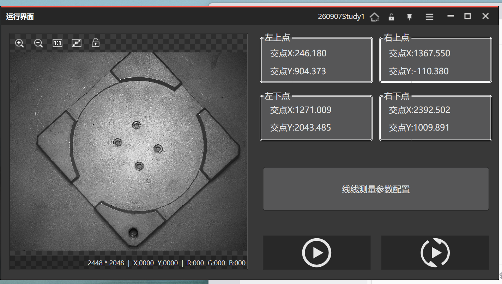

# 2026-09-08 · GUI 设计阶段总结

> **学期/日期**：260908（2026-09-08）
> **主题**：基于项目1（工装板产品定位）的初步 GUI 设计已完成；准备进入项目2（PCB板质量检测）学习。
> **截图**：运行界面（260907Study1），展示四角点交点显示 + 线线测量参数配置 + 运行控制。

## 一、当前进度

- **已完成**：基于「01-工业视觉工装板产品定位项目」的**初步 GUI 设计**（VisionMaster 运行界面方案）。
- **下一步**：准备进行**项目2「02-工业视觉PCB板质量检测项目」**的学习。

## 二、GUI 运行界面说明（见截图）

界面分为左右两区：

### 左侧：图像显示区
- 顶部工具条：缩放 / 平移 / 1:1 / 保存 / 锁定（走查工具）。
- 主窗口显示**工装板图像**（2448×2048 灰度图）。
- 底部状态栏：`2448 * 2048 | X:0,000 Y:0,000 | R:000 G:000 B:000`（分辨率 + 光标坐标 + 颜色值）。

### 右侧：结果显示与参数区
- **四个角点结果框**（左上点 / 右上点 / 左下点 / 右下点），各显示**交点X / 交点Y**：
  - 左上点：交点X 246.180，交点Y 904.373
  - 右上点：交点X 1367.550，交点Y -110.380
  - 左下点：交点X 1271.009，交点Y 2043.485
  - 右下点：交点X 2392.502，交点Y 1009.891
- **线线测量参数配置**按钮：进入线线测量参数设置。
- **运行控制按钮**：播放（▶ 运行）/ 步进（单步）双按钮，位于底部。

## 三、要点串记

- 四个"角点"是**左右/上下直线求交**得到的交点（对应 Day1 流程里的 `23 中心点`/线线测量，或 19~22 四角点）。GUI 把这四个交点坐标以运行界面形式呈现出来。
- 界面已将**图像显示、热点/结果文本、参数配置入口、运行/单步控制**整合为简洁的"运行界面"布局——这是 VisionMaster "运行模式"下的操作面板，便于车间/上位机人员直接看结果与运行。

## 四、下一步学习（项目2 预备）

- 进入 **02-工业视觉PCB板质量检测项目**：PCB 板上缺陷/元件检测（相关参考：`无线充电N点标定点.txt`、`9点标定文件.iwcal`、`Checkerboard-A4-30mm-8x6.pdf` 等标定素材）。
- 重点关注：N点标定 → 像素精度/标定文件、模板匹配/缺陷检测模块、以及本 GUI 四角点模式如何在项目2 复用/扩展。

## 参考工具链接

- `../实习日志/260907_Day1_工装板产品定位报告.md`：Day1 的流程/算子/中心点结果。
- `2026-09-07_高精度匹配九点逐个标定.md`：N 点标定点集对 6 列含义。
- `VisionMaster知识库/第3章_定位查找.md`、`第4章_测量.md`、`第6章_标定.md`。
