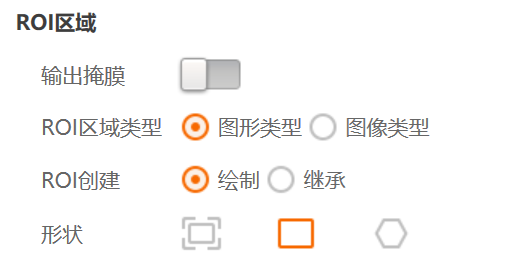

# 2026-09-08 · 快速匹配：固定搜索区域（ROI 区域）

> **来源**：实操 + 截图。关联《第3章_定位查找.md》模板匹配、快速匹配模块的搜索区域设置。

## 一句话

**通过「基本参数 → ROI区域」来设定"固定的一片搜索区域"，让快速匹配只在框内找目标，框外不搜索。**

## 操作路径（见图）

进入快速匹配模块 → 最左侧「**基本参数**」页签 →「**ROI区域**」分组：

| 字段 | 设置 | 说明 |
|------|------|------|
| **输出掩膜** | 关闭 | 本例无需输出掩膜；需要排除干扰区域时才开 |
| **ROI区域类型** | 选 **图形类型** | 用图形框定搜索区（另一选项「图像类型」按图像遮罩） |
| **ROI创建** | 选 **绘制** | 手动在画面上画框；另有「继承」=沿用上游框 |
| **形状** | 选 **矩形** | 三种形状：矩形（角标框，常用）/ 多边形 / 圆环(六边形图标) |

### 操作步骤
1. 切到快速匹配的「基本参数」页签。
2. ROI区域类型 选 **图形类型**。
3. ROI创建 选 **绘制**，在右侧图像上**拖画一个矩形框**，框住你要搜索的那一片固定区域。
4. （可选）形状改**多边形/圆环**适配特殊区域；需要排除某块时，用**屏蔽区多边形**把不该搜索的区域圈掉。
5. 之后切到「特征模板」创建模板 →「运行参数」设**最大匹配个数**（复数匹配）。

## 要点串记

- **固定区域 = ROI**：模板匹配只在 ROI 内搜索，ROI 外不匹配 → 实现"只针对固定一片区域"。
- **为什么重要**：目标若只在板子某局部，设定 ROI 能**排除干扰、提速、防误检**；不设 ROI 则全图搜索，噪声多、易错配。
- 与"复数最大匹配个数"配套：**ROI 限定范围（此处）+ 最大匹配个数（运行参数）**，即可"固定区域里一次找多个目标"。

## 参考工具链接

- `VisionMaster知识库/第3章_定位查找.md`：模板匹配、输出结果、位置修正。
- `2026-09-08_固定搜索区域+最大匹配个数.md`（若另建）：多目标快速匹配设置。
