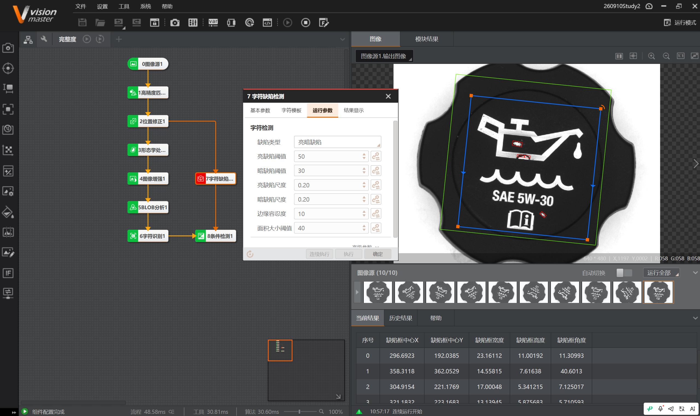

# 2026-09-10 · 机油加注口盖图标完整度检测

> **来源**：实操（VisionMaster 4.3.0）+ 项目《05-工业视觉检测图标完整度项目（机油加注口盖）》的操作过程.docx。关联《第3章_定位查找》《第5章_缺陷检测》《第7章_图像处理》《第9章_识别》《第11章_逻辑脚本》。
> **案例**：机油加注口盖图标/字符**完整度**检测（图标缺笔画、断线、模糊等）。

## 一、案例目的

检测机油加注口盖上的**图标与字符是否完整**——机油壶图标（带油滴）、波浪线、文字 `SAE 5W-30`、说明书图标。工件会**旋转**，需先定位再检测。

## 二、项目步骤（操作过程.docx）

```
1. 图像源，添加图像
2. 快速匹配特征（模板按第1张图）→ 匹配点匹配局部
3. 位置修正（按第2张图）
4. 形态学处理（原流程 5 号）
5. 图像增强（原流程 0 号）
6. BLOB 分析
7. 字符识别
8. 字符缺陷检测
9. 条件检测
```

## 三、本项目流程（本任务实际）

```
0图像源1 → 1高精度匹配 → 2位置修正1
   ├─ 3形态学处理 → 4图像增强1 → 5BLOB分析1 → 6字符识别1 ─┐
   └────────────────────────────────────→ 7字符缺陷检测 ─┴→ 8条件检测1
```

> 两条支路：
> - **下支路**：形态学处理 → 图像增强 → BLOB分析 → 字符识别（预处理+识别/完整度）
> - **上支路**：字符缺陷检测（对比标准字符模板，找缺陷）
> 最后汇总到 **8条件检测**。

## 四、字符缺陷检测参数（本任务配置）



| 参数 | 配置 | 说明 |
|------|------|------|
| **缺陷类型** | 亮暗缺陷 | 检测亮/暗缺陷 |
| **亮缺陷阈值** | 50 | 亮缺陷判定阈值 |
| **暗缺陷阈值** | 30 | 暗缺陷判定阈值 |
| **亮缺陷尺度** | 0.20 | 亮缺陷尺寸尺度 |
| **暗缺陷尺度** | 0.20 | 暗缺陷尺寸尺度 |
| **边缘容忍度** | 10 | 允许的边缘偏差容差 |
| **面积大小阈值** | 40 | 缺陷面积阈值 |

**当前结果**：检出多个缺陷框（中心X/Y、宽度、高度、角度）——如 (296.69, 192.04)、(358.31, 362.05)、(304.92, 221.18) 等。

> **卡尺/阈值注意点**（同前几次经验）：阈值为判定灵敏度核心——**亮/暗缺陷阈值调大→更宽松（漏检风险）**，调小→更严格（误报风险）；**边缘容忍度**越大越能容忍图标边缘的轻微偏移，防误判；**面积阈值**过滤小噪点。需按实际缺陷大小调，直到"合格品不误报、缺陷品能检出"。

## 五、关键模块理解

- **形态学处理 / 图像增强**：图标/字符的**预处理**——让图标更清晰、去噪、增强对比，便于后续识别与缺陷检测。
- **BLOB 分析**：按连通域分析图标/字符（个数、面积等），辅助判断完整度。
- **字符识别**：识别 `SAE 5W-30` 等文字。
- **字符缺陷检测**：与**标准字符模板**比对，检测**缺笔画、断线、亮暗缺陷**（阈值/尺度/容忍度控制）。
- **条件检测**：综合各支路结果，判定 OK/NG。

## 六、要点串记

- **图标完整度检测** = 定位（匹配+位置修正）+ 预处理（形态学/增强）+ 识别/BLOB + **字符缺陷检测（模板比对）** + 条件检测。
- **工件会旋转** → 必须"高精度匹配 + 位置修正"建立随工件转的参考系，否则 ROI 跑偏、误判。
- **字符缺陷检测核心参数**：亮/暗缺陷阈值、亮/暗缺陷尺度、边缘容忍度、面积大小阈值——**调阈值平衡"漏检 vs 误报"**。

## 参考工具链接

- 项目：`05-工业视觉检测图标完整度项目（机油加注口盖）`（操作过程.docx、06-…项目.sol、10张图）。
- `VisionMaster知识库/第5章_缺陷检测.md`：字符缺陷检测。
- `VisionMaster知识库/第7章_图像处理.md`：形态学处理、图像增强。
- `VisionMaster知识库/第9章_识别.md`：字符识别。
- `VisionMaster知识库/第3章_定位查找.md`：快速匹配、位置修正。
