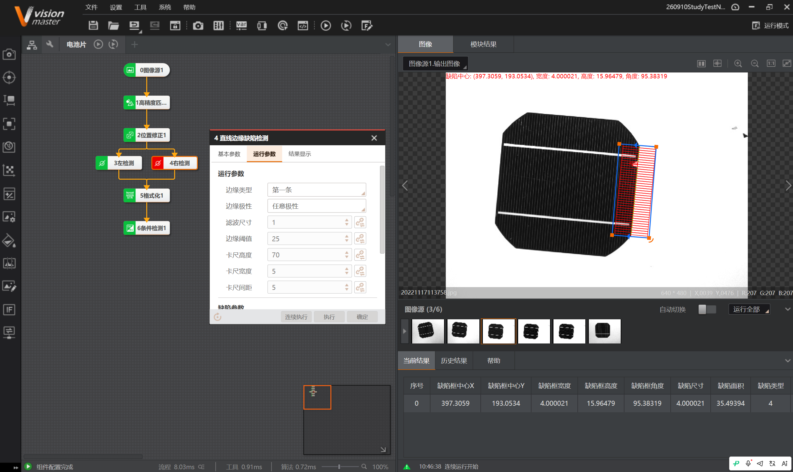
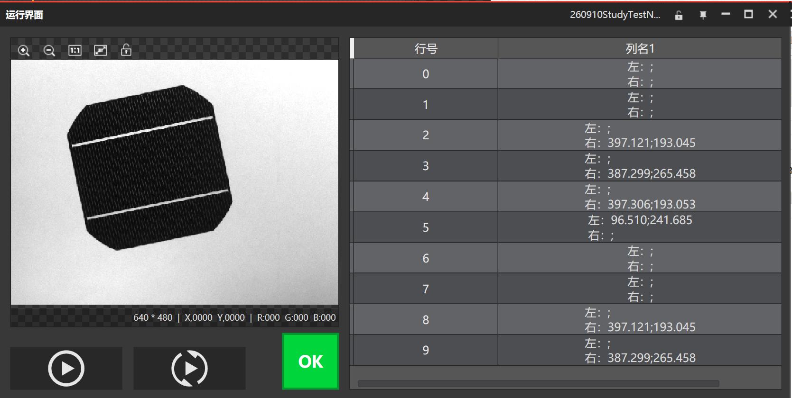

# 2026-09-10 · 电池片边缘缺陷检测

> **来源**：实操（VisionMaster 4.3.0）+ 案例说明《练习图片/电池片边缘检测》。关联《第5章_缺陷检测》《第3章_定位查找》《第11章_逻辑脚本》《第9章 运行界面》。
> **案例**：光伏电池片边缘缺陷检测（检测四条边是否断裂）。

## 一、案例目的

检测**电池片四条边是否有断裂**。电池片为黑色片体、带两条白色栅线，边缘若有缺口/断裂即为缺陷。

## 二、案例步骤（说明文件）

1. **高精度特征匹配**：对需要检测的工件进行初定位。
2. **位置修正**：建立基准点，工件位置改变时后续模块的 ROI 区域跟随。
3. **两个直线边缘检测**：分别查找两条直线边的缺陷。
4. **格式化**：将缺陷中心输出来。
5. **条件检测**：通过缺陷个数判断工件是否合格。

## 三、本项目流程（本任务实际）

```
0图像源1 → 1高精度匹配 → 2位置修正1
   → 3左检测 / 4右检测（直线边缘缺陷检测）
   → 5格式化1 → 6条件检测1
```

> 3左检测、4右检测 分别检测电池片左右两条边的缺陷；结果经格式化输出缺陷中心，条件检测判合格。

## 四、直线边缘缺陷检测参数（本任务配置）



| 参数 | 配置 | 说明（官方）|
|------|------|------|
| **边缘类型** | 第一条 | 最强 / 第一条 / 最后一条；第一条=查找方向上梯度大于阈值的第一条边 |
| **边缘极性** | 任意极性 | 边缘明暗方向 |
| **滤波尺寸** | 1 | 增强边缘抑噪（最小1），模糊/噪声时调大 |
| **边缘阈值** | 25 | 梯度阈值0~255；越大抗噪越强、边缘越少 |
| **卡尺高度** | 70 | 卡尺（检测边缘点的ROI）高度；查找不准时增大 |
| **卡尺宽度** | 5 | 卡尺宽度 |
| **卡尺间距** | 5 | 卡尺之间的间距 |

**结果**：检出缺陷框中心 (397.3059, 193.0534)，宽度 4.0，高度 15.96，角度 95.38，缺陷尺寸 4.0，面积 35.49，缺陷类型 4。

## 五、模块原理（官方）

- 将**实际提取的边缘**与**基准边缘直线**比较，通过边缘的**存在性和位置**判断是否有缺陷（常见：**断裂、位置偏移**）。
- 在基准边缘直线与检测ROI的相交线段上**均等分布 N 个卡尺**，每个卡尺提取一个边缘点，组成边缘点集（边缘采样）。
- 卡尺查找失败时，用卡尺中心点作为该边缘点 → 这些"缺失/偏移"就形成缺陷。
- 前序：图像源；**加直线查找可更精确定位目标**。

## 六、运行界面（GUI）设计（说明文件）



1. **表格**：订阅条件检测，保存**最近10次**的检测结果（行号 0~9）。
2. **组合框 + 文本框**：订阅格式化结果，显示**缺陷中心坐标**（如"右:397.121;193.045"）。
3. **OK/NG 按钮**：绑定条件检测结果显示（图中显示 **OK** 绿色按钮）。

> 这对应之前学的"运行界面"设计——用表格/文本框/按钮把检测结果可视化，便于产线操作。

## 七、要点串记

- **直线边缘缺陷检测** = 实际边缘 vs 基准直线比对 → 判断裂/偏移；核心是**沿边缘布卡尺采样**。
- **核心三参**：边缘阈值（抗噪）、卡尺高度（采样窗高，查找不准时增大）、边缘类型（最强/第一条/最后一条）。
- **前置定位**：高精度匹配 + 位置修正，保证 ROI 跟随工件——本项目左右两条边分别检测。
- **运行界面**：表格存历史、文本框显坐标、OK/NG 按钮显结果。

## 参考工具链接

- 官方帮助：《直线边缘缺陷检测》（GUID-5A6EF92F）。
- `VisionMaster知识库/第5章_缺陷检测.md`：缺陷检测家族、输出结构。
- `VisionMaster知识库/第3章_定位查找.md`：匹配/位置修正/直线查找。
- `VisionMaster知识库/第9章_识别.md`、运行界面相关。
- 案例：`练习图片/电池片边缘检测`（含 `电池片边缘检测.txt`、6张图）。
