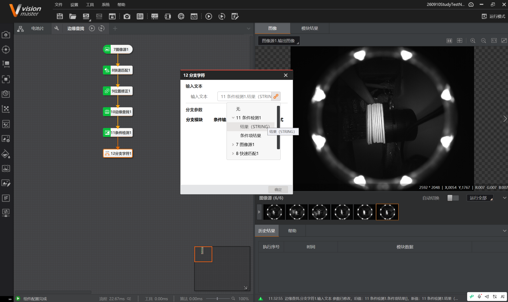

# 2026-09-10 · 边缘查找（纸巾张数检测）

> **来源**：实操（VisionMaster 4.3.0）+ 案例说明《练习图片/边缘查找》。关联《第3章_定位查找》《第11章_逻辑脚本》《第7章_图像处理》。
> **案例**：通过边缘查找检测一包纸巾的张数，不足8张判 NG。

## 一、案例目的与步骤（说明文件）

检测一包纸巾的**张数**，**不满足8张则 NG**：
```
1. 边缘查找检测一摞纸巾的张数
2. 条件检测判断是否满足一包纸巾8张的数量
3. 不满足8张 → 格式化以红色字输出；满足 → 绿色字输出（分支字符）
4. 格式化合并前两者结果，并设置前序显示边缘查找结果
```

## 二、图像难点（本案例的核心）

图像**复杂度很高、难做边缘检测**：
- **塑料包装强反光**：膜上多处高光斑，亮度与纸巾边缘接近 → 易误判。
- **背景暗且杂乱**：环形灯、支架、泡沫等都在画面里。
- **纸巾只占中间一小条**：有效区域小。
- **边缘密集**：纸巾张与张之间的缝（暗线）与边缘（亮线）交替、间隔很近。
- **整体偏暗、对比低**。

## 三、解决思路（由外到内分三层）

| 层级 | 做法 | 目的 |
|------|------|------|
| ① 缩小战场 | 用**矩形 ROI** 紧紧框住纸巾那一条 | 避开环灯/支架/大面积反光，干扰最少 |
| ② 预处理 | **滤波**（抹反光噪点）+ **二值化**（分出亮线）+ **形态学**（去斑点/连断线）+ **图像增强**（提对比） | 把"纸巾白线边缘"从"塑料反光噪点"里分离 |
| ③ 边缘检测 | 沿垂直方向扫卡尺/边缘查找，数边缘点个数（=张数）；**提高边缘阈值**滤掉反光弱边 | 数出张数 |

> **经验**：面对"脏"图像，**ROI 和预处理比算法参数更关键**；必要时可用**灰度投影**（数波峰）或 **Blob** 等更鲁棒的方法替代逐条边缘检测。

## 四、本项目流程（本任务实际）

```
7图像源1 → 8快速匹配1 → 9位置修正1 → 10边缘查找1 → 11纸巾张数(条件检测)
   → 12分支字符1 → 13OK(格式化) / 14NG(格式化) → 15格式化1(合并)
```


- **8快速匹配 + 9位置修正**：定位纸巾，建立随工件移动/旋转的参考系（保证ROI跟随）。
- **10边缘查找1**：数纸巾边缘点（张数）。结果：边缘点X/Y、分数、边缘极性、边缘状态。
- **11纸巾张数**：**条件检测**，判断张数是否 == 8，输出 OK/NG。
- **12分支字符1**：按 OK/NG 分流。
- **13OK / 14NG**：两个格式化分别输出（OK/NG 分支）。
- **15格式化1**：合并两分支结果。

## 五、分支字符 + 格式化（本任务配置）


- **12分支字符1**：输入文本订阅 `11条件检测1.结果(STRING)`（内容 OK/NG）；
  「分支模块」区给下游设条件输入值：`13OK` → **OK**、`14NG` → **NG**。
- **15格式化1**：订阅 `13OK.格式化结果` 与 `14NG.格式化结果`，合并输出。

> 踩坑：格式化结果作为**订阅项**时的参数名是 **`格式化结果`**，不是 `格式化结果(%s)`（`%s` 是内部预览占位，不是参数名）。



## 六、红/绿颜色显示的疑问（本日学习疑问）

**问题**：最后一个格式化如何显示不同颜色（合格绿、不合格红）？

**结论**：
- **格式化模块只输出字符串，本身没有任何颜色设置。** 颜色属于"显示层"，要在**运行界面控件**上设。
- **方案A（推荐）：OK/NG 控件** —— 数据源订阅条件检测的 **结果(INT)**（`1=OK、0=NG`），控件自带 **OK-字体色/NG-字体色**，可自动红绿切换。之前电池片案例的绿色 OK 按钮就是此控件。
- **方案B：文本框控件** —— 数据类型 `stringType`，数据源订阅 `<15格式化1.格式化结果>`，可设字体/颜色，但**颜色固定、不随OK/NG自动切换**。
- **要实现"自动红绿切换"，必须用 OK/NG 控件**（文本框做不到自动变色）。
- 控件位置：在**运行界面编辑环境**的控件列表里（非流程编辑区）。

## 七、要点串记

- **边缘查找数张数**：ROI 缩小 + 预处理（滤波/二值化/形态学）+ 提高边缘阈值，才不被塑料反光干扰。
- **分支字符**：读条件检测的 OK/NG 字符串，分流到不同分支；分支模块区要设条件输入值 OK/NG。
- **颜色 = 显示层**：格式化不管颜色；用 **OK/NG 控件**（订阅结果INT）实现自动红绿切换，文本框只能固定色。

## 参考工具链接

- 案例：`练习图片/边缘查找`（含 `边缘查找说明.txt`、6张图）。
- 官方帮助：《边缘查找》《分支字符》《格式化》《控件功能介绍》（运行界面 OK/NG、文本框控件）。
- `VisionMaster知识库/第3章_定位查找.md`、`第7章_图像处理.md`、`第11章_逻辑脚本.md`。
