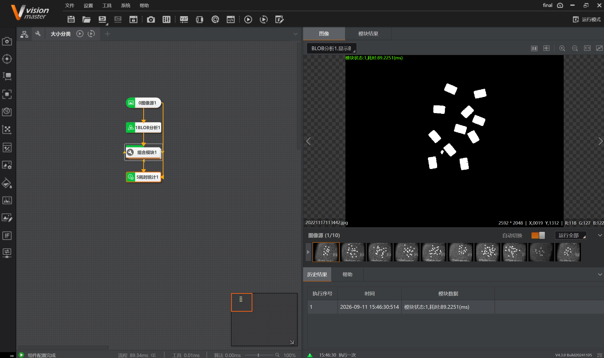
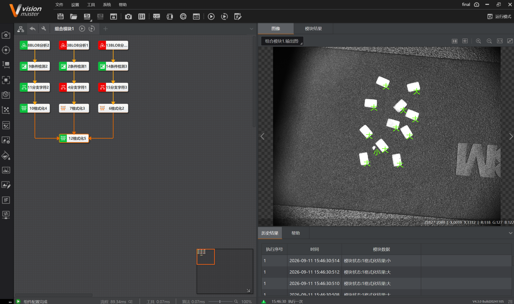

# 2026-09-11 · 大小晶片分类（BLOB 面积分级）

> **来源**：实操（VisionMaster 4.3.0）+ 案例《练习图片/大小晶片分类》（`大小分类说明.txt`，10 张图）。关联《第5章_缺陷检测》（BLOB 分析）《第11章_逻辑脚本》（条件检测/分支字符/格式化）《第12章_通信》（全局变量收发）。
> **案例**：对台面上的**晶片**做 BLOB 分析，按**面积大小**分为**小 / 中 / 大**三类，分别在图像上标注类别并计数（小：红、中：橙、大：绿）。**已完成（历史结果可见 `格式化结果:小 / 大`）。**

## 一、案例目的与步骤（说明文件）

**目的**：通过 BLOB 分析区分晶片大小，并在**对应晶片上显示大小类别**，各类分别计数。

```
1. 对晶片进行 BLOB 分析
2. 条件检测：BLOB 面积 5000–35000 → 进入"大/中"分类（小为一组，大中为一组）
3. 小于 5000（且大于 1000）→ 判为"小"，计数并格式化显示
4. 5000–12000 为"中"，12000–35000 为"大"，分别计数并格式化显示
5. 发送 / 接收全局变量数据
6. 在图像源和接收数据之间进行耗时统计
7. 颜色约定：小 → 红；中 → 橙；大 → 绿
```

**面积阈值小结**：

| 类别 | BLOB 面积区间 | 显示颜色 |
|------|--------------|---------|
| 小 | 1000 ~ 5000 | 红 |
| 中 | 5000 ~ 12000 | 橙 |
| 大 | 12000 ~ 35000 | 绿 |

> 说明里"小/中/大"用两级条件切分：先用 5000–35000 把"大中"和"小"分开，再把"大中"按 12000 切成"中/大"。

## 二、完成流程

### 主流程

```
0图像源1 → 1BLOB分析1 → 组合模块1 → 5耗时统计1
```



- **0图像源1**：加载本地晶片图，共 **10 张**（图像源面板 `1/10`，可"自动切换 / 运行全部"）。
- **1BLOB分析1**：对整幅图做 BLOB 分析，把晶片从背景中分割出来（显示图为黑白二值：白 = 晶片）。
- **组合模块1**：封装"按面积分级 + 分类计数/标注"的内层流程（见下）。
- **5耗时统计1**：统计流程耗时（历史结果里 `模块状态:1,耗时:89.2251(ms)`，状态栏流程约 89.34 ms）。

### 组合模块1 内部（三级分类）

```
8BLOB分析2  → 9条件检测2  → 11分支字符2 → 6格式化2  ┐
3BLOB分析1  → 2条件检测1  → 4分支字符1  → 7格式化3  ├→ 12格式化5（合并输出）
13BLOB分析3 → 14条件检测3 → 15分支字符3 → 10格式化4 ┘
```



**结构**：三条**并行支路**，每条支路都是 `BLOB分析 → 条件检测 → 分支字符 → 格式化`（分别对应小 / 中 / 大三个面积区间），最后用 **12格式化5** 把三路结果**合并输出**。输出图上晶片被标出类别标记（绿色十字/箭头）。

> ⚠️ 三条支路与"小/中/大"的一一对应关系是**据界面结构 + 说明推断**，实际以工程配置为准。

## 三、各模块作用

| 模块 | 作用 |
|------|------|
| **0图像源1** | 加载本地晶片图片（10 张，可自动切换/运行全部） |
| **1BLOB分析1** | 主 BLOB：把晶片从背景分割出来 |
| **8/3/13 BLOB分析** | 三条支路各自的 BLOB 分析（按不同**面积区间**筛选晶片） |
| **9/2/14 条件检测** | 判断 BLOB 面积是否落在该支路的区间内 |
| **11/4/15 分支字符** | 按条件结果分流，给出类别标签（小/中/大） |
| **6/7/10 格式化** | 每类**计数并格式化输出**（并控制显示颜色：红/橙/绿） |
| **12格式化5** | 合并三路结果统一输出 |
| **5耗时统计1** | 统计图像源→输出的耗时 |

## 四、★ 要点与经验

### 1. 用条件检测把"连续面积"切成"离散类别"
- 面积是连续量，分类靠**阈值切分**：`<5000` 小、`5000–12000` 中、`12000–35000` 大。
- 先用宽区间 5000–35000 分出"大中"，再细分，避免一次设多段导致条件互相重叠。

### 2. 三路并行 + 最后合并
- 三类各自一条 `BLOB→条件→分支字符→格式化` 支路，结构对称、便于逐类调试；
- 末尾用**格式化合并**汇总（同 0911 胶囊检测/端子计数的 Final 合并思路）。

### 3. 分类结果要"看得见"
- 说明要求"在**对应晶片上**显示大小类别"，靠格式化/显示模块把类别标签贴到 BLOB 上，颜色沿用 **小红 / 中橙 / 大绿**，一眼可辨。

### 4. 说明中的"收发全局变量 / 耗时统计"本次落地情况
- 说明第 5 条提到**发送/接收全局变量**、第 6 条提到**耗时统计**；
- 本次实际流程里可见的是末端的 **5耗时统计1**，未见独立的发送/接收数据模块——**收发全局变量这部分本次未在流程中体现**，后续补做时需核对。

## 五、要点串记

- **面积分级三板斧**：BLOB 分析量面积 → 条件检测设区间 → 分支字符/格式化分类标注。
- **阈值**：小 1000–5000、中 5000–12000、大 12000–35000；颜色 小红/中橙/大绿。
- **结构**：主 BLOB 分割 → 组合模块内三条并行支路 → 格式化合并 → 耗时统计。
- **分类计数套路**与端子计数（按颜色）、胶囊检测（按面积判错料）同源：**先分割/定位，再按特征分流，最后各自计数**。

## 参考工具链接

- 案例：`练习图片/大小晶片分类`（`大小分类说明.txt` + 10 张 `2022111711*.jpg`）。
- 官方帮助：《BLOB 分析》《条件检测》《分支字符》《格式化》《耗时统计》《发送数据/接收数据》。
- 知识库：`第5章_缺陷检测.md`（BLOB）、`第11章_逻辑脚本.md`（条件检测/分支字符/格式化）、`第12章_通信.md`（全局变量收发）。
- 学习记录：`2026-09-11_工业端子计数颜色识别`（分类计数 + 通信）、`2026-09-11_胶囊检测`（按面积判错料）。
- 0911 系列（当日汇总）：[2026-09-11_当日汇总.md](2026-09-11_当日汇总.md)（当日 4 案例横向对照）
