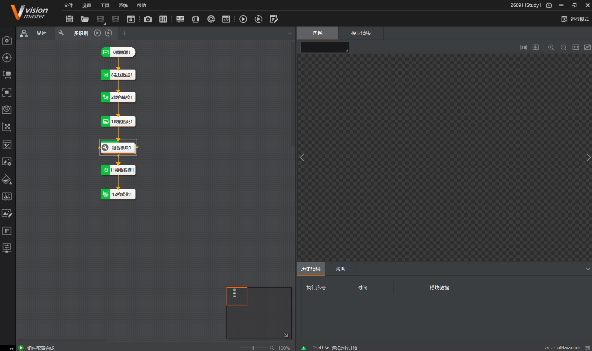
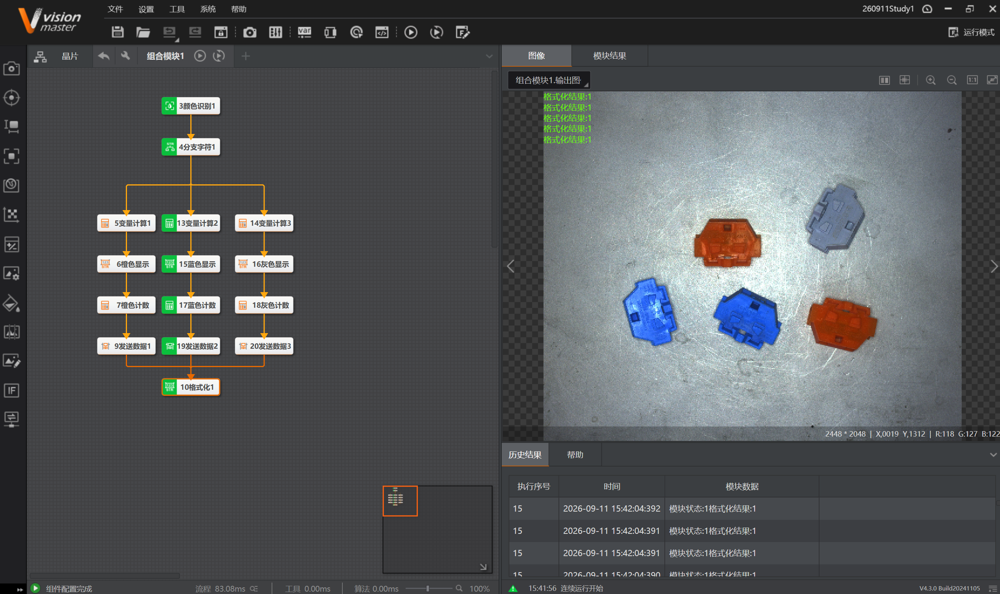

# 2026-09-11 · 工业端子计数（颜色识别）

> **来源**：实操（VisionMaster 4.3.0）+ 案例《06-工业视觉彩色端子计数项目》。关联《第8章_颜色处理》《第11章_逻辑脚本》（分支字符/变量计算/格式化）《第12章_通信》。
> **案例**：金属台面上散落着**橙、蓝、灰**三种颜色的塑料接线端子，需按颜色分别计数，并把结果通过通信发送出去。**本次已用 Group+循环 遍历每个端子，比胶囊检测有突破。**

## 一、案例目的与图像特征

**目的**：识别台面上所有接线端子，按**颜色**分三类（橙/蓝/灰）分别计数，并通过发送数据把结果发出去。

**图像特征**：
- 背景：金属台面，**有划痕、反光、纹理杂乱**；
- 目标：塑料端子，形状固定但**位置随机、颜色三种**；
- 本图共 **5 个端子**：橙 2 个、蓝 2 个、灰 1 个。



---

## 二、完成流程

### 主流程（多识别）

```
0图像源1 → 8发送数据1 → 2颜色转换1 → 1灰度匹配1 → 组合模块1 → 11接收数据1 → 12格式化1
```

### 组合模块1内部（晶片分支）

```
3颜色识别1 → 4分支字符1
   ├─(橙) → 5变量计算1 → 6橙色显示 → 7橙色计数 → 9发送数据1
   ├─(蓝) → 13变量计算2 → 15蓝色显示 → 17蓝色计数 → 19发送数据2
   └─(灰) → 14变量计算3 → 16灰色显示 → 18灰色计数 → 20发送数据3
                                          ↓
                                    10格式化1
```



**结果**：图像上 5 个端子全部识别并按颜色归类；右上角依次输出 5 行 `格式化结果:1`（每个端子走一遍分支→计数→格式化），总耗时约 83 ms。

---

## 三、各模块作用

| 模块 | 作用 |
|------|------|
| **0图像源1** | 加载本地端子图片 |
| **8发送数据1** | 主流程开头发送数据（通信闭环起点） |
| **2颜色转换1** | 把 RGB 彩色图转到适合颜色识别的颜色空间（如 HSV），让颜色区分更稳定 |
| **1灰度匹配1** | 对端子做模板匹配定位，输出所有端子的位置框（彩色图直接匹配慢且不稳，转灰度匹配更快更鲁棒） |
| **组合模块1** | 封装"颜色识别→分支→三色计数"的内层流程，**内部开了 Group 循环**遍历每个端子 |
| **3颜色识别1** | 识别每个端子的颜色类别，输出颜色字符串 |
| **4分支字符1** | 按颜色字符串分流：橙→橙路、蓝→蓝路、灰→灰路 |
| **5/13/14变量计算** | 三路各自做计数累加（初始化开关**关**=累计；开=每轮重置） |
| **6/15/16颜色显示** | 在端子上显示对应颜色标识 |
| **7/17/18计数** | 橙/蓝/灰分别计数 |
| **9/19/20发送数据** | 三路计数结果分别发送 |
| **10格式化1** | 合并三路结果输出 |
| **11接收数据1 / 12格式化1** | 主流程末尾接收+格式化，完成通信闭环 |

---

## 四、★ 难点与经验

### 1. 循环终于用起来了（相比胶囊检测的突破）

- 胶囊检测时循环未突破，改用分支模块替代，丢失了"逐颗检测+定位"的能力；
- 本次**组合模块1内部开了 Group 循环**，遍历颜色识别出的每个端子（本图 5 个端子→格式化1 执行 5 次）；
- 核心机制同 0910 顶点检测：`InputROI[组合模块1.循环索引]` 逐页取端子位置，每轮颜色识别判断颜色→分支字符分流→对应颜色计数+1；
- **这是循环能力的第一次真正用在"多目标分类计数"场景**。

### 2. 颜色识别前为什么要"颜色转换+灰度匹配"

- **颜色转换**：RGB 颜色空间下颜色受光照影响大；转到 HSV 后，H（色相）分量对颜色区分更鲁棒，S（饱和度）过滤白色反光；
- **灰度匹配**：模板匹配在灰度图上做最快最稳；先定位端子**在哪**，再用颜色识别判断**是什么颜色**——"先定位、后判色"两步走。

### 3. 分支字符按颜色字符串分流

- 颜色识别输出的是颜色类别字符串（如"橙""蓝""灰"）；
- 分支字符1 订阅该字符串，分别给三路设条件值"橙""蓝""灰"；
- 同 0910 纸巾张数案例的分支字符用法。

### 4. 计数用变量计算，注意初始化开关

- 三路计数靠 **变量计算** 累加；
- **初始化开关必须关**（用上次结果做本次输入=累计）；如果开了，每轮循环都重置为初始值，计数永远只加 1；
- 这是 0908 踩过的坑，这次直接避开了。

### 5. 通信闭环

- 主流程开头 8发送数据1、末尾 11接收数据1+12格式化1；
- 三条颜色支路也各有发送数据，可分别把橙/蓝/灰计数发给 NetAssist；
- 复用 0909 的 TCP 闭环。

---

## 五、运行界面设计

1. **图像区**：显示端子识别结果，三色框/标注对应橙蓝灰；
2. **文本框**：订阅三路计数/格式化结果，显示"橙:X 蓝:Y 灰:Z"；
3. **通信**：NetAssist 配合 TCP 触发与结果回传。

---

## 六、要点串记

- **颜色分类套路**：颜色转换(RGB→HSV) → 灰度匹配定位所有目标 → 颜色识别判色 → 分支字符分流 → 各颜色分别计数。
- **Group 循环这次用起来了**：遍历每个端子，逐次判色、累加计数。相比胶囊检测的分支替代，这次真正实现了"逐目标处理+分类计数"。
- **先定位后判色**：灰度匹配管"在哪"，颜色识别管"是什么颜色"，分工明确。
- **变量计算初始化开关**：计数必须关初始化（累计），判断必须开初始化（每轮重算）。
- **分支字符认字符串**：颜色识别输出字符串，直接喂给分支字符即可，不像数值路由那样需要脚本转 int。

---

## 参考工具链接

- 案例：`06-工业视觉彩色端子计数项目`（含 `260911Study1.sol`、ExampleImages、260908Images）。
- 官方帮助：《颜色转换》《灰度匹配》《颜色识别》《分支字符》《变量计算》《格式化》《发送数据/接收数据》《Group循环》。
- 知识库：《第8章_颜色处理》《第11章_逻辑脚本》（分支字符/变量计算/格式化）《第12章_通信》。
- 学习记录：`2026-09-10_循环功能顶点检测`（Group循环/索引机制）、`2026-09-11_胶囊检测`（分支替代循环的对照）。
- 0911 系列（当日汇总）：[2026-09-11_当日汇总.md](2026-09-11_当日汇总.md)（当日 4 案例横向对照）
