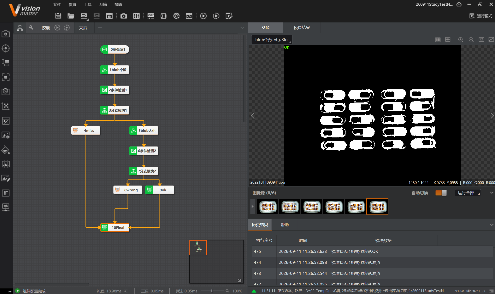
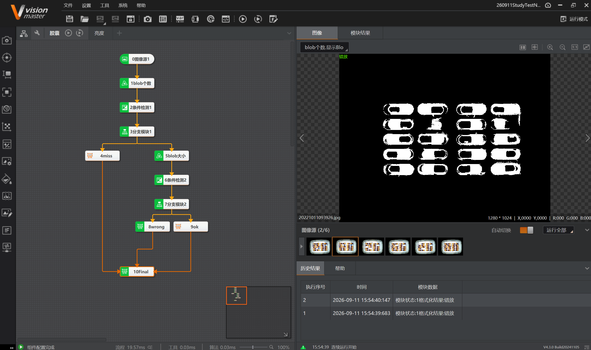

# 2026-09-11 · 胶囊检测（漏放/错放检测）

> **来源**：实操（VisionMaster 4.3.0）+ 案例《练习图片/胶囊检测》（胶囊检测说明.txt）。关联《第5章_缺陷检测》（BLOB）《第11章_逻辑脚本》（分支/条件检测/变量计算）。
> **案例**：检测药板胶囊是否**漏放**（缺药）或**错放**（药不对）。**已用分支模块替代循环实现，老师认可；但循环未突破，部分功能缺失。**

## 一、案例目的与步骤（说明文件）

**目的**：检测胶囊是否存在**漏放、错放**。

```
1. BLOB分析判断每颗药的面积，条件检测判断是否有漏放；有漏放 → 格式化输出"缺料"（红色文字）
2. 若每板药都放置有药 → 循环内条件检测逐一检查每个药片的BLOB结果
3. 循环内条件检测NG → 在对应药品前打印"错料"信息
4. 若条件检测OK → 计算OK个数，等于药品总数 → 整个检测OK
```

> ⚠️ **本项目的遗憾**：说明第2、3步的"**循环内逐颗检查 + 对应位置输出**"**未能实现**（循环是我的难点），改用分支模块替代，丢失了这部分功能。

## 二、本项目完成流程（本任务实际，经修改）

```
0图像源1 → 1blob个数 → 2条件检测1 → 3分支模块1
      ├─(NG/漏放) → 4miss（格式化，输出"漏放"）─────────────────┐
      └─(OK/有药) → 5blob大小 → 6条件检测2 → 7分支模块2           │
                        ├─(NG) → 8wrong（格式化"错料"）──────────┤
                        └─(OK) → 9ok（正常）─────────────────────┤
                                                                 ↓
                                                          10Final（合并输出）
```



**结果**：历史结果显示 `格式化结果:OK`（合格）、`格式化结果:漏放`（缺药）等。

### 典型 NG 场景：错放

下面是"**错放**"的运行截图——某颗药被换成了**异形/不同大小**的药（上图右侧中间那颗），`1blob个数` 数量虽然够，但 `5blob大小` + `6条件检测2` 判出**面积异常**，经 `7分支模块2` 走 `8wrong` 输出 `格式化结果:错放`。



> 这正好印证两条判据：**BLOB 个数**管"漏放"（少了），**BLOB 面积/大小**管"错放"（不对）。

## 三、各模块作用

| 模块 | 作用 |
|------|------|
| **1blob个数** | BLOB分析：找所有胶囊，输出**个数 + 面积** |
| **2条件检测1** | 判断 **blob个数 == 药品总数**？不足 → 漏放 |
| **3分支模块1** | 按条件检测1结果分流：NG→漏放路，OK→继续检查 |
| **4miss** | 格式化输出 **"漏放"**（缺料提示）|
| **5blob大小** | 按 **blob面积大小** 分析/排序（挑出大小异常的药）|
| **6条件检测2** | 判断 **面积是否在正常范围**（错放=面积异常/异形）|
| **7分支模块2** | 按条件检测2结果分流 |
| **8wrong** | 格式化输出 **"错料"**（错放提示）|
| **9ok** | 正常（合格）|
| **10Final** | 格式化**合并**"漏放/错料/OK"结果，统一输出 |

## 四、★ 难点与经验

### 1. 循环仍未突破（本项目最大遗留）
- 原案例要求"**循环逐一检查每颗药**"，用 **Group + 循环 + `[循环索引]`** 遍历每颗药。
- **实际情况**：**循环仍未完成/未能用起来**（循环依旧是我的难点）。
- **本次做法**：**改用「分支模块」替代循环**实现漏放/错放检测（`1blob个数`、`5blob大小`、`2/6条件检测`、`3/7分支模块`）。
- **代价（丢失的功能）**：
  - **无法"循环逐一检测每一颗"**；
  - **无法把结果输出/标注在对应位置**（不能指出"是第几颗错"）。
- 最终功能**未完整**（老师认可了当前替代方案，但循环相关功能缺失）。

### 2. 遗留小项
- **缺失"在对应错误处显示"功能**——本质上就是**循环能力未掌握**导致的（循环才能逐颗定位并标注）。

### 3. 订阅必须手动选类型（重要规律）
- **凡是"订阅模块输出参数 + 索引"时，都要先手动选好数据类型**（float/int/…），再点订阅。
- 否则默认值带**中文字符**会导致识别不上/索引失效（0910 顶点检测、0911 条件检测都踩过）。

| 位置 | 手选类型 |
|------|---------|
| Group输入 BlobArea | `float` |
| Group输入 BlobCount | `int` |
| 条件检测订阅面积 | `float` |

## 五、运行界面设计（说明文件）

1. **文本框（药片数）**：订阅 **blob个数** → 显示检测到的药片数。
2. **文本框（检测结果）**：订阅 **格式化结果** → 显示检测结果。
3. **开关控制**：绑定本地图像的**字符触发使能**，打开后由外部发**字符 `A`** 触发流程；发非 `A` 则流程异常。

## 六、要点串记

- **胶囊检测两条线**：① 数量够不够（**BLOB个数**，判漏放）② 大小/特征对不对（**BLOB面积**，判错放）。
- **分支模块**：按条件检测结果分流到不同格式化，输出不同提示。
- **格式化合并**：Final 汇总多路结果统一输出。
- **循环是难点，本次未突破**：胶囊检测**未能用起循环**，改用 **分支模块** 替代，因此**丢失了"循环逐颗检测 + 结果输出到对应位置"**的功能。→ **后续需重点攻克 Group 循环**（参考 `2026-09-10_循环功能顶点检测` 的 `[循环索引]` 机制）。
- **触发方式**：字符触发（TCP发 `A`）启动流程。

## 参考工具链接

- 案例：`练习图片/胶囊检测`（含 `胶囊检测说明.txt`、6张图）。
- 官方帮助：《BLOB分析》《条件检测》《分支模块》《分支字符》《格式化》《变量计算》。
- `VisionMaster知识库/第5章_缺陷检测.md`（BLOB）、`第11章_逻辑脚本.md`（分支/条件/变量计算）。
- 学习记录：`2026-09-10_循环功能顶点检测`（Group循环/索引）、`2026-09-11_亮度检测孔填充`。
- 0911 系列（当日汇总）：[2026-09-11_当日汇总.md](2026-09-11_当日汇总.md)（当日 4 案例横向对照）
