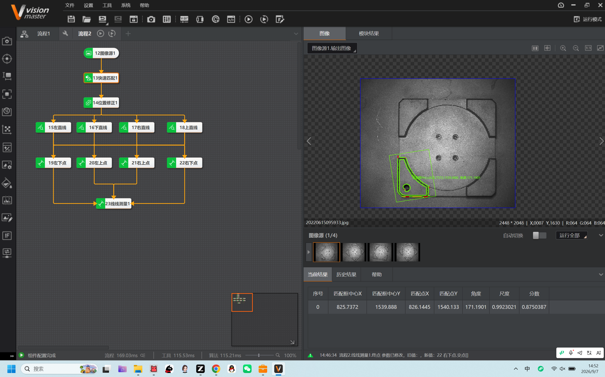
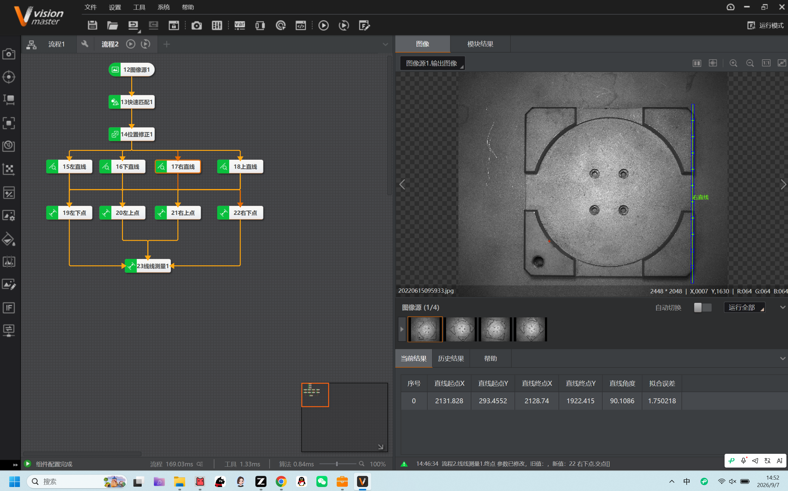
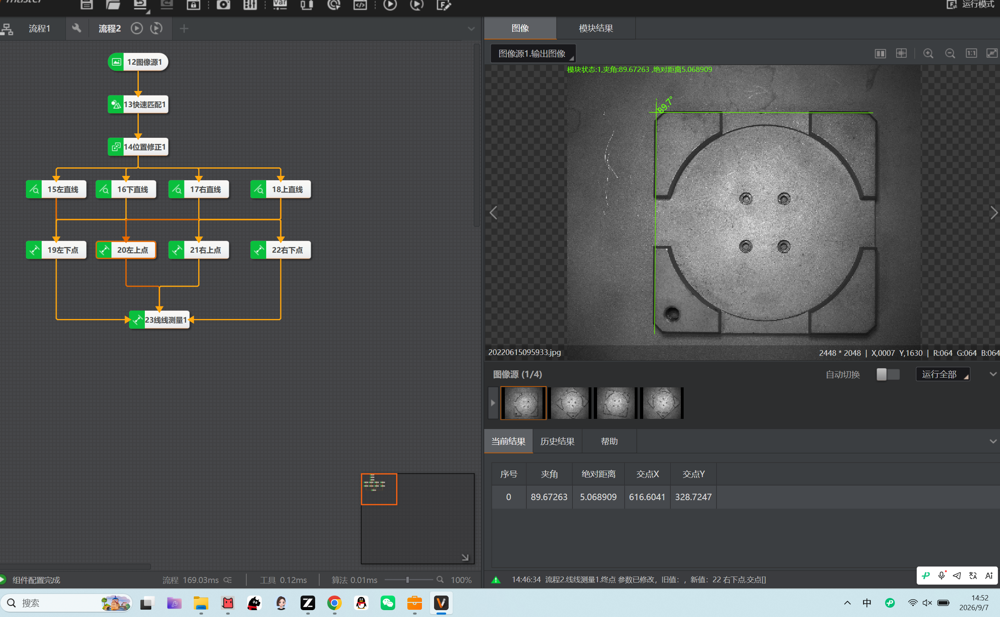
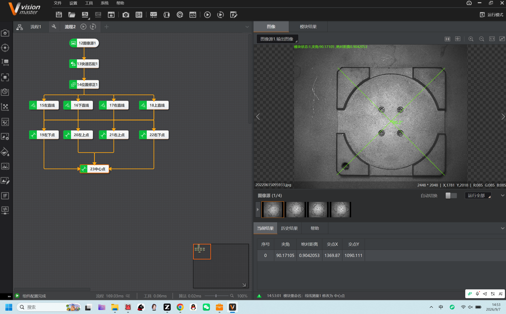

# 测控系统实习 · Day1 报告

> ⚠️ **免责声明**：本篇实习日志（及本仓库全部内容）为基于个人学习记录**由 AI 自主整合**的版本，**未经人工优化**，仅供学习内容参考；如照搬全抄造成课程成绩损失，概不负责。

> **项目**：01-工业视觉工装板产品定位项目
> **范围**：本篇只覆盖 0907 上午的工装板定位；当天全貌（含 N 点标定）见《[260907专业生产实习报告](260907专业生产实习报告.md)》。
> **软件**：VisionMaster 4.3.0
> **实训日期**：2026-09-07（Day1）
> **核心内容**：以"模板匹配 + 位置修正"建立参考系，用直线查找、边缘交点提取四条基准边与四个角点，最终通过"线线测量 / 中心点"求取工装板工件中心。

---

## 一、项目背景与目标

工业视觉中，**定位是视觉检测的骨架核心**：任何"判断"（测量、缺陷、识别）之前，都要先"找到东西在哪、什么角度"。

本项目针对**工装板**工件，目标是在工件位置/角度不稳定的前提下，稳定输出**工件的中心点坐标**。工件在画面里放歪、放偏都没关系，关键在于测量的是"工件自身的几何关系"，而不是"工件在画面里的绝对位置"。

---

## 二、流程搭建（流程1）

在 VisionMaster 中搭建的算子流程如下：

```
12 图像源1        → 加载工装板照片（本地图）
13 快速匹配1      → 模板匹配，找到工件主体，输出位置/角度/分数
14 位置修正1      → 用匹配结果建立"随工件移动/旋转"的局部坐标系
15 左直线         ┐
16 下直线         │ 在修正后的坐标系里，提取两条基准直边
17 右直线         │
18 上直线         ┘
19 左下点         ┐
20 左上点         │ 求两两直线的交点，得到四个角点
21 右上点         │
22 右下点         ┘
23 中心点         → 由线线求交，得到工件中心（原模块名"线线测量1"，后重命名为"中心点"）
```

---

## 三、关键结果与理解（附截图）

### 1. 快速匹配：建立参考系

匹配模块输出**匹配框中心、匹配点、角度、尺度、分数**，代表工件主体在画面中的位置与姿态。



### 2. 直线查找：提取基准边

以"右直线"为例，输出**直线起点/终点、直线角度、拟合误差**。本次右直线角度约 **90.11°**，拟合误差 **1.75**（越小越贴近真实边）。



### 3. 线线测量：量夹角与距离

由两条直线得到**夹角、绝对距离、交点**。本次夹角约 **89.67°**，接近直角，说明工件放置姿态正常。



### 4. 中心点：求对角线交点得到工件中心

将相对角点连成对角线，两对角线求交即得工件**中心点**。输出交点 **X=1369.87，Y=1090.111**，夹角 **90.17°** 接近直角，验证了工件姿态。



---

## 四、今日核心体会：线/点定位与模板是"相对定位"

这次最关键的认知是：**线定位与点定位，并不要求强制包在"快速匹配"模板里，而是和模板形成了"相对定位"关系。**

具体来说：

* **模板匹配**只需要定位一个"有辨识度的特征"（如工装板主体），用于**建立参考系 / 局部坐标系**。
* **位置修正**模块利用匹配结果，把基准平移到/旋转到运行点，让后续的**测量、查找模块始终作用在工件上**，而不是固定在画面坐标。
* 于是**直线查找、边缘交点所在的搜索区域会自动跟随工件移动、旋转**。

这正是工业上工件可以随意摆放、传输带乱转，检测依然稳定的原因——**测量的是"工件自己的几何关系"（夹角、中心、边距），而不是"工件在画面里的坐标"**。

> 用一句话总结今日主线：**定位管参考系，测量管几何关系，两者靠"位置修正"串起来。**

---

## 五、今日疑问 / 下一步

1. 当前输出单位是**像素**；如需输出**毫米**，后续需要加**标定**（第6章），把像素换算成真实物理尺寸。
2. 若工件正反、种类变化，模板匹配得分会下降，需要考虑多模板或换用更高精度的匹配（高精度匹配 / 图形定位）。
3. 下一步可继续：把中心点坐标经**通信模块**（TCP/UDP/串口）传给上位机，用于引导后续动作。

---

## 附录：参考资料来源

* 《第3章 定位查找》：模板匹配、图形定位、直线查找、位置修正、通用数据结构。
* 《第4章 测量》：线线测量的夹角 / 绝对距离 / 交点，点点/点线测量。
* 案例目录：`01-工业视觉工装板产品定位项目`（工装板照片、练习图片）。
* 测试图片：工装板照片 `20220615095933.jpg` 等。

