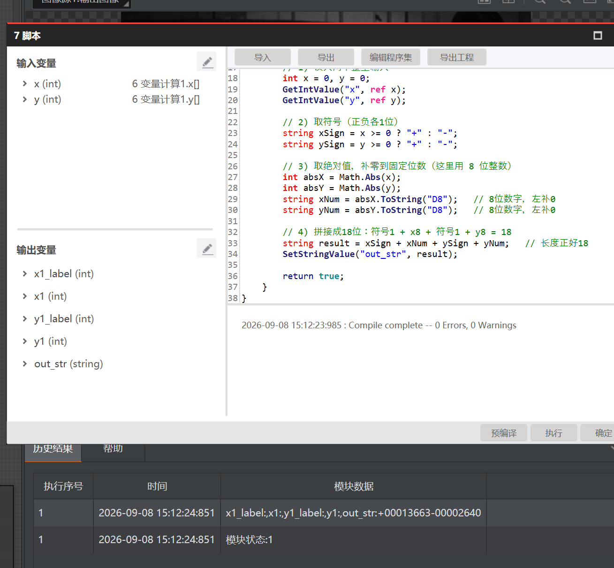

# 实习日记 · Day 0908

> ⚠️ **免责声明**：本篇实习日志（及本仓库全部内容）为基于个人学习记录**由 AI 自主整合**的版本，**未经人工优化**，仅供学习内容参考；如照搬全抄造成课程成绩损失，概不负责。

> **实习时间**：2026年09月08日（周二）
> **实习地点**：中德技师学院
> **实习方式**：编程实训（VisionMaster 4.3.0）
> **实习主题**：GUI 界面 · 格式化 · 变量计算 · 脚本入门与定长字符串

---

## 一、实习内容

今天在 Day 0907 的"定位 + 标定"基础上，进一步学习**如何把流程结果用起来**：先做运行界面（GUI），再学格式化、变量计算、脚本三个能"处理/输出数据"的模块。

### （一）运行界面（GUI）设计

基于项目1（工装板定位）设计初步运行界面，分左右两区：

- **左侧图像区**：显示工装板图像，含缩放/平移/1:1/保存/锁定工具，底部状态栏（分辨率/光标坐标/RGB）。
- **右侧结果区**：四个角点结果框（左上/右上/左下/右下，各显示交点X/Y），线线测量参数配置入口，运行(▶)/单步按钮。

**要点**：四个"角点"是左右/上下直线求交所得，对应 Day1 流程里的交点/中心逻辑。运行界面把"图像显示 + 结果文本 + 参数配置 + 运行控制"整合，便于车间/上位机人员直接看结果。

### （二）格式化模块：把数据拼成字符串

用于**把多个数据整合成字符串输出**（常见于通信发送前）。界面中 `+ 添加` 新增一条数据，每条数据用 **T（插入文本）**、**🔗（插入订阅）**、**表格（插入数组）** 拼内容。

**格式化模块的三个分隔符**：**「输入结束符」**（`\r \n \r\n`）是每条数据之间的换行，**"分行"就用它**（推荐 `\r\n`）；**「分隔符」** 是同一条数据里多个值之间的符号（如圆心X、Y之间的 `, `）；**「数组间分隔符」** 是两个数组之间的符号。

### （三）变量计算模块

五个字段含义：**名称 / 表达式 / 初始值 / 输出类型（int、float、POINT）/ 初始化**。

- **表达式**里的 `<17 快速匹配2.匹配个数>[0]`：订阅前序模块结果，`[0]` 取第0组。点表达式框右下"计算器"图标，可在弹窗内点右侧列表插入 `<模块.输出参数>`。
- **`初始化` 开关（易忽略）**：开 = 每次流程执行都重置为初始值（每轮重算）；关 = 用上次运算结果作本次输入（累计计数）。
- **实例**：`count0 = <17 快速匹配2.匹配个数> + <18 快速匹配2.匹配个数> + 0`，把两个匹配模块个数相加。
- **结果恒为 0** → 多半是两个匹配模块本身没找到目标（匹配个数=0），或 `[0]` 取错组；先确保匹配模块有输出。

### （四）脚本入门：数量判定 OK/NG（已跑通）

读入"检测数量"，==4 输出 OK，否则输出 NG。编辑前配置：输入变量 `in0`(int，绑匹配个数)，输出变量 `out0`(string)。

```csharp
int count = 0;
GetIntValue("in0", ref count);          // 读入数量
if (count == 4)
    SetStringValue("out0", "OK");       // 4 → OK
else
    SetStringValue("out0", "NG");       // 其他 → NG
return true;
```

**核心原理——读→判→写**：
- `GetIntValue("in0", ref count)`：`ref` 是引用传递，把读到的值填回 count，漏掉 `ref` 读不到。
- `if (count == 4)`：`==` 判断相等，`=` 是赋值。
- `SetStringValue("out0", ...)`：把结果写进 out0。
- `return true`：模块显绿；想让数量≠4变红可用 `return count == 4;`（二选一）。

### （五）脚本进阶：双整型 → 18位定长字符串（已跑通）

输入 x、y 两个整型，输出 **18 位字符串**。

**18 位分成四部分**（`1+8+1+8 = 18`）：

| 部分 | 占位 | 示例（x=13663，y=-2640）|
|------|------|------|
| 符号 x | 1 | `+` |
| x 数值 | 8 | `00013663` |
| 符号 y | 1 | `-` |
| y 数值 | 8 | `00002640` |

**结果截图（x=13663，y=-2640）**：



```csharp
string xSign = x >= 0 ? "+" : "-";
string ySign = y >= 0 ? "+" : "-";
string xNum = Math.Abs(x).ToString("D8");
string yNum = Math.Abs(y).ToString("D8");
string result = xSign + xNum + ySign + yNum;  // 18位
SetStringValue("out_str", result);
```

输出：`+00013663-00002640`（正好18位）。

**老师约定的"1正0负"**：`1=正，0=负`，符号仍占1位、总长18。

**关键认知——int 补不了零**（重要）：

| 方案 | 变量 | 能否出18位 |
|------|------|-----------|
| ① 数值用 string | x1/y1 为 string，label 为 int | ✅ 脚本内 `ToString("D8")` 补零 |
| ② 纯 int + 格式化 | 4 个都是 int | ⚠️ 看格式化能否"定宽补零" |

> int 类型存不了前导零，补零产生的是字符串。所以**数值必须 string 输出**，label（1/0）可 int。若硬性要求四变量都是 int，脚本内无法补零出18位，需靠格式化模块的定宽补零（待核实其能力）。

---

## 二、遇到的问题

1. **格式化"分行"不知用哪个**：初学时分不清三个分隔符。→ 后明白：分行用「输入结束符 `\r\n`」。
2. **变量计算结果恒为0**：两个匹配模块没找到目标或 `[0]` 取错组。→ 先确保匹配模块有输出，再设固定区域+最大匹配个数。
3. **只贴 Process() 报错**：`应输入 class...` → 脚本必须包在 `public partial class UserScript:ScriptMethods,IProcessMethods{...}` 类外壳里，不能只贴方法。
4. **int 补不了零**：四个变量都是 int 时，脚本内无法输出18位。→ 数值改 string 用 `D8` 补零；或靠格式化定宽补零（待核实）。
5. **`ref` 漏写**：`GetIntValue("x", ref x)` 必须带 `ref`，否则值读不回来。

---

## 三、收获与心得

1. **理解了模块间的"分工"**：定位管参考系、测量管几何关系；脚本管"算"，格式化管"拼"，通信管"发"——各司其职，组合成完整流程。
2. **掌握了字符串处理**：`D8` 补零定宽、符号位编码（1正0负）、18位拼接，为后续给机械手/控制器发定位指令打下基础。
3. **理解了 int 与 string 的本质区别**：int 存数值（丢前导零），string 存文本（可补零）。这是脚本里最常见的类型陷阱。
4. **脚本三要素贯通**：读(Get) → 算/判(if、拼接) → 写(Set)，两次练习（OK/NG、18位字符串）已跑通，掌握 `ref`、`Init/Process`、变量类型匹配。

---

## 四、下一步计划

1. 用**格式化模块**把四个变量（label/数值）拼成 18 位串，验证"四变量 int"或"数值 string"两条路线。
2. 核实**格式化模块能否"定宽补零"**，决定纯 int 方案是否可行。
3. 学**通信发送**：把 18 位串经 TCP 发给上位机/机械手（对应《第13章 通信数据收发控制》）。
4. 进入 **PCB 板质量检测（项目2）**，复用"ROI固定区域 + 最大匹配个数"做多目标识别。

---

## 附录：参考资料来源

- 知识库：《第3章 定位查找》《第4章 测量》《第6章 标定》《第11章 逻辑脚本》《第13章 高级/其他》。
- 官方帮助：模板匹配、N点标定、格式化、变量计算、脚本、脚本开放接口、应用示例·通信数据收发控制。
- 学习记录：`2026-09-08_GUI设计阶段总结`、`2026-09-08_快速匹配固定搜索区域ROI`、`2026-09-08_脚本模块数量判定OKNG`、`2026-09-08_脚本双整型18位定长字符串`。
