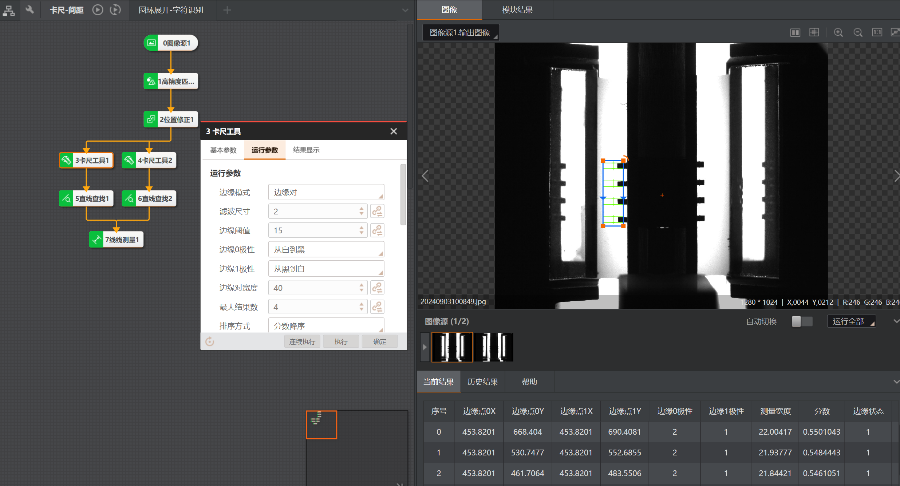
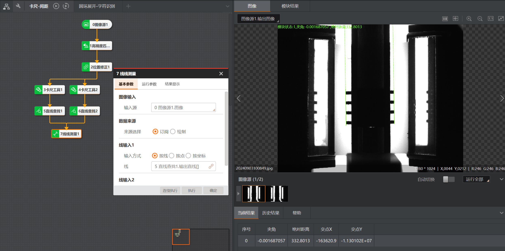
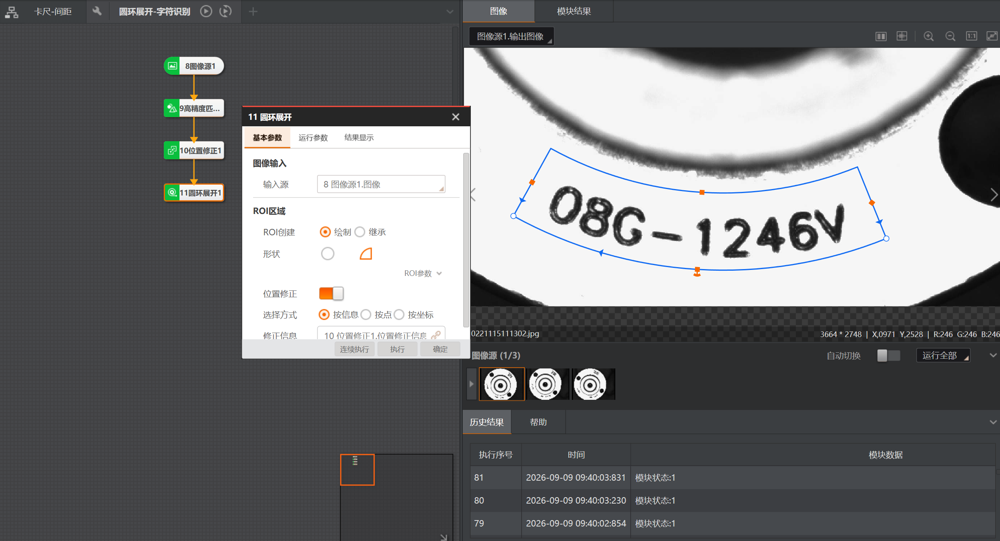
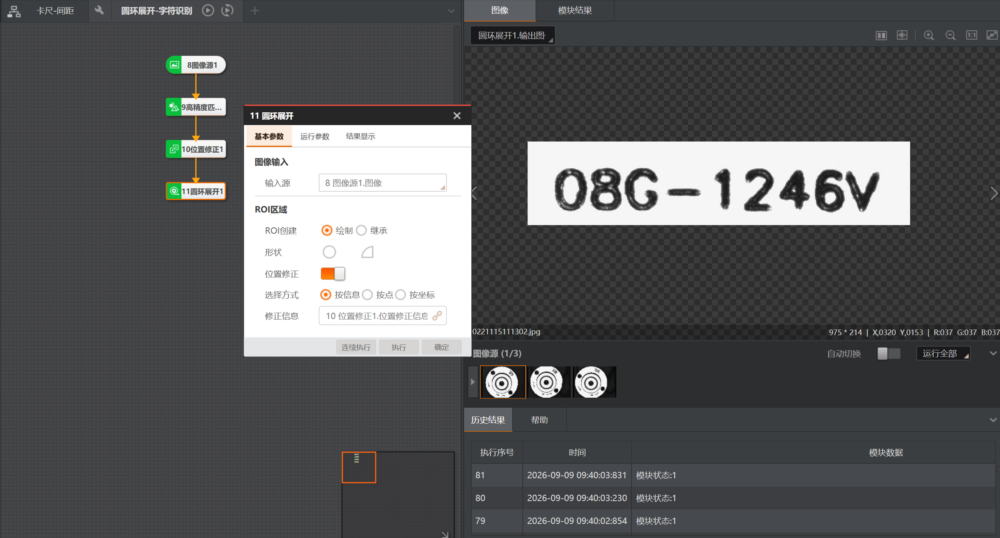
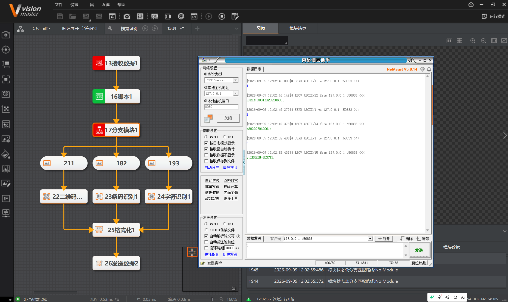
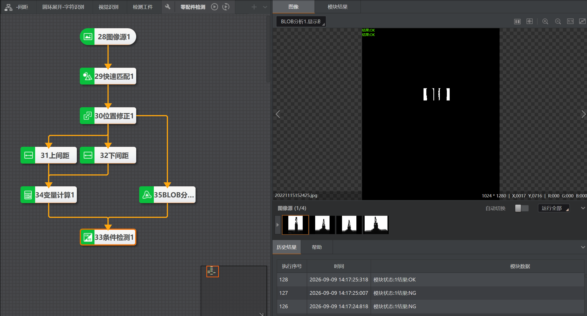
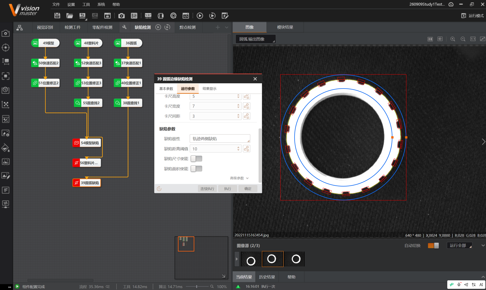
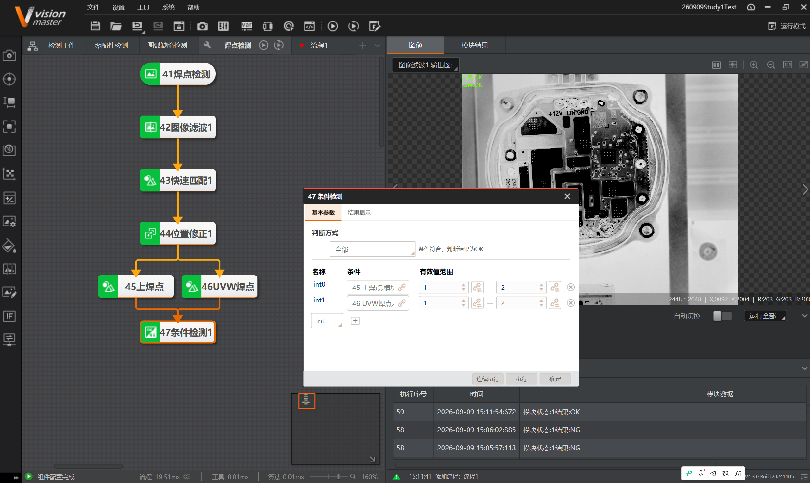
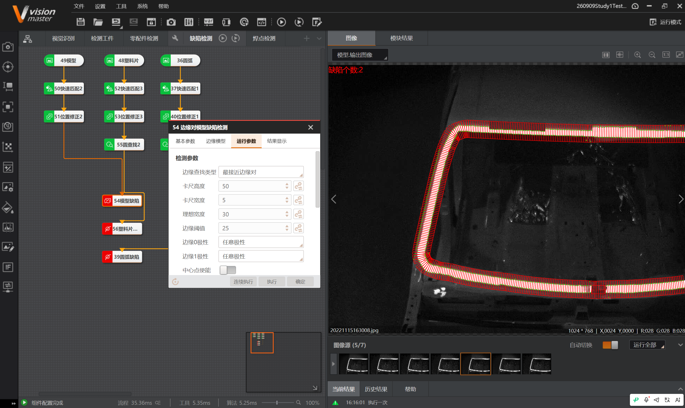

# 实习日记 · Day 0909

> ⚠️ **免责声明**：本篇实习日志（及本仓库全部内容）为基于个人学习记录**由 AI 自主整合**的版本，**未经人工优化**，仅供学习内容参考；如照搬全抄造成课程成绩损失，概不负责。

> **实习时间**：2026年09月09日（周三）
> **实习地点**：中德技师学院
> **实习方式**：编程实训（VisionMaster 4.3.0）
> **实习主题**：卡尺测量 · 圆环展开 · 通信收发与自动切图 · 缺陷检测（零配件/圆弧/焊点/边缘对）

---

## 一、实习内容

今天完成了六项实操：卡尺测量、圆环展开、通信收发与自动切图识别、零配件检测、圆弧边缘缺陷检测、焊点检测与边缘对模型缺陷检测。

### （一）卡尺测量（卡尺-间距）

**流程链**：
```
0图像源1 → 1高精度匹配 → 2位置修正
3卡尺工具1 / 4卡尺工具2 → 5直线查找1 / 6直线查找2 → 7线线测量1
```

**卡尺工具用途**：测量物体宽度、边缘特征位置、边缘对位置和间距，在 ROI 内快速精确定位。**模板匹配+位置修正粗定位，卡尺工具精定位。**

**运行参数配置**：



| 参数 | 配置 | 说明 |
|------|------|------|
| 边缘模式 | 边缘对 | 边缘对=检测边缘间距（测宽度）|
| 滤波尺寸 | 2 | 增强边缘抑噪；边缘模糊时调大 |
| 边缘阈值 | 15 | 梯度阈值0~255；越大抗噪越强 |
| 边缘0极性 | 从白到黑 | 灰度突变方向 |
| 边缘1极性 | 从黑到白 | 边缘对模式下才有 |
| 边缘对宽度 | 40 | 期望边缘对间距 |
| 最大结果数 | 4 | 返回边缘对个数上限 |
| 排序方式 | 分数降序 | 按得分排序 |

**当前结果**：`测量宽度=22.04，分数=0.55`；线线测量：`夹角=-0.00168，绝对距离=332.6013`。



### （二）圆环展开（圆环展开-字符识别）

**流程链**：`8图像源1 → 9高精度匹配 → 10位置修正 → 11圆环展开1`

**用途**：从特定起始角度将圆环图像**展开为矩形**，消除圆环部件上字符因环状呈现导致的识别问题。



| 参数 | 配置 |
|------|------|
| 图像输入 | 8图像源1.图像 |
| ROI创建 | 绘制 |
| 形状 | 圆环(弧/扇形) |
| 位置修正 | 开启 |
| 选择方式 | 按信息 |
| 修正信息 | 10位置修正1.位置修正信息 |

**展开结果**：环形字符 `O8C-1246V` 经圆环展开后摊平为清晰矩形条，便于 OCR。



### （三）通信收发 + 自动切图识别（NetAssist ↔ VisionMaster）

**目标**：NetAssist 发 `1/2/3` → VisionMaster 自动加载对应图片（1.png/2.png/3.png）并跑对应识别（二维码/条码/字符识别）→ 结果回传。**已跑通。**

**流程链**：
```
13接收数据1 → 16脚本1 → 17分支模块1 → 211 / 182 / 193（三个图像源）
   → 22二维码识别 / 23条码识别 / 24字符识别 → 25格式化1 → 26发送数据2
```

**关键设计（多图像源+分支，不依赖改路径，必成）**：
1. 三个图像源各自固定加载 1.png / 2.png / 3.png。
2. **脚本**把接收到的字符串 "1"/"2"/"3" 转成 int `route`。
3. **分支模块**按值索引认 int，值1→图源211、值2→图源182、值3→图源193。
4. 识别结果经格式化、发送数据回传 NetAssist。

**脚本核心**（输入 recv(string) 绑接收数据，输出 route(int)）：
```csharp
string cmd = "";
GetStringValue("recv", ref cmd);   // 收到的 "1"/"2"/"3"
int route = 0;
if (cmd == "1")      route = 1;
else if (cmd == "2") route = 2;
else if (cmd == "3") route = 3;
else                 route = 0;
SetIntValue("route", route);
```

**通信连接**：NetAssist（TCP客户端，127.0.0.1:8080）→ VisionMaster（TCP服务器，本机IP 127.0.0.1、端口 8080）。**客户端目标IP/端口 = 服务端本机IP/端口**（一致才能通）。



**关键认知**：分支模块只认 int；接收到的字符串需用**脚本转成 int** 再给分支模块——"脚本管读/转、分支管路由、图像源管切图"。

### （四）零配件检测（综合案例）

**目的**：检测焊锡及焊锡以上部分不能超出下方圆柱体，同时焊锡与中间塑料板保持漏空。

**流程链**：
```
28图像源1 → 29快速匹配1 → 30位置修正1
31上间距 / 32下间距 → 34变量计算1 → 33条件检测1
                → 35BLOB分析(漏空检测)
```

**变量计算**：`<31上间距.测量宽度> > <32下间距.测量宽度>` → 输出 `var0`（1=上间距大/对，0=假）。曾错用"边缘个数"，应选"测量宽度"。

**Blob 分析**：检测焊锡与塑料板间漏空连通域个数。

**条件检测**：同时满足 `var0>0 且 blob个数>3` → 工件合格。



**结果**：模块状态1结果 **OK**。

### （五）圆弧边缘缺陷检测

**对象**：环形零件（光滑圆弧），检测弧边缘缺陷（断裂/凹陷/凸点/磨损）。

**原理**：圆弧上自动布卡尺，**比对相邻卡尺中心点的 X/Y 轴和角度偏移**，按阈值判缺陷（红框=缺陷，绿点=正常）。

**流程链**：`36圆弧 → 37快速匹配1 → 40位置修正1 → 38圆查找1 → 39圆弧边缘缺陷检测`

**参数配置**：


| 参数 | 配置 | 参数 | 配置 |
|------|------|------|------|
| 边缘类型 | 最强 | 卡尺高度 | 5 |
| 边缘极性 | 任意极性 | 卡尺宽度 | 7 |
| 滤波尺寸 | 4 | 卡尺间距 | 3 |
| 边缘阈值 | 80 | 缺陷距离阈值 | 10 |
| 缺陷极性 | 轨迹两侧缺陷 | 缺陷尺寸/面积使能 | 关 |



**调参要点**：**缺陷距离阈值**是核心（太小误报、太大漏检）；**卡尺间距**控制采样密度；调大缺陷距离阈值+打开尺寸/面积使能可防误判。

### （六）焊点检测 与 边缘对模型缺陷检测

**焊点检测**（功率模块焊点）：
```
41焊点检测 → 42图像滤波1(取反) → 43快速匹配1 → 44位置修正1
   → 45上焊点 / 46UVW焊点 → 47条件检测1
```
**设计思路**：先**滤波取反** → 分别匹配上下两处焊点 → **以坏的为基准** → 发现坏工件才拉高电平。

条件检测（全部/AND）：`45上焊点.积分` 与 `46UVW焊点.积分` 有效值范围均 `1~2` → OK，否则 NG。



**边缘对模型缺陷检测**（塑料片等）：检测两边缘之间的宽度/位置偏移/气泡等。



| 参数 | 配置 | 参数 | 配置 |
|------|------|------|------|
| 边缘查找类型 | 最接近边缘对 | 缺陷极性 | 轨迹两侧缺陷 |
| 卡尺高度 | 50 | 缺陷距离阈值 | 20 |
| 卡尺宽度 | 5 | 缺陷尺寸使能 | 关 |
| 理想宽度 | 30 | 缺陷面积使能 | 关 |
| 边缘阈值 | 25 | 边缘0/1极性 | 任意极性 |

---

## 二、遇到的问题

1. **分不清"单边缘"与"边缘对"**：测**宽度/间距**用边缘对；测**单一边缘位置/有无**用单边缘。
2. **滤波尺寸与精度权衡**：滤波核越大抗噪越强，但边缘精度可能变差；相邻边缘太近时会丢失边缘。
3. **圆环展开后方向/字符仍难识**：展开后可能还需几何变换转方向对齐字符。
4. **ROI 要跟随工件**：圆环在画面位置会变，不用位置修正会跑偏。→ 开启位置修正。
5. **通信连不上**：两边都设客户端、或端口(8080/7980/8090)不一致 → `网络尚未连接：发送失败`。→ 必须一服务端一客户端、IP/端口一致。
6. **分支模块绑不了字符串**：分支模块只认 int。→ 用脚本把"1/2/3"转成 int `route`。
7. **脚本报错"应输入 class"**：只贴了 `Process()`，没包在类外壳里。→ 用完整类结构。
8. **圆弧缺陷误报**：缺陷距离阈值太小会把正常起伏都当缺陷。→ 调大阈值 + 打开尺寸/面积使能。

---

## 三、收获与心得

1. **掌握卡尺工具**：边缘对测间距/宽度、单边缘测位置；模板匹配粗定位 + 卡尺精定位是高精度检测的常见组合。
2. **理解圆环展开的价值**：把环形字符"摊平"成规则矩形，显著提升 OCR 成功率。
3. **打通通信+自动切图闭环**：接收→脚本(转int)→分支模块(按值选路)→多图像源→识别→格式化→发送。实现了发指令即自动切图识别回传，无需手动切换。
4. **完成综合检测案例**：零配件检测把定位、间距测量、变量计算、Blob、条件检测串成完整检测线。
5. **掌握缺陷检测家族**：圆弧边缘缺陷检测（布卡尺比对偏移）、焊点检测（滤波取反+条件判定）、边缘对模型缺陷检测（边缘对宽度/位置）。核心都是**卡尺找边缘 + 阈值判定**。

---

## 四、下一步计划

1. 优化通信切图：把"多图像源"精简为**脚本动态改图像路径**，减少模块。
2. 学习发送数据/接收数据更多配置（数据上传、自动重连、接收结束符处理黏包），对接真实 PLC/上位机。
3. 学习**标定**，把像素尺寸换算为毫米。
4. 继续缺陷检测进阶（异常检测、深度学习缺陷检测）。

---

## 附录：参考资料来源

- 官方帮助：《卡尺工具》《圆环展开》《分支模块》《分支字符》《脚本开放接口》《圆弧边缘缺陷检测》《边缘对模型缺陷检测》。
- 知识库：《第3章 定位查找》《第4章 测量》《第5章 缺陷检测》《第7章 图像处理》《第9章 识别》《第11章 逻辑脚本》《第12章 通信》。
- 学习记录：`2026-09-09_卡尺测量与圆环展开`、`2026-09-09_零配件检测`、`2026-09-09_圆弧边缘缺陷检测`、`2026-09-09_焊点检测与边缘对缺陷检测`。
- 案例：`练习图片/零配件检测`、`练习图片/圆弧缺陷检测`、`练习图片/焊点检测`。
