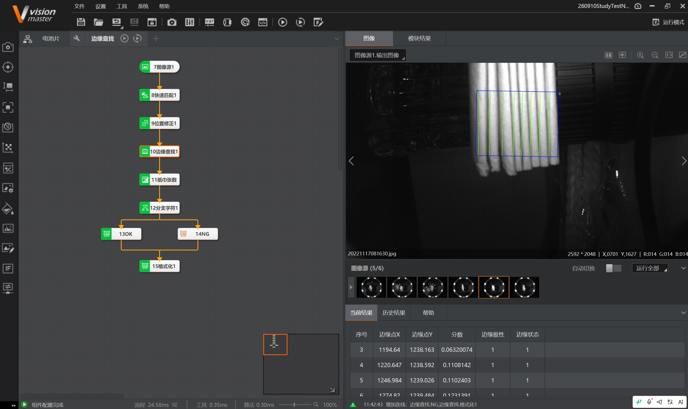
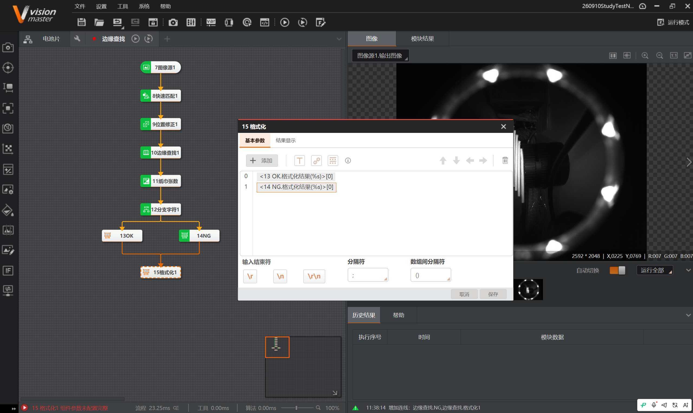
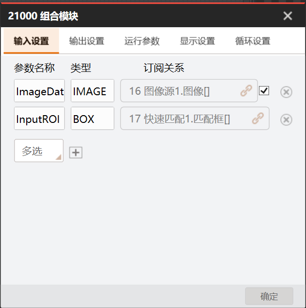
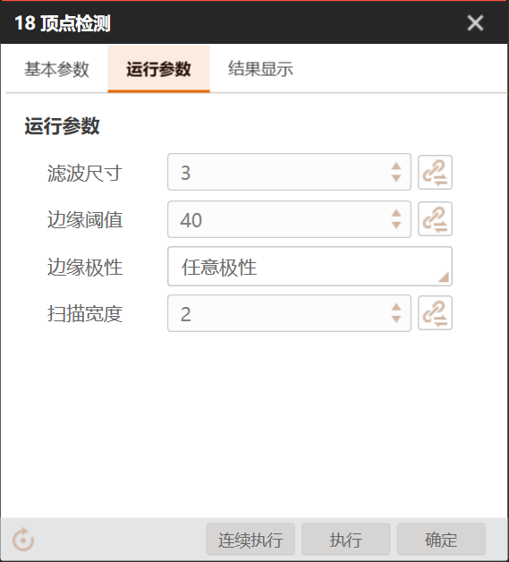
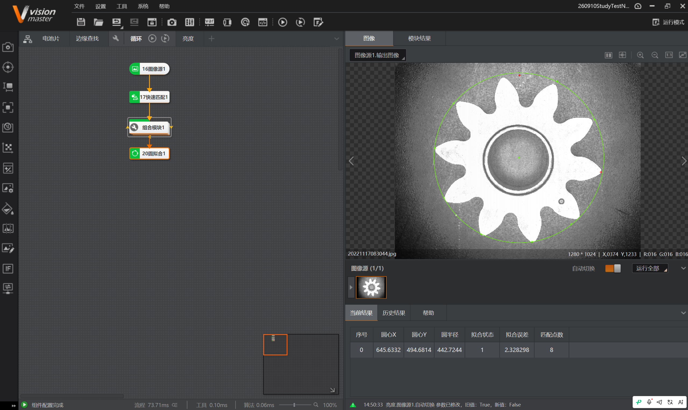

# 实习日记・Day 0910

> ⚠️ **免责声明**：本篇实习日志（及本仓库全部内容）为基于个人学习记录**由 AI 自主整合**的版本，**未经人工优化**，仅供学习内容参考；如照搬全抄造成课程成绩损失，概不负责。

> **实习时间**：2026 年 09 月 10 日（周四）
> **实习地点**：中德技师学院
> **实习方式**：编程实训（VisionMaster 4.3.0）
> **实习主题**：边缘 / 缺陷检测（电池片、机油盖、纸巾张数）・循环功能（顶点检测）


***

## 一、实习内容

今天完成四项实操：电池片边缘缺陷检测、机油加注口盖图标完整度检测、边缘查找（纸巾张数）、循环功能（顶点检测）。

### （一）电池片边缘缺陷检测

**目的**：检测电池片**四条边是否有断裂**。

**案例步骤**：① 高精度特征匹配初定位 → ② 位置修正建立基准 → ③ 两个直线边缘检测分别查两条边 → ④ 格式化输出缺陷中心 → ⑤ 条件检测按缺陷个数判合格。

**本项目流程**：`0图像源1 → 1高精度匹配 → 2位置修正1 → 3左检测 / 4右检测 → 5格式化1 → 6条件检测1`


**直线边缘缺陷检测参数**：


| 参数   | 配置   | 参数   | 配置 |
| ---- | ---- | ---- | -- |
| 边缘类型 | 第一条  | 卡尺高度 | 70 |
| 边缘极性 | 任意极性 | 卡尺宽度 | 5  |
| 滤波尺寸 | 1    | 卡尺间距 | 5  |
| 边缘阈值 | 25   |      |    |

**结果**：缺陷框中心 (397.3059, 193.0534)、宽 4.0、高 15.96、角度 95.38、尺寸 4.0、面积 35.49、缺陷类型 4。

**运行界面（GUI）**：


* **表格**订阅条件检测，保存最近 10 次结果；

* **组合框 + 文本框**订阅格式化结果，显示缺陷中心坐标；

* **OK/NG 按钮**绑定条件检测结果显示（显示 OK）。

### （二）机油加注口盖图标完整度检测

**目的**：检测机油盖上的**图标 / 字符是否完整**（机油壶图标、波浪线、`SAE 5W-30`、说明书图标）。工件会旋转。

**项目步骤（操作过程.docx）**：① 图像源 → ② 快速匹配特征 → ③ 位置修正 → ④ 形态学处理 → ⑤ 图像增强 → ⑥ BLOB 分析 → ⑦ 字符识别 → ⑧ 字符缺陷检测 → ⑨ 条件检测。

**本项目流程**：


```
0图像源1 → 1高精度匹配 → 2位置修正1

   ├─ 3形态学处理 → 4图像增强1 → 5BLOB分析1 → 6字符识别1 ─┐

   └────────────────────────────────────→ 7字符缺陷检测 ─┴→ 8条件检测1
```

**字符缺陷检测参数**：


| 参数    | 配置   | 参数     | 配置   |
| ----- | ---- | ------ | ---- |
| 缺陷类型  | 亮暗缺陷 | 暗缺陷尺度  | 0.20 |
| 亮缺陷阈值 | 50   | 边缘容忍度  | 10   |
| 暗缺陷阈值 | 30   | 面积大小阈值 | 40   |
| 亮缺陷尺度 | 0.20 |        |      |

**结果**：检出多个缺陷框（中心 X/Y、宽、高、角度）。

### （三）边缘查找（纸巾张数检测）

**目的**：通过边缘查找检测一包纸巾的**张数**，不足 8 张判 NG。

**图像难点**（复杂度高、难做边缘检测）：**塑料包装强反光**、背景暗且杂乱、纸巾只占中间一小条、边缘密集、整体偏暗对比低。

**解决思路（由外到内三层）**：


1. **缩小 ROI**：用矩形 ROI 紧框纸巾那一条，避开环灯 / 支架 / 大面积反光。

2. **预处理**：滤波（抹反光噪点）+ 二值化（分出亮线）+ 形态学（去斑点 / 连断线）+ 图像增强（提对比）。

3. **边缘检测**：沿垂直方向扫卡尺 / 边缘查找数边缘点；**提高边缘阈值**滤掉反光弱边。

**本项目流程**：





```
7图像源1 → 8快速匹配1 → 9位置修正1 → 10边缘查找1 → 11纸巾张数(条件检测)

   → 12分支字符1 → 13OK(格式化) / 14NG(格式化) → 15格式化1(合并)
```

**分支字符 + 格式化配置**：





* **12 分支字符 1**：输入文本订阅 `11条件检测1.结果(STRING)`；「分支模块」区给下游设条件值：`13OK`→**OK**、`14NG`→**NG**。

* **15 格式化 1**：订阅 `13OK.格式化结果` 与 `14NG.格式化结果` 合并输出。

> **踩坑**：格式化结果作为**订阅项**时参数名是 `格式化结果`，不是 `格式化结果(%s)`（`%s` 是内部预览占位）。

### （四）循环功能（顶点检测 + Group 循环 + 圆拟合）

**目的**：使用【循环】工具**找到星形零件的全部顶点**（外缘约 12 个尖角）。

**核心难点**：**顶点检测一个模块一次只输出一个顶点** → 找全部顶点必须用 **Group + 循环**。

**核心机制**：顶点检测的 ROI 绑定 `组合模块1.InputROI[组合模块1.循环索引]`


* `循环索引` 是 Group 循环自动递增的变量（0,1,2,…）；

* 每轮循环取数组中第 N 个 ROI → 逐个尖角检测；

* 原来写死 `InputROI[2]`（固定索引）→ 永远只看同一尖角，只出一个顶点。

**Group 输入设置**：





| 参数名称        | 类型    | 订阅关系            |
| ----------- | ----- | --------------- |
| `ImageData` | IMAGE | `16图像源1.图像[]`   |
| `InputROI`  | BOX   | `17快速匹配1.匹配框[]` |

**顶点检测运行参数**：





| 参数   | 配置   |
| ---- | ---- |
| 滤波尺寸 | 3    |
| 边缘阈值 | 40   |
| 边缘极性 | 任意极性 |
| 扫描宽度 | 2    |

**循环设置**：循环使能开启、起始值 0、结束值 12（订阅值，差值 = 循环次数）、间隔按需。

**最终流程**：`16图像源1 → 17快速匹配1 → 组合模块1(循环) → 20圆拟合1`




**圆拟合结果**：圆心 (645.6332, 494.6814)、圆半径 442.7244、拟合状态 1、拟合误差 2.328298、匹配点数 8。

> **★ 踩坑 Bug**：默认选择（订阅参数）后**默认值带中文字符**产生 bug，导致索引失效。**解决：手动选择变量类型后再进行索引。**


***

## 二、遇到的问题


1. **复杂图像难做边缘检测**（纸巾案例）：塑料反光、背景杂乱。→ ROI 缩小 + 预处理（滤波 / 二值化 / 形态学）+ 提高边缘阈值。

2. **格式化结果订阅名写错**：写成 `格式化结果(%s)`。→ 正确参数名是 `格式化结果`。

3. **顶点检测只出一个顶点**：ROI 用固定索引 `InputROI[2]`。→ 改为 `InputROI[循环索引]`。

4. **顶点检测参数费解 / 结果异常**：ROI 太大（整图）导致边缘点 1279 个、顶点坐标乱。→ ROI 必须小、框住单个尖角。

5. **索引失效 Bug**：默认订阅值带中文字符。→ **手动选择变量类型后再索引**。

6. **红 / 绿颜色显示疑问**：格式化模块无法设颜色。→ 颜色在**运行界面控件**设置：用 **OK/NG 控件**（订阅条件检测结果 INT）实现自动红绿切换；文本框只能固定色。


***

## 三、收获与心得


1. **掌握直线边缘缺陷检测**：实际边缘 vs 基准直线比对，沿边缘布卡尺采样，卡尺失败 / 偏移形成缺陷。核心参：边缘阈值、卡尺高度、边缘类型。

2. **掌握字符缺陷检测 + 完整度检测链**：定位（匹配 + 位置修正）+ 预处理（形态学 / 增强）+ BLOB + 字符识别 + 字符缺陷检测（模板比对）+ 条件检测。工件旋转时必须先定位。

3. **理解 "脏图像" 的处理哲学**：ROI 和预处理比算法参数更关键；必要时用投影 / Blob 等更鲁棒的方法替代逐条边缘检测。

4. **掌握分支字符做 "红 / 绿" 分流**：条件检测输出 OK/NG 字符串 → 分支字符分流 → 不同格式化；颜色要在运行界面 OK/NG 控件设置。

5. **掌握 Group 循环的核心机制**：`输入ROI数组[循环索引]` 逐页翻数组、逐个目标检测；顶点检测是单点检测，必须循环；结果用图形收集汇总、Group 输出设置必须配。**并踩通了 "默认值中文 Bug → 手动选类型" 的坑。**

6. **延伸套路**：顶点集合可再送**圆拟合**，得圆心 / 半径 ——"先找点、再拟合形状"。


***

## 四、下一步计划


1. 继续练习：**亮度测量（循环）**—— 检测孔是否被填充（黑色孔洞 = 未填充），循环测每个孔亮度，比较填充孔数与匹配孔数判合格。

2. 深入 Group 循环在 "多目标检测 / 精定位" 中的应用。

3. 学习运行界面控件（OK/NG、文本框、表格）的完整用法。


***

## 附录：参考资料来源


* 官方帮助：《直线边缘缺陷检测》《字符缺陷检测》《形态学处理》《图像增强》《BLOB 分析》《字符识别》《边缘查找》《分支字符》《格式化》《顶点检测》《Group》《圆拟合》《控件功能介绍》。

* 知识库：《第 3 章 定位查找》《第 4 章 测量》《第 5 章 缺陷检测》《第 7 章 图像处理》《第 9 章 识别》《第 11 章 逻辑脚本》。

* 学习记录：`2026-09-10_电池片边缘缺陷检测`、`2026-09-10_机油盖图标完整度检测`、`2026-09-10_边缘查找纸巾张数`、`2026-09-10_循环功能顶点检测`。

* 案例：`练习图片/电池片边缘检测`、`05-工业视觉检测图标完整度项目（机油加注口盖）`、`练习图片/边缘查找`、`练习图片/循环功能`。