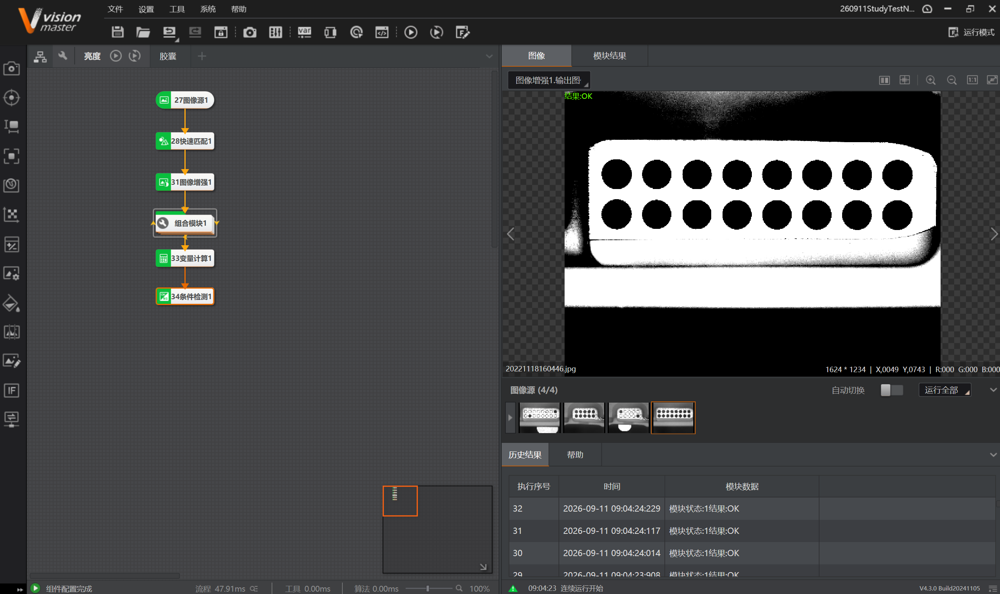
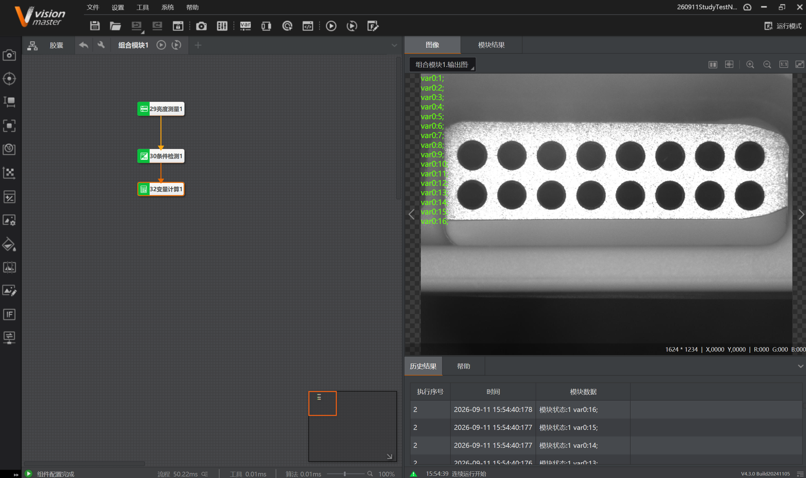

# 实习日记・Day 0911

> ⚠️ **免责声明**：本篇实习日志（及本仓库全部内容）为基于个人学习记录**由 AI 自主整合**的版本，**未经人工优化**，仅供学习内容参考；如照搬全抄造成课程成绩损失，概不负责。

> **实习时间**：2026 年 09 月 11 日（周五）
> **实习地点**：中德技师学院
> **实习方式**：编程实训（VisionMaster 4.3.0）
> **实习主题**：**分类 / 计数四案例**（亮度检测孔填充、大小晶片分类、端子颜色计数、胶囊漏放/错放）・**循环能力推进**

---

## 一、实习内容

今天完成四项实操，都属于**"分类 / 计数"**大类：先把目标**分割/定位**出来（BLOB 面积、颜色、亮度），再**条件检测 + 分支**分流，最后**格式化计数**并（部分）**通信**输出。当天也把 0910 遗留的"下一步计划"——**亮度测量（循环）**——做掉了。

### （一）亮度检测（孔填充检测）—— 完成 0910 的下一步计划

**目的**：检测工件的孔**是否被填充**（黑色孔洞 = 未填充）；**只要有一个孔被填充，整件不合格**。

**案例步骤**：① 匹配对孔洞初定位 → ② 亮度测量继承匹配区域，循环逐一测每个孔亮度 → ③ 条件检测按**亮度均值 100~180 = 未填充**判断 → ④ 循环内变量计算统计未填充孔数 → ⑤ 循环外变量计算与匹配孔数比较 → ⑥ 条件检测判整件是否合格。

**本项目流程**：

```
27图像源1 → 28快速匹配1 → 31图像增强1 → 组合模块1(循环) → 33变量计算1 → 34条件检测1
```

**组合模块1 内部（Group 循环体）**：`29亮度测量1 → 30条件检测1 → 32变量计算1`





**结果**：`结果:OK`（4 张源图，流程约 50 ms）。Group 每轮输出一个 `var0:N`，图上依次 `var0:1 … var0:16`，说明本工件 **16 孔（2 行 × 8）**，**循环执行 16 次**。

**关键理解**：**两级统计**——循环内数"未填充孔个数"、循环外与"匹配孔数"比较；孔数由匹配给出，工件孔数变化能自适应。**阈值设置是成败关键**（要卡在填充孔与未填充孔的亮度之间）。

### （二）大小晶片分类（BLOB 面积分级）

**目的**：对台面晶片做 BLOB 分析，按**面积大小**分**小 / 中 / 大**三类，在晶片上标注类别并计数（小：红、中：橙、大：绿）。

**案例步骤**：① BLOB 分析 → ② 条件检测 5000–35000 分出"大中"（小为一组）→ ③ <5000 判"小" → ④ 5000–12000 中、12000–35000 大 → ⑤ 收发全局变量 → ⑥ 耗时统计。

**本项目流程**：`0图像源1 → 1BLOB分析1 → 组合模块1 → 5耗时统计1`

**组合模块1 内部（三级分类）**：三条并行支路 `BLOB分析 → 条件检测 → 分支字符 → 格式化`，再由 `12格式化5` 合并输出。


**结果**：历史结果可见 `格式化结果:小 / 大`；流程约 89 ms（图像源 10 张）。

| 类别 | BLOB 面积区间 | 颜色 |
|------|--------------|------|
| 小 | 1000 ~ 5000 | 红 |
| 中 | 5000 ~ 12000 | 橙 |
| 大 | 12000 ~ 35000 | 绿 |

> **说明中的"收发全局变量"本次未在流程中体现**（只见末端耗时统计），后续补做时需核对。

### （三）工业端子计数（颜色识别）

**目的**：金属台面上散落**橙、蓝、灰**三种颜色的塑料接线端子，按颜色分别计数，并通过通信发送结果。

**案例步骤**：① 颜色转换（RGB→HSV）→ ② 灰度匹配定位所有端子 → ③ 组合模块内 **Group 循环**遍历每个端子 → ④ 颜色识别判色 → ⑤ 分支字符按颜色分流 → ⑥ 三色分别计数 → ⑦ 通信发送。

**主流程**：`0图像源1 → 8发送数据1 → 2颜色转换1 → 1灰度匹配1 → 组合模块1 → 11接收数据1 → 12格式化1`

**组合模块1 内部**：`3颜色识别1 → 4分支字符1`，按橙 / 蓝 / 灰分三路，各 `变量计算 → 显示 → 计数 → 发送数据`，最后由 `10格式化1` 合并。


**结果**：图像上 5 个端子全部识别并按颜色归类；右上角依次输出 5 行 `格式化结果:1`，总耗时约 83 ms。

**本案例意义**：**循环能力第一次真正用在"多目标分类计数"场景**——组合模块内 Group 循环遍历每个端子（`InputROI[组合模块1.循环索引]`），相比胶囊检测"改用分支模块替代循环"是一次**突破**。

### （四）胶囊检测（漏放 / 错放）

**目的**：检测药板胶囊是否**漏放**（缺药）或**错放**（药不对）。

**案例步骤**：① BLOB 判断每颗药面积，条件检测判是否有漏放，有则格式化输出"缺料" → ② 若都有药，循环内条件检测逐一检查每颗药的 BLOB → ③ NG 则在对应药前打印"错料" → ④ OK 则计算 OK 个数，等于药片总数则整板 OK。

**本项目流程（实际，经修改）**：

```
0图像源1 → 1blob个数 → 2条件检测1 → 3分支模块1
      ├─(NG/漏放) → 4miss（格式化"漏放"）
      └─(OK/有药) → 5blob大小 → 6条件检测2 → 7分支模块2
                        ├─(NG) → 8wrong（格式化"错料"）
                        └─(OK) → 9ok（正常）
                                        ↓
                                 10Final（合并输出）
```


**典型 NG：错放**——某颗药被换成异形 / 不同大小的药（图中右侧中间那颗），数量虽够，但 `5blob大小 + 6条件检测2` 判出**面积异常**，经 `7分支模块2` 走 `8wrong` 输出 `格式化结果:错放`。


**结果**：历史结果显示 `格式化结果:OK / 漏放 / 错放`。

> ⚠️ **本项目的遗憾**：说明要求"**循环内逐颗检查 + 在对应位置输出**"**未能实现**（循环是难点），改用**分支模块替代**，丢失了"逐颗定位 + 对应位置标注"的能力。老师认可当前替代方案，但循环相关功能缺失。

---

## 二、遇到的问题

1. **循环仍是最大难点**：胶囊检测**未能用起循环**，只能用分支模块替代，无法"逐颗检测并标注到对应位置"；而端子计数**已成功用起 Group 循环**。→ 需继续专攻 Group + `[循环索引]`。

2. **订阅必须手选数据类型**（反复踩坑）：凡"订阅模块输出参数 + 索引"，都要**先手选 float/int 再订阅**，否则默认值带中文字符会导致识别不上 / 索引失效（0910 顶点检测、0911 条件检测都踩过）。

3. **计数用变量计算的初始化开关**：计数要**关**（沿用上次结果=累计），比较要**开**（每轮重算）；若把初始化开关**打开**（每轮重置），计数会**永远只加 1**（0908 踩过，本次避开）。

4. **大小分类的"收发全局变量"未落地**：说明第 5 条要求收发全局变量，本次流程中未见对应模块，只有末端耗时统计。→ 需核对补做。

5. **颜色识别前要先"颜色转换 + 灰度匹配"**：RGB 受光照影响大，转 HSV 后色相更稳；灰度匹配负责"在哪"，颜色识别负责"是什么颜色"。

---

## 三、收获与心得

1. **掌握"分类 / 计数"的统一套路**：**目标分割/定位（BLOB 面积 / 颜色 / 亮度）→ 条件判据 → 分支（字符/模块）分流 → 格式化计数/标注 → 通信**。四个案例同源，只是"判据"不同（面积 / 颜色 / 亮度 / 个数）。

2. **循环能力明显推进**：从 0910 顶点检测学会 `InputROI[循环索引]`，到 0911 端子计数**首次用于多目标分类计数**；亮度检测也成功用循环遍历 16 孔。但胶囊检测仍未突破，**循环是最薄弱环节**。

3. **掌握"两级统计"思路**（亮度检测）：循环内数局部量、循环外与总量比较 → 条件检测判整体合格。

4. **掌握按面积/颜色分级计数**：条件检测把连续量（面积）切成离散类别；分支字符按字符串（颜色、OK/NG）分流；格式化合并多路结果。

5. **理解"先定位、后判别"**：灰度匹配 / 快速匹配负责定位，颜色识别 / 亮度测量 / BLOB 负责判别，分工明确。

6. **颜色显示在运行界面控件设置**：格式化模块本身不能设颜色，OK/NG 控件订阅条件检测结果实现自动红绿切换（延续 0910 经验）。

---

## 四、下一步计划

1. **重点攻克 Group 循环**：补齐胶囊检测"循环逐颗检查 + 结果输出到对应位置"的功能，掌握循环内定位标注。

2. **补做大小分类的"全局变量收发"**：按说明核对发送 / 接收全局变量环节。

3. **深入循环在"多目标 + 精定位"中的应用**：把 `[循环索引]` 与匹配、测量、判别的组合用熟。

4. 整理并完善运行界面（OK/NG、文本框、表格）的用法，尝试把结果经通信完整回传上位机。

---

## 附录：参考资料来源

* 官方帮助：《亮度测量》《BLOB 分析》《颜色转换》《灰度匹配》《颜色识别》《条件检测》《分支字符》《分支模块》《变量计算》《格式化》《Group》《发送/接收数据》《耗时统计》。
* 知识库：《第 4 章 测量》《第 5 章 缺陷检测》《第 8 章 颜色处理》《第 11 章 逻辑脚本》《第 12 章 通信》。
* 学习记录：`2026-09-11_亮度检测孔填充`、`2026-09-11_大小晶片分类`、`2026-09-11_工业端子计数颜色识别`、`2026-09-11_胶囊检测`；汇总见 `2026-09-11_当日汇总`。
* 案例：`练习图片/亮度测量（循环）`、`练习图片/大小晶片分类`、`06-工业视觉彩色端子计数项目`、`练习图片/胶囊检测`。
